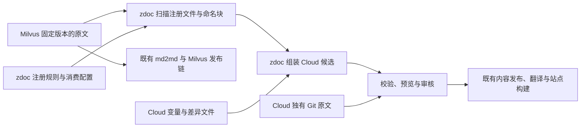

# 共享文档架构设计

状态：当前设计提案；已确认的边界汇总于此。生产实现与集成验收尚未完成。读者先看[方案总览](./proposal.md)，实施范围见[首期方案](./phase-1.md)，配置字段以[消费规范](./consumption-schema.md)为准。

## 1. 内容权威与仓库边界

| 内容或能力 | 归属 |
|---|---|
| 共享 User Guide 原文、命名边界与默认变量 | [milvus-docs](https://github.com/milvus-io/milvus-docs)，文档工程师与社区贡献者通过 PR 维护 |
| Cloud 消费配置、变量、产品差异及独有原文 | [zdoc](https://github.com/zilliztech/zdoc)，文档工程师通过 PR 维护 |
| registry 扫描、获取共享源、组装及影响检测 | zdoc 内的共享内容接入能力 |
| 变量与文件 include 的基础处理 | [md2md](https://github.com/zilliztech/md2md)，增加可独立调用的预处理入口，保留原入口行为 |
| Milvus 内容处理与站点发布 | 既有 [web-content](https://github.com/milvus-io/web-content) → [milvus.io](https://github.com/milvus-io/milvus.io) 链路 |
| SDK Reference 原文 | web-content；不在 milvus-docs 单独维护，不属于本次 User Guide 接入范围 |
| registry、提取片段、Cloud 页面和来源记录 | 工具生成；不作为编辑源 |
| 翻译与发布 | 沿用 zdoc 现有流程，扩展共享输入的来源校验 |

共享原文从 goover 处理前的 milvus-docs 固定 Git 修订读取，不从 Milvus 站点 HTML 或 web-content 的 User Guide 发布产物反推。共享层直接接入 zdoc，不新增在线 registry、独立内容包分发服务或另一条发布队列。

本设计仓库维护方案与验证样例，不参与生产内容发布；样例中的两个仓库目录是输入示意，不是第三份内容权威。

## 2. 从输入到 Cloud 页面



- **整篇复用**：共享正文、标题和结构在变量绑定及站点适配后均适用。只有产品名、endpoint、token 或元数据不同，仍属于整篇复用；无需命名块。
- **整篇加差异**：只有需要增删替换的位置才命名，zdoc 在同一 `transforms` 清单声明差异。
- **独立编排并引用共享内容**：当产品确实需要不同章节组织时，保留 Cloud 原文加 include 的扩展路径；不要求普通共享页维护框架。现有两篇样例与本地构建器不覆盖多来源框架。
- **Cloud 独有页**：无共享引用时不获取 Milvus 内容，仍须接入正式来源、校验、翻译及发布契约。

标题相同时随正文引用，不重复写。先审核并消除可以合并的内容漂移，再编码必须保留的产品差异。语言缺失、旧 SDK 写法或错误示例不能直接当作长期产品差异。

### 产品变量

沿用 `Variables.json` 与 `{{var.xxx}}`。Milvus 默认文件位于 `site/en/Variables.json`；Cloud 在明确的消费根目录读取同名文件。同一产品不同 SDK 共用连接变量；各语言的参数名、引号和代码结构仍在原文维护。

产品展示名称使用 `product_name`；`MilvusClient`、包名、命令及明确讨论 Milvus 本身的措辞保留真实名称。产品功能或认证流程不同不能靠改名字掩盖。变量只放小粒度值，不塞入整行代码或用空文本拼接语法。缺失 Cloud 绑定时失败，不静默套用 Milvus 值。

生产接入需核实原有 md2md 的目录/页面作用域，保持旧入口兼容；新消费约定使用显式根目录、导出变量和产品绑定，首期不引入多层隐式继承。

## 3. 最少注册规则与自动 registry

人工在 `shared/modules.yaml` 登记源文件、稳定模块 ID、导出策略及变量契约；工具只扫描已登记的文件。模块 ID 在同一 registry 内唯一，块 ID 在模块内唯一。文件路径变更可以修改映射而保持模块 ID。

```yaml
modules:
  filtered-search:
    file: site/en/userGuide/search-query-get/filtered-search.md
    export_page: true
    export_blocks: marked
```

Markdown 边界写在源内，标记不承担 Cloud 的产品选择：

```markdown
<!-- doc:block:start id="standard-filtering-code" -->
此处放完整的共享代码组。
<!-- doc:block:end id="standard-filtering-code" -->
```

工具生成 registry 中的文件、块、类型、语言、摘要、来源和依赖。没有块的整页照样可注册；新增命名块无需再手填一条注册记录。定位依赖稳定身份，行号只用于报错，不用于消费。重复 ID、孤立边界、交叉边界、非法结构和空块应明确失败；标记识别需遵守 Markdown/代码语言上下文，不能误识别示例字符串。

生产解析器需区分 Markdown 块、完整代码组和代码区域。受限代码子区域最多一层；父子同时替换、非法嵌套或区域移出消费上下文须拒绝或要求明确迁移。现有本地原型仅覆盖平面 Markdown/代码组。

registry 与内容包是 zdoc 内部可重建输出。artifact 是实际文件或包；manifest 是来源版本、文件及摘要清单，不能代替实际内容。每次在干净输出目录生成，避免旧块残留。包摘要在包外计算，避免自引用。

## 4. 消费、依赖与升级

具体操作统一为 `add`、`replace`、`remove`，目标及冲突语义见[消费规范](./consumption-schema.md)。站点适配负责 Tabs、提示组件、元数据、链接与图片，不为每一种业务差异定义新 operation。

正式接入复用 md2md 的变量/include 实现，新增只做预处理的公开入口，不直接复用会运行 Milvus 站点插件的完整转换入口。zdoc 的 LarkDocWriter 接收飞书 JSON，不能充当通用 Markdown 编译器；现有 local source 也不能代替共享来源与消费协议。能力依据见[复用审计](../research/md2md-zdoc-reuse-audit.md)。

include 使用受控读取接口收集实际依赖，检测循环、目录越界、符号链接逃逸、深度和体积超限。共享层不再实现第二套 token 解析器。源链接与资源按照原始文件身份解析，提取片段后仍保留其来源。

### 代码区域的缩进契约

writer 正常放置 include，并决定调用位置的缩进；工具去掉源片段公共基础缩进，保留内部相对层级，再逐行应用调用处缩进。不能对每行分别去掉全部前导空格。

例如源片段有四格基础缩进，目标 include 位于八格位置，工具将所有非空行整体右移四格。writer 无需手动清理源空格或配置缩进数。该规则不修改 Milvus 源文件。

代码 include 首期须独占目标 fence 的一行，语言匹配；空行不添加尾部空白。混用 tab/空格、不支持的词法上下文、字符串内伪 include、可能改变多行字符串值等情况明确失败。展开后检查完整父代码，语法通过也不能替代产品语义审核。此规则仅用于显式共享代码区域，普通 Markdown 和旧 md2md 默认入口保持兼容；正式实现仍待验证。

### 上游 PR 与采用版本

```text
社区或文档工程师提交 Milvus PR
→ 校验源结构、变量及 Milvus 构建兼容性
→ 合并后 zdoc 发现候选，解析并固定 commit
→ 比较整页、块、上下文、变量和资源，查询消费依赖
→ 生成 Cloud 升级候选、预览、影响报告及 lock
→ Cloud 审核产品适用性和差异
→ 批准采用后进入既有发布流程
```

`track` 分支用于发现候选，正式生成使用固定 commit。工具生成 lock 与消费索引；writer 不手填 hash。报告包含整页引用、直接/间接片段、被替换原文及必要的语义审核依赖。当前本地样例仅展示结构依赖，额外审核依赖的具体字段仍需正式接入时定义，不暗示本地已支持。

| 上游变化 | 必须发生的行为 |
|---|---|
| 新增合法块 | 自动进入 registry；不自动升级或发布 |
| 移动块、改变标题但保留 ID | 身份保持，检查内容及上下文变化 |
| 块改名或删除 | 旧引用失效时阻止该消费者升级，保持旧采用版本；需显式迁移 |
| 被替换原文变化 | 即使 Cloud 输出相同也提示复核，不被 override 遮蔽 |
| 类型、父上下文或语言变化 | 检查消费兼容性，不能继续静默组装 |
| 只增加标记、正文未变 | 更新身份和依赖；不据此无条件重译 |

代码区域至少记录完整父代码上下文，Markdown 区域采用页面上下文。首期提示可保守，按页合并报告；摘要只能发现变化，不能自动判断语义一致。

## 5. 生成结果与发布保护

**生成文件不作为编辑源，手动修改不能进入正式发布。** 文件在本地能够被编辑，保护靠受控来源、重建检查和发布权限共同成立。

| 环节 | 强制要求 |
|---|---|
| 源 PR | 作者修改 Milvus 源或 zdoc 消费输入，预览提供正确编辑入口 |
| 权限 | 正式生成状态分支不允许普通作者直接推送、强推或绕过检查；授权发布身份按页面/语言归属写入 |
| 候选任务 | 可生成和预览，无生产分支或部署写权限；社区 PR 无需 Cloud 凭据 |
| 批准绑定 | 批准来自可信 PR/发布审核并绑定最终输入；YAML 自报 approved 或填写 PR 编号不构成授权 |
| 干净重建 | 按固定源、配置、变量、片段、资源、工具与依赖锁在新 stage 生成；不读取手改输出作为输入 |
| 对照检查 | 正文、路径、资源与来源记录不一致即失败，指出可编辑源；正文和 manifest 一起改也不能绕过 |
| 产物交接 | 校验结果绑定实际发布产物的身份和摘要；校验后替换 artifact 时部署拒绝 |
| 核心保护 | 工作流和校验器变更需工程审核，不能由内容 PR 自行关闭保护 |

lock 保存固定输入身份与摘要；receipt 记录实际构建输入、lock 和输出身份。它们用于追溯，不是密码学签名或审核授权。不要把一个 Git commit 的 SHA 写入该 commit 自身包含的文件形成自引用。相关输入在批准后变化，重新检查及审核。

## 6. 按页迁移与正式激活

每页任一时刻只有一个正式生成来源。未迁移页继续飞书链路；Git 页面和飞书页面可以同批发布，但同一页面不双写。迁移顺序：盘点正文及导航/资源 → 准备 Git 输入 → 影子对照 → 确认最新飞书修订 → 审核切换 → 稳定运行。

**配置同步只准备候选，不改变当前生效来源。** master/tooling sync 到达 dev 时，旧来源仍按已生效配置工作；新配置只参与候选生成。通过审核与校验后，生效配置引用、正文、必要导航、来源清单和 receipt 在同一个受控 dev 状态提交中激活，旧来源同时失去该页写入权；站点构建与部署随后进行。生效记录由 CI 生成，不增加 writer 的所有权登记表。

```text
已生效：C0 配置 + P0 正文 + R0 来源记录
同步 C1 → 候选构建与审核
  失败或取消 → 保持 C0 / P0 / R0
  通过且发布基线匹配 → 同一提交激活 C1 / P1 / R1
```

既有串行队列保证顺序，不能代替同批激活。候选等待时基线若变化，需重新生成、检查及相应审核；已完成的重试应识别相同发布身份，不恢复旧来源。内容提交和网站部署不是跨系统事务，部署失败走既有重试或镜像回滚，不自动把编辑权威交回飞书。

Lark 全量抓取、旧缓存、删除清单及恢复任务都须遵守当前页面归属；重复 route/ID、错误 producer 写入和删除应失败，未迁移页正常更新。Milvus 若仍有飞书导入任务，也须撤销其对已迁移共享源的覆盖能力。

切换前短暂冻结该页或重新核对最终修订，确保飞书新修改没有遗漏。除正文外，导航、附件、图片、同步块和必要元数据也要迁移。暂时仍依赖固定飞书片段的页面不能计为完全迁出；这类片段只能有一个编辑源，并有明确迁移责任。

一页完成迁移意味着从批准 Git 输入生成、旧任务不能改变结果、资源可重建、翻译输入有效且编辑入口明确。最终范围内页面及依赖迁完后，再停止对应飞书抓取和调度。

## 7. 翻译、恢复与运行边界

翻译输入是完成组装、产品绑定和格式校验的 Cloud 正文。沿用 sourceHash、候选选择、语义单元、技术内容保护、locale/style contract、批次与恢复机制；writer 不为翻译逐段命名。输出未变且已有有效译文时，不因被遮蔽的上游变化强制重译；缺译文、强制刷新等沿用既有规则。语义增量功能需确认实际启用配置。

英文站构建包含日文；中文是独立站点，不直接当作英文的一般 locale。公共构建/工作流变更按既有测试矩阵检查两站，不据此扩大内容迁移范围。

| 恢复目标 | 复用入口 | 需补充的验证 |
|---|---|---|
| 生成正文、导航及译文状态 | zdoc Git 修订和既有固定修订恢复流程 | 将生效配置、来源记录与 receipt 纳入恢复一致性 |
| 从共享源重建 | 锁定的 Milvus/zdoc Git 输入、工具和资源 | 输入仍可获取，重组装结果与摘要一致 |
| 已发布网站回滚 | 既有可信成功发布记录和容器镜像 digest | 运维侧保留策略与实际回滚接线可用 |

短期 CI artifact 过期不意味着 Git 正文丢失。不先新增完整归档机制；先复用已有 Git、媒体存储和发布记录，只补真实缺口。Git 图片按同一源修订读取；实际消费的外部图片需固定字节摘要和可恢复对象版本，不能只固定可被覆盖的 URL。源或资源缺失时明确失败，不回退到 latest。详见[恢复核验](../research/recovery-capability-audit.md)。

内容恢复需保持来源与页面一致；网站镜像回滚不自动恢复飞书编辑权威。重新交回旧 producer 必须作为显式来源切换审核。实际镜像和图片保留仍需运维核实，不能从源码推断已具备生产恢复保障。

运行时按 repository + commit 共用检出，每个注册文件解析一次，只展开实际消费闭包。完整输入参与缓存身份：共享源、规则、变量、片段、资源、展示规则、工具及生效来源。冷/热构建结果一致；旧 Lark 的“内容未变”不能跳过 Git 输入变化。限制展开深度、体积、下载并发和超时，沿用原发布队列，不增加旁路写入者。
