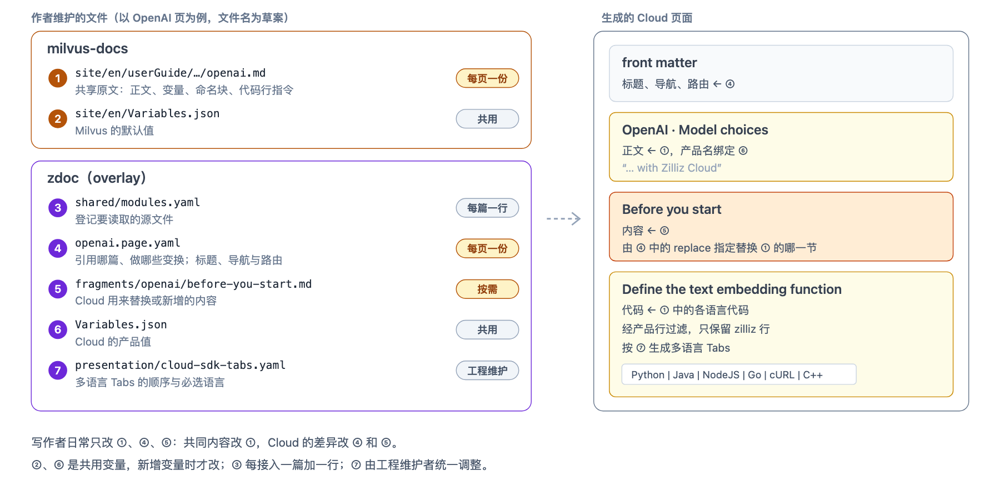

# 共享页面的写法与配置（草案）

本文面向 Cloud 文档工程师，按常见任务说明一个共享页面要写哪些文件、怎么写。也作为与 zdoc 维护者共同确定配置字段的起点。

**状态：草案。** 文中的字段名、文件位置和目录布局来自本地样例，将在实现设计中与 zdoc 维护者共同确定，并与 zdoc 现有的手册注册、front matter 和导航配置对齐。方向对齐阶段只需确认第 1 节的约束。系统怎样处理这些文件见[架构设计](./architecture.md)。

## 1. 需要对齐的约束

- **按身份定位。** 先按整页、命名块和语言定位；只有代码行可以在已定位的语言示例内按连续整行的原文定位。不使用行号、正则、全文搜索或标题选择器。
- **差异只有三种动作**：add、replace、remove，另可让命名块只在 Next 显示；不按业务类型增加专门的操作。
- **变量沿用 md2md**：`Variables.json` 与 `{{var.xxx}}`；缺少 Cloud 绑定时报错，不静默使用 Milvus 的值。
- **原文不写 Cloud 的内容**：段落、章节和代码行的差异都写在 zdoc，原文只加中性的命名块，不写产品指令或条件。
- **生成文件不能手改**：发现问题回到对应的源文件。
- **作者成本**：每个共享页一份页面配置，Cloud 内容文件按需提供，共用规则在站点范围维护一次。

## 2. 一个页面涉及哪些文件



图 1 · 一个共享页面涉及哪些文件（以 OpenAI 页为例）
- **日常只改三类文件**：共同内容改共享原文 ①；Cloud 的差异改页面配置 ④ 和 Cloud 内容文件 ⑤。一个页面的 ④ 和 ⑤ 放在同一目录 `shared-pages/<页面>/` 中。
- **共用文件很少动**：变量 ② ⑥ 只在新增变量时改；注册文件 ③ 每接入一篇加一行；Tabs 规则 ⑦ 由工程维护者统一调整。
- **“片段”只指 milvus-docs 的片段。** milvus-docs 现有的 `site/en/fragments/` 由正文用 `{{fragments/xxx.md}}` 引用、md2md 展开，与 Cloud 内容文件是两回事。Cloud 内容文件中也可以写 `{{fragments/xxx.md}}`，路径同样指 milvus-docs 的片段。
- 两篇样例的实际文件：[Delete Entities](../examples/delete-entities/zdoc/shared-pages/delete-entities/page.yaml)（整篇复用）和 [Filtered Search](../examples/filtered-search/zdoc/shared-pages/filtered-search/page.yaml)（加 CLI 示例），作者操作见各自的 walkthrough。

## 3. 按任务写

### 3.1 整篇复用一篇共享文章

在注册文件中加一行，登记源文件：

```yaml
# shared/modules.yaml
modules:
  delete-entities:
    file: site/en/userGuide/insert-and-delete/delete-entities.md
    export_page: true
    export_blocks: marked   # 原文中有命名块时自动扫描
```

再写一份页面配置：

```yaml
# shared-pages/delete-entities/page.yaml
schema_version: 1
page: cloud.delete-entities
source:
  take: page
  module: delete-entities
variables:
  file: Variables.json
presentation:
  code_groups: presentation/cloud-sdk-tabs.yaml
metadata:
  title: Delete Entities | Cloud
  slug: /delete-entities
  sidebar_label: Delete
```

正文的标题和章节结构随原文引用，不需要在配置中重复。

### 3.2 把产品名或连接值写成变量

在共享原文中写变量，两端的 `Variables.json` 各自给值：

```markdown
In {{var.product_name}}, filtered searches are categorized into two types.
```

```python
client = MilvusClient(
    uri="{{var.example_endpoint}}",
    token="{{var.example_token}}"
)
```

| 变量 | Milvus | Cloud |
|---|---|---|
| `product_name` | `Milvus` | `Zilliz Cloud` |
| `example_endpoint` | `http://localhost:19530` | `YOUR_CLUSTER_ENDPOINT` |
| `example_token` | `root:Milvus` | `YOUR_CLUSTER_TOKEN` |

- 同一产品的各语言共用连接变量；各语言的参数名、引号和代码结构仍写在原文中。
- `MilvusClient`、`pymilvus` 等真实名称不要写成变量。
- 变量只放小粒度的值，不放整行代码。新增变量时，要同时更新 Milvus 默认值、注册文件中的导出声明和 Cloud 的绑定。

### 3.3 替换一节

先在共享原文中为这一节加命名块：

```markdown
<!-- doc:block:start id="before-you-start" -->
## Configure credentials
……Milvus 的写法……
<!-- doc:block:end id="before-you-start" -->
```

再在页面配置中声明替换，Cloud 的内容写在同一目录的内容文件中：

```yaml
# shared-pages/openai/page.yaml
transforms:
  - operation: replace
    target:
      module: openai
      block: before-you-start
    content:
      file: before-you-start.md   # 即 shared-pages/openai/before-you-start.md
```

内容文件提供完整的替换内容，包括这一节的标题。

### 3.4 在一节前后增加内容

```yaml
transforms:
  - operation: add
    target:
      module: some-guide
      block: setup
    position: before        # 或 after
    content:
      file: cloud-prerequisites.md
```

可以增加前置条件、提示、列表或带代码块的 Markdown。原文中必须有 `setup` 这个命名块，工具不会根据标题猜位置。同一块旁可以有多条 add，同一方向按列表顺序输出。

### 3.5 删除一节

```yaml
transforms:
  - operation: remove
    target:
      module: some-guide
      block: product-notes
```

不提供内容文件，也不要用空文件表达删除。删除只影响 Cloud 输出，不改 Milvus 原文。删除代码组不会自动删除它外面的标题或说明，命名块应覆盖完整的语义范围，并检查预览中是否留下悬空的链接或锚点。

### 3.6 增加、替换或删除一个语言示例

在目标中加上 `language`。下面是 Filtered Search 中为一个代码组增加 Cloud CLI 示例：

```yaml
transforms:
  - operation: add
    target:
      module: filtered-search
      block: standard-filtering-code
      language: shell
    content:
      file: standard-filtering-cli.md
```

- add 时该语言必须还不存在；replace 和 remove 时必须已经存在。
- 内容文件包含一个语言匹配的完整代码块。语言在 Tabs 中的顺序由 Tabs 规则决定，不在配置中写。
- 不再需要 Cloud 自己加的示例时，直接删掉那条 add，不要再加一条 remove。

### 3.7 代码中的个别行不同

共享原文的代码**不改**，只给整个代码组加命名块（写法同 3.3）。差异写在页面配置中：在 `target` 里加上 `lines`，写出原文中要处理的连续几行。下面是 OpenAI 页：Python 把两行可选的 credential 注释换成必填的 `integration_id`，Java 在 `model_name` 一行后面加一行。

```yaml
transforms:
  - operation: replace
    target:
      module: openai
      block: define-function-code
      language: python
      lines: |
        # Optional parameters:
        # "credential": "apikey_dev",
    content:
      lines: |
        "integration_id": "YOUR_INTEGRATION_ID",

  - operation: add
    position: after
    target:
      module: openai
      block: define-function-code
      language: java
      lines: |
        .param("model_name", "text-embedding-3-small")
    content:
      lines: |
        .param("integration_id", "YOUR_INTEGRATION_ID")
```

- `lines` 从原文直接复制。比较时忽略行首缩进和行尾空格，其余必须一致；在这个语言示例中必须恰好出现一次，最多 5 行。`lines` 和 `content.lines` 中都不能有空行。
- 新内容写在 `content.lines` 中，不需要写缩进：工具以被定位的第一行的缩进为基准，保留各行之间的相对缩进。`remove` 不提供内容。
- 定位行尽量选不常改的行。上游改了这几行时匹配失败，这一页的升级 PR 被拦下，从新原文复制后更新 `lines` 即可。
- 一段代码中有多处不同，或连续超过 5 行，改为用 3.6 节替换整个语言示例。
- 共享原文中不写产品指令（如 `include-next-line`），Milvus 站点上看到的就是原文的代码。

### 3.8 让内容只在 Next 显示

| 内容 | 写法 |
|---|---|
| Cloud 内容文件中新增或替换的内容 | 在文件里直接用 `<NextChannel action="include">` 包住 |
| 整个页面 | 页面配置中的通道字段（**写法待定**，用来替代飞书多维表格中的 `Release Channel`） |
| 共享原文中的一段 | 原文为这一段加命名块，在页面配置中声明它只在 Next 显示（**写法待定**） |

共享原文本身不写通道标记。Cloud 上线后，去掉对应的声明或包裹即可。场景说明见[方案总览第 4.1 节](./proposal.md#41-milvus-先上线cloud-后上线的内容)。

## 4. 什么情况会报错

工具先校验全部配置，再生成页面。以下情况直接失败，不会静默跳过：

- 未知的动作、字段或 `schema_version`；目标命名块、语言或内容文件不存在；内容文件路径指向页面目录之外。
- 同一个目标被多次变换；整块的 replace 或 remove 与该块的语言项变换、前后增加同时出现；语言项的 replace 或 remove 与该语言内的行级变换同时出现；同一语言内两条行级规则定位的行有重叠。
- 在内容文件中再写命名块标记或手写 Tabs；试图对本轮刚插入的内容再做变换。
- 删除了 Tabs 规则要求必须存在的语言或默认语言。
- 缺少 Cloud 变量绑定。
- `lines` 在目标语言示例中找不到、出现多次或超过 5 行；`lines` 用在没有 `language` 的目标上。
- 生成结果被手动修改过。

新增和替换的内容同样参与变量绑定和依赖记录。原文中被替换的一节发生变化时，即使 Cloud 输出不变，升级 PR 也会提示复核。

## 5. 待与 zdoc 维护者确定

| 问题 | 现状与考虑 |
|---|---|
| 链接与图片映射 | 样例在每页配置中手工维护 `links`、`assets`，页数增多后成本线性增长；可以考虑由 registry 推导或用站点级规则 |
| 页面元数据 | 样例的 `metadata` 与 zdoc 现有的 front matter 和导航配置重复，应挂接现有手册注册，而不是重新定义 |
| 页面目录 | 样例为每个共享页面建一个 `shared-pages/<页面>/` 目录，放页面配置和 Cloud 内容文件；它在 zdoc 中的位置，以及是否与现有内容目录或手册注册对应 |
| 注册文件 | `shared/modules.yaml` 让文件改名时模块 ID 不变，但多一个共用文件；试点阶段是否可以简化 |
| lock 粒度与跟踪分支 | 每页独立采用还是全仓统一；Cloud 跟踪哪个 Milvus 版本分支 |
| 发布通道 | 整页通道迁出飞书多维表格后放在哪里；命名块只在 Next 显示的写法；Git 页面的整页通道怎样传递到译文 |

## 6. 字段参考（样例中的草案）

| 字段 | 作用 |
|---|---|
| `schema_version` | 配置格式版本，样例为 `1`，与 Milvus 产品版本无关 |
| `page` | Cloud 页面 ID |
| `source.take` / `source.module` | 引用方式（目前只有整页 `page`）与注册的模块 ID |
| `variables.file` | Cloud 变量文件 |
| `presentation.code_groups` | 多语言 Tabs 规则文件 |
| `metadata` | 标题、路由、导航标签等 front matter（待与 zdoc 现有配置对齐） |
| `links` / `assets` | 原文链接与图片到 Cloud 地址的映射（待定是否改为站点级规则） |
| `transforms[].operation` | `add`、`replace` 或 `remove` |
| `transforms[].target` | `module`、`block`，可选 `language`；有 `language` 时可选 `lines`（连续整行，最多 5 行） |
| `transforms[].position` | 在命名块或代码行旁 add 时使用：`before` 或 `after` |
| `transforms[].content.file` | 新增或替换内容的 Cloud 内容文件，相对于页面目录；remove 不提供 |
| `transforms[].content.lines` | 目标有 `lines` 时使用：新增或替换的代码行，直接写在配置中 |

- 每个共享页面一个目录 `shared-pages/<页面>/`，放 `page.yaml` 和这一页的 Cloud 内容文件。`content.file` 相对于这个目录解析，不能指向目录之外；文件名不决定动作，配置才决定。
- `variables.file` 和 `presentation.code_groups` 是站点共用文件，相对于 zdoc 的消费配置根目录解析。不做递归查找或多层继承。
- 模块 ID 在 registry 内唯一，块 ID 在模块内唯一，语言在代码组内唯一。目标的类型由原文结构决定，不由作者指定。

## 7. 首期不支持

- 行号、正则、全文搜索、标题选择器，以及任意语法树路径或下标定位。
- 代码中的区域标记、超过 5 行或跨多处的行级修改：改为替换整个语言示例。
- 在共享原文中写产品指令或条件。
- move、copy、嵌套变换，以及对本轮插入内容的再次变换。
- 变量表达式、循环、条件模板，或把整段代码放进变量。
- 用脚本动态生成内容、插件式的自定义操作、自动判断不同语言示例是否等价。
- 独立编排多个共享命名块的页面：保留为扩展路径。

本地样例覆盖 Markdown 块、语言项和代码行三级的 add / replace / remove，其中代码行级用 Filtered Search 的合成用例测试；Next 包裹以及真实的 md2md、Docusaurus 构建仍需工程实现。验证状态见[首期实施计划](./phase-1.md#7-当前证据本地样例)。
