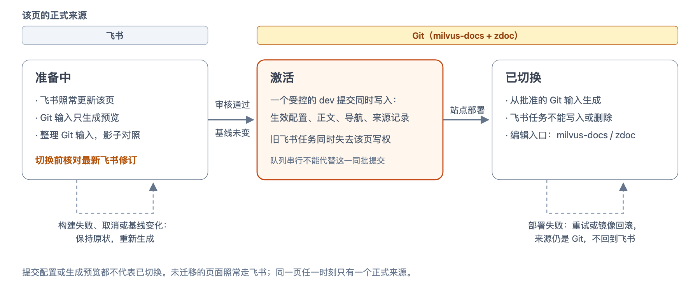

# 05b 页面切换与归属

**这一篇只在 Phase 1 过渡期存在。** Phase 1 中飞书还不能退出：每一页原本都在飞书中编写，导航也仍由飞书目录决定。所以迁移期间，同一页可能在飞书和 Git 两边都有内容，Fetch 每次运行都要知道该用哪一边。本篇定义：

- 这个开关：飞书表格中这一页记录的 `Docs` 链接，以及 Fetch 按它生成的 `active.json`；
- 一页怎样从飞书交给 Git（激活）；
- 交给 Git 之后，飞书怎样让路，指向这一页的飞书链接怎样保持有效；
- 怎样下线。

飞书退出后，本篇的大部分内容不再需要。生命周期的总览见[产品需求第 4 节](../prd.md#4-一页的生命周期)；生成结果怎样写入 dev 见 [05](./05-publish-handoff.md)。

对应的产品需求见[产品需求场景 9](../prd.md#场景-9从飞书切换到-git激活)、[场景 10](../prd.md#场景-10下线一页)。

**参与方**：文档负责人（比较与激活）、文档工程师（下线）、zdoc 发布（Fetch 工作流）、飞书知识库目录与多维表格（Phase 1 仍决定导航与整页通道）。

**状态**：2026-10-20 改为在飞书表格中激活与下线；2026-10-26 按 zdoc 代码的核对，开关从新增 placement type `git` 改为替换 `Docs` 链接。

## 约定

### 开关（`Docs` 链接）

飞书表格（DocsList）中，页面记录的 placement type 是 `canonical`，`Docs` 列是飞书文档链接。Fetch 按这个链接下载飞书正文；判断一行是不是飞书文档，在 `packages/docs-tooling/src/lark/guidesBaseRecordSemantics.js` 的 `isFeishuDocumentLink`。

一页改由 Git 生成，就把 `Docs` 换成这一页在 zdoc master 上的目录地址：

```
https://github.com/zilliztech/zdoc/tree/master/shared-docs/guides/pages/delete-entities
```

- placement type 仍是 `canonical`。发布目标（`Targets`）、路径、`Progress`、`Release Channel` 与导航用的标签和排序照常填写，发布目标与路径必须与页面配置的 `publish` 一致。
- Fetch 按 `Docs` 的开头分流：
  - 飞书文档链接：照常抓取与渲染；
  - `https://github.com/zilliztech/zdoc/tree/master/shared-docs/` 开头：共享页，组与页面标识取自路径，不抓飞书正文，改用 Git 生成的结果；导航仍按这条记录生成；
  - 其他写法：这一行失败（`OWNERSHIP_CONFIG_MISSING`）。
- 地址在浏览器中打开就是这一页的源文件目录，编辑可以直接从表格找到它。

共享页的记录没有飞书文档 ID。zdoc 现有的代码默认每条 `canonical` 记录都有这个 ID，下面这些模块都要认得共享页的记录：按共享页处理，或者明确报错，不能悄悄跳过。

| 模块 | 现在怎样用飞书文档 ID |
|---|---|
| `lark/sourceSnapshot.js` | 快照中每条记录都必须有 ID，没有就报错 |
| `lark/incrementalFetchPlanner.js`、`lark/requestedGuidesFetchPlanner.js` | 按 ID 判断哪些记录变了、哪些被删除；换掉链接后，旧 ID 会被看成“记录删除” |
| `lark/canonicalLinkAuditor.js` | 列出 canonical 记录时，没有 ID 的行被过滤掉 |
| `lark/guidesBasePreflight.js` | 按 ID 检查同一篇飞书文档只有一个 canonical 记录 |
| `scripts/docs-workflow/guides-assembly-identity.js`、`guides-cache-save-decision.js` | 按快照判断能否复用上一次的组装结果；只看飞书输入 |
| `scripts/docs-workflow/guides-media-prefetch.js` | 按 ID 预取图片 |

其中组装身份与缓存还要把共享页的输入算进去：只改了 milvus-docs 原文或 Cloud 配置、飞书没有变化时，Fetch 也要重新生成这一页（见 [05](./05-publish-handoff.md#缓存与运行)）。

### 生效配置（`active.json`）

**`active.json` 是 Fetch 按表格生成的派生记录**，列出已经交给 Git 的页面。每组一份，Guides 组的放在 dev 中的 `generated/en/manifests/shared-pages/guides/active.json`，与各页的记录文件同一目录（见 [05](./05-publish-handoff.md#记录文件)），人不手改。

```json
{
  "schema_version": 1,
  "pages": [
    {
      "page": "delete-entities",
      "record": "recXXXXXXXX",
      "feishu_token": "WkLmdoxcnAbCdEf",
      "anchors": { "doxcnQ1w2e3r4": "delete-entities-by-filter" },
      "activated_in": "11873360452"
    }
  ]
}
```

| 字段 | 含义 |
|---|---|
| `schema_version` | 格式版本，目前为 `1` |
| `pages[].page` | 已交给 Git 的页面标识 |
| `pages[].record` | 飞书表格中对应记录的 ID |
| `pages[].feishu_token` | 激活前这条记录的飞书文档 ID，取自上一次成功的 Fetch 快照；全新的页面为 `null` |
| `pages[].anchors` | 激活前飞书版中被其他页面链接到的标题块：块 ID → Git 版中的锚点；全新的页面为空 |
| `pages[].activated_in` | 第一次按 Git 生成这一页的 Fetch 运行编号（GitHub Actions 的运行 ID），用于追溯 |

- **只在两个时刻变化**：激活后的第一次 Fetch 加入一项，下线完成的那次 Fetch 删除一项（见下文）。其余运行照抄。
- **与页面内容同一个提交**：加入或移除时，这一页的 MDX、导航与记录文件在同一个 dev 提交中写入或删除，不会出现清单说归 Git、dev 中却还是飞书内容的情况。
- **它有四个用处**：
  - Git 中有一份可以追溯的记录；
  - dev 上的检查不调用飞书，就能拦住改写已激活页面的提交；
  - Fetch 每次把表格与上一次的清单对比，发现 `Docs` 被改回飞书链接时失败（见下文“出错时”）；
  - 其他飞书页面指向这一页的链接，靠它换算（见下文）。
- 飞书退出时，`active.json` 可以直接改为正式来源，不再从表格生成。

### 指向已激活页面的链接

其他飞书页面链接到这一页时，链接中写的是这一页的飞书文档 ID；链接到某一节时，锚点是飞书的块 ID。zdoc 转换这种链接，要读目标页这次抓下来的飞书原文，从中取 slug，再按标题文字算出锚点（`lark/larkDocWriter.js` 的 `__convert_link`）。找不到原文时，链接变成普通文字，只在日志中打一行，运行不会失败。激活之后这一页不再抓飞书原文，所以要另外保住这些链接：

- **转换时先查 `active.json`**：飞书页面中的链接，文档 ID 等于某一项的 `feishu_token`，就换成 `./<页面标识>`；带块 ID 时，按 `anchors` 换成锚点。zdoc 现有的 `--linkShim`（按文档 ID 替换链接）可以复用。
- **`anchors` 在激活时算出**：激活后的第一次 Fetch，按 `feishu_token` 重新抓取原来的飞书文档（它保留、不删除），从这一次抓到的其他页面原文中找出指向它的链接，取出被链接到的标题块，按飞书版的标题算出锚点，再在 Git 版中找同一个锚点。都找得到，就记入 `anchors`；有找不到的，激活检查不通过（`ACTIVATE_CHECK_FAILED`），`detail` 中列出这些链接所在的页面，由文档负责人修改飞书中的链接或 Git 版的标题。
- **之后出现的块 ID 不在 `anchors` 中**：链接只指到页面顶部，运行摘要中列出，不失败。

### 切换与激活

激活就是把一页记录的 `Docs` 换成页面目录地址，一页只做一次，由文档负责人进行。Fetch 要新增一种可以手动发起的运行：只比较某一页。做成 Fetch 的参数还是单独的工作流，由 zdoc 维护者确定。激活本身不是一次运行，是表格中的一次修改。



图 1 · 一个页面从飞书切换到 Git

这张图从实现角度画切换前后的状态，没有画激活前的比较与确认；从文档负责人角度看的三步见[产品需求场景 9 图 2](../prd.md#场景-9从飞书切换到-git激活)。

1. **比较。** 文档负责人手动发起一次“比较”运行，指定这一页。运行把两份 MDX 逐个手册比较：一份是按 `lock.yaml` 与 `page.yaml` 生成的 Git 版本（两个版本已合并），一份是 dev 中这一页现有的 MDX，也就是网站当前的内容。差异中单独列出锚点的变化（飞书版中的锚点在 Git 版中没有了，以及其中哪些被其他页面链接）。同时做激活前的检查：能生成；图片与链接都能解析；飞书表格记录的发布目标与路径与页面配置一致。差异与检查结果写进这次运行的结果（如运行摘要或可下载的产物），不写 dev。比较运行做好之前，试点页面用 `shared-docs build` 生成，与 dev 中的 MDX 手工比较。
2. **确认。** 文档负责人看过差异，确认飞书最近的修改已反映到 Git 中（或这一页已在飞书暂时冻结），并确认候选结果已审核。这两项由人判断，工具不检查。
3. **激活。** 文档负责人在飞书表格中把这一页记录的 `Docs` 换成页面目录地址。原来的飞书文档保留、不再编辑，不要删除。
4. **下一次 Fetch 同一个提交写入。** Fetch 读到这条记录，再做一遍第 1 步的检查，并算出 `anchors`。通过后，在同一个 dev 提交中写入 `active.json`、两个手册的 MDX、导航与记录文件；从这次提交起，飞书不再生成这一页。不通过时，这一页保留 dev 中现有的版本（第一次激活时就是飞书版），不退回飞书重新生成，并发飞书卡片通知文档负责人。
5. **部署。** 站点部署在激活之后进行，不与激活在同一个事务中；失败时走既有的重试或镜像回滚，编辑来源仍是 Git，不自动交回飞书。

全新的页面没有飞书版：在表格中新建记录时，`Docs` 直接填页面目录地址，不需要比较；第一次 Fetch 同样按第 4 步写入，`feishu_token` 为 `null`。

### 激活之后的归属规则

以下规则在 Phase 1 中新增：现有的 Fetch 和相关任务没有“页面归属”的概念，所有页面都从飞书生成。每次运行都先读飞书表格与 `active.json`，按它们决定每一页听谁的；具体在哪些任务中怎样实现，由 zdoc 维护者确定（见 [Phase 1 实施计划第 6.1 节](../phase-1.md#61-待确认的接口)中的“Fetch 的接入点”）。

| 规则 | 做法 |
|---|---|
| 飞书让路 | 这条记录不再指向飞书文档，Fetch 不抓它的飞书正文；原来的飞书文档被修改或删除，都不能改写或删除这一页的输出与译文 |
| 不许重复 | 同一个输出路径既有飞书页面又有 Git 页面时，生成失败 |
| 旧任务遵守归属 | 飞书全量抓取、旧缓存、删除清单和恢复任务都不能改变已迁移的页面；重复路由或 ID、错误来源的写入和删除直接失败；未迁移页面照常更新。Milvus 侧若仍有飞书导入任务，也要撤销它对已迁移共享原文的覆盖能力 |
| 不切回飞书 | Phase 1 不提供切回飞书：`active.json` 中的页面，`Docs` 被改回飞书链接时 Fetch 失败。激活后出了问题，用 dev 的恢复流程或镜像回滚处理（见 [05](./05-publish-handoff.md#恢复)） |

### 导航（Phase 1）

Phase 1，迁移页的导航仍由飞书目录管理：

- 迁移页在飞书知识库目录中的节点和多维表格记录**保留**，只用来决定它在导航中的位置、顺序和标签；正文和其余元数据由 Git 生成。记录的 placement type 仍是 `canonical`，所以指向它的 `ref` 记录不用改。
- 导航生成遇到迁移页的节点时，不渲染飞书正文，改用 Git 的生成结果；front matter 中的 `sidebar_label`、`sidebar_position` 按飞书记录填写，与导航一致。
- 页面配置中不写导航标签和排序（见 [02](./02-page-config.md)）。调整迁移页在导航中的位置，和其他页面一样在飞书目录中操作。
- 飞书记录的发布目标与页面配置的 `publish` 必须一致，包括手册和路径（`publish[].path`）。
- 其他导航项对迁移页的引用依赖飞书记录，记录保留后照常有效；正文中的链接见上文“指向已激活页面的链接”。

范围内的页面大批迁移、停用飞书抓取时，再把导航整体迁到 Git。这一选择已与文档负责人确认。

### 下线完成

Phase 1 下线沿用飞书表格现有的做法，与其他页面相同（zdoc `README.md` 中的 Release Channel gating 一节）：

| 步骤 | 谁 | 做什么 | 网站 |
|---|---|---|---|
| 决定下线 | 文档工程师 | 表格中把 `Release Channel` 改为 `RETIRE-IN-NEXT` | UAT 不再显示，Prod 照常；Fetch 照常生成，整页带 `channel: retire-in-next` |
| 发版 | 文档工程师 | 删除表格记录与飞书节点 | 下一次 Fetch 在同一个 dev 提交中删除这一页两个手册的 MDX、译文与记录文件，并把它从 `active.json` 移除 |
| 之后 | 文档工程师 | 普通 PR 删除 `shared-docs/guides/pages/<页面标识>/`（见 [04](./04-channels-and-lock.md#删除页面目录)） | 无 |

- 表格中为 `RETIRE-IN-NEXT` 或已没有记录的页面，上游更新不再检查（见 [06](./06-upstream-changes.md#发现与运行)）。
- 记录已删除、目录还在：Fetch 不生成这一页，在运行摘要中提示删除目录。
- 目录已删除、记录还在且 `Docs` 仍指向这个目录：这一页生成失败，保留 dev 中现有的版本并通知。

尚未激活的页面被删除时，不涉及 dev：Fetch 本来就不为它生成。

### 一页完成迁移的标准

- 从批准的 Git 输入生成并上线，旧任务不能改变结果。
- 资源可以重建，翻译输入有效，编辑入口明确。
- 迁移不只是正文：附件、图片、同步块（飞书中多页共用的内容块）和必要元数据也要迁移；仍依赖飞书同步块的页面不算完全迁出。
- 导航位置 Phase 1 仍在飞书目录中维护。

范围内的页面和依赖迁完后，再停用相应的飞书抓取与调度。

## 出错时

| 情况 | 结果 |
|---|---|
| 同一个输出路径既有飞书页面又有 Git 页面 | 生成失败 |
| 飞书记录的发布目标或路径与页面配置的 `publish` 不一致 | 该页生成失败 |
| 飞书任务试图改写或删除已切换页面的输出 | 失败，已切换页面保持不变 |
| 比较时检查不通过（不能生成、图片或链接无法解析、表格记录不一致） | 运行结果中列出，不应激活 |
| `Docs` 换成页面目录地址后，Fetch 检查不通过（包括被链接的锚点在 Git 版中找不到） | 这一页保留 dev 中现有的版本，通知文档负责人 |
| `Docs` 既不是飞书文档链接，也不是存在的页面目录地址 | 这一页生成失败，保留 dev 中现有的版本 |
| `active.json` 中的页面，`Docs` 被改回飞书链接 | Fetch 失败，页面保持 Git 版；要切回飞书不在 Phase 1 范围内 |
| zdoc 中按飞书文档 ID 工作的模块遇到没有 ID 的共享页记录，又不认得它 | 失败，不能悄悄跳过这一行 |

## 例子

<details>
<summary>Delete Entities 的激活（示意）</summary>

1. 接入 PR 合并后，网站上仍是飞书版本；Fetch 不为 Delete Entities 生成任何东西，候选结果只出现在 PR 校验中。
2. 文档负责人发起一次“比较”运行，指定 `delete-entities`，查看 Git 版本与飞书当前版本的差异，确认飞书最近的修改已反映到 Git 中。
3. 文档负责人在飞书表格中把 Delete Entities 记录的 `Docs` 换成 `https://github.com/zilliztech/zdoc/tree/master/shared-docs/guides/pages/delete-entities`。
4. 下一次 Fetch 检查通过，在同一个 dev 提交中写入 `active.json`（加入 `delete-entities`，记下它原来的飞书文档 ID 与被链接的锚点，样例见上文）、Guides 与 BYOC 两份 MDX、导航和 `delete-entities.json` 记录文件。从这次提交起，飞书不再生成这一页；它在导航中的位置仍由飞书表格和目录决定。Insert Entities 等飞书页面中指向它的链接，按 `active.json` 换成 `./delete-entities` 与对应的锚点。

</details>

## 设计理由

<details>
<summary>展开设计理由</summary>

激活与提升分开、在飞书表格中激活与下线、不提供切回飞书的理由见[产品需求场景 9](../prd.md#场景-9从飞书切换到-git激活)、[场景 10](../prd.md#场景-10下线一页)。

**为什么 Phase 1 导航仍由飞书管理。** Guides 的导航从飞书知识库目录树生成：工具逐层遍历节点，同一层按多维表格的 `Sidebar Order` 排序，标签也来自多维表格；页面 front matter 中的 `sidebar_position` 只是按这个顺序算出的结果。Phase 1 只迁 3 页，其余 360 多页的导航仍在飞书。另一种做法是删除迁移页的飞书节点，让 Git 页面按 `page.yaml` 的路径与排序插入导航：可以完全迁出，但要新增把 Git 页面插进飞书导航的合并规则，处理其他导航项对它的引用，作者调整导航时也要面对两套规则。

**为什么用 `Docs` 链接作开关。** `Docs` 列本来就说明“这一页的内容在哪里”，切到 Git 就是把它换成 Git 中的地址：一行只对应一个来源，飞书退出时不用再迁一次。placement type 说明的是这一行在导航中是什么，迁移后这一页在导航中仍是一个页面，所以保持 `canonical`，指向它的 `ref` 记录也不用改。代价有两个：zdoc 中按飞书文档 ID 工作的模块都要认得没有 ID 的记录（上文“开关”中的表）；其他飞书页面指向这一页的链接，要靠 `active.json` 换算。另外两种做法比较过：

- **新增 placement type `git`，清空 `Docs`**（2026-10-20 的做法）：同样没有飞书文档 ID，链接同样要另外保住，两个代价都在；placement type 还要同时表示导航与来源，导航、`ref`、可发布判断中所有按 `canonical` 判断的地方都要认得 `git`。
- **保留飞书链接，另加一列填页面目录**：按 ID 工作的模块不用改，链接中的页面也能找到。但一行有两个来源，飞书文档要一直保留，Fetch 仍会去抓它；锚点按飞书版的标题算，与 Git 版的标题不同时一样会错；飞书退出时还要再迁一次。

**为什么以表格为来源、`active.json` 只是派生记录。** 人只在一处操作，两处不会不一致；表格是文档负责人维护导航的地方，激活与其他页面的维护方式相同，不用另建激活工作流与 GitHub 环境审批。代价是表格的修改没有 PR 审核，所以用 Fetch 的检查和 `active.json` 的对比兜底。

**为什么 `active.json` 放在 dev、由 Fetch 写入。** zdoc 约定 master 放工具，dev 放内容和发布状态，`active.json` 属于发布状态。“这一页由 Git 管”和“这一页的 Git 生成结果”必须在同一个提交中生效，否则会出现清单说归 Git、dev 中却还是飞书内容的情况。

**为什么激活前先比较一次。** 接入 PR 合并后，候选结果只在 PR 校验中出现过一次，之后没有地方可以看；接入之后，飞书上也可能又有人改过这一页。先比较一次，把 Git 版本与飞书当前版本的差异写出来，文档负责人才有东西可审。

</details>

## 验收

- **T07**：混源与切换，覆盖图 1 中的每一种情况；比较不写 dev；换成页面目录地址后检查不通过时保留现有版本；`Docs` 被改回飞书链接时失败；其他飞书页面指向已激活页面的链接与锚点仍然正确；下线时 `RETIRE-IN-NEXT`、删除记录、目录残留与目录先删四种情况。
