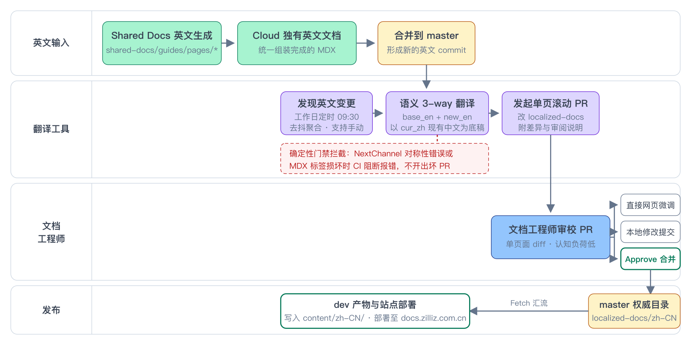
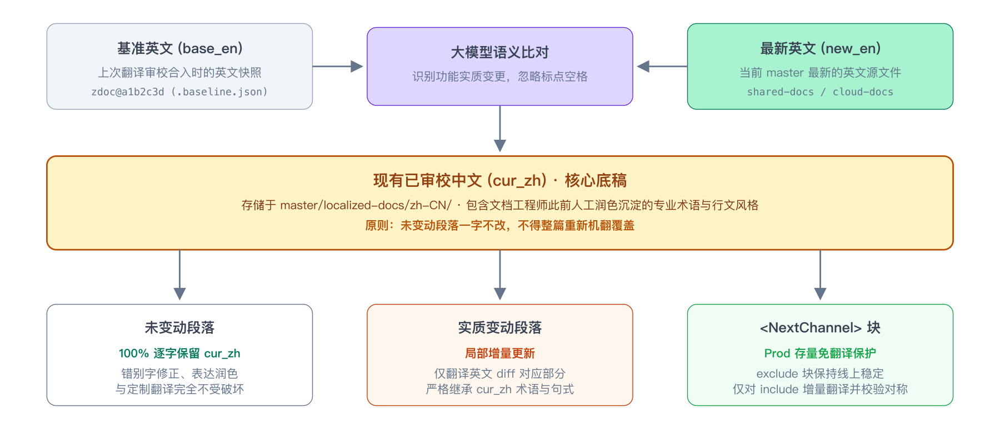
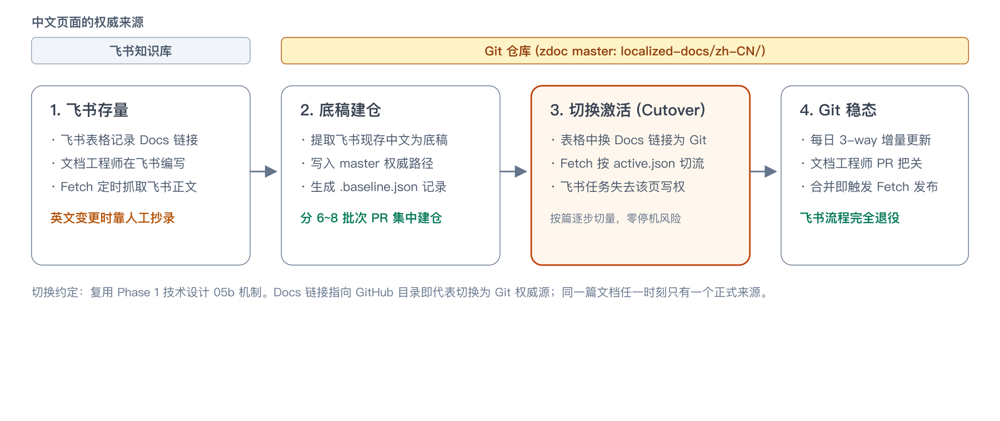

# Zilliz Cloud 中文 Guides 翻译与发布设计

文档团队的评审对齐稿、范围原则与会议待拍板事项见[中文 Guides 翻译方案（对齐稿）](../proposal-zh-cn-guides.md)。

中文 Guides 正文逐页从飞书迁入 zdoc，新增共享页也支持在 Git 注册并首译同步。文档工程师在 GitHub 审校或直接编写中文，模型根据已采用的英文版本起草局部更新，Fetch 将已激活页面组装并发布到 dev。首期保留飞书的导航与切流开关。本文定义工程实施、数据结构、异常兜底与验收契约。中文路由、校验和分支保护须在试点中验证，通过后才允许生产激活。

## 1. 生产准入

| 必须满足 | 实施约定 | 验收证据 |
|---|---|---|
| 文档工程师审批当前版本 | 为 `localized-docs/zh-CN/guides/` 配置文档团队 CODEOWNERS，并在 `master` 分支保护或规则集中强制代码所有者审批和中文候选检查。候选代码、审批和检查均绑定当前 PR head。推送审阅相关变更后撤销旧审批并重跑检查。机器人无合并或绕过权限。手写修订、迁移导入、新页首译与 Promote 中的中文变更同样受保护。 | 未获文档团队批准、旧 head 已批准、候选检查失败、机器人尝试合并四种情形均无法合入。机器人开 PR 和追加提交后，必需检查能在相应 head 上启动并回报结果。 |
| 通道完整性 | 使用 `<NextChannel action="include">` 和 `<NextChannel action="exclude">`，由程序构造或保留边界。校验块归属，并验证 CURRENT 与 NEXT 的实际站点输出，详见第 4 节。 | 属性错误、块换位、未闭合、遗漏整页通道和代码指令错置均被拦截。故意置入的 NEXT 哨兵在 CURRENT 可见输出中缺失，在 NEXT 预期位置出现。 |
| 控制台 UI 词隔离 | 在 `zdoc` 侧提供极简 `<UI>` MDX 组件（渲染为统一加粗/UI 样式，不影响 `milvus-docs` 或 `md2md`）。翻译解析器识别 `<UI>` 节点，不交模型自由翻译。 | `<UI>` 组件在双站正常渲染；翻译起草时不改动 `<UI>` 原词，自动归入 PR 待确认清单。 |
| 可提前公开 | zdoc 是公开仓库。共享镜像将 NEXT 正文随浏览器 JS 交付，中文搜索索引还可能显示 NEXT 整页标题。页面所有者须确认正文、媒体和审校材料均可提前公开，才能进入这条流水线。需保密的内容使用受限来源与独立预览产物，按批准的数据范围处理。 | 敏感内容在进入公开分支、PR、日志、产物、媒体存储或模型请求前被拦截。对需要保密的预览产物做独立发布验证。 |

当前 zdoc 的 `master` 尚未强制文档负责人审批。现有 `shared-docs-validate` 和 `site-validation.yml` 的 master PR 路径（`skip_content=true`）也不能为中文候选提供所需覆盖。新增必需检查由受信任的工作流对拟合入的中文稿运行只读生成、通道检查和中文站点验证，并校验相关英文输入仍有效。候选检查不授予 PR 内容生产凭据。可以用受限 GitHub App 自动触发检查，或使用显式派发并验证检查回报的 SHA。发布前必须选定一种方式并验证真实分支保护下的通过与拒绝路径。

[GitHub 分支保护](https://docs.github.com/en/repositories/configuring-branches-and-merges-in-your-repository/managing-protected-branches/about-protected-branches) · [zdoc 通道运行手册](https://github.com/zilliztech/zdoc/blob/master/runbook/release-channel-gating.md)

## 2. 数据流、目录结构与职责边界

### 2.1 数据流与所有权



图 1 · 英文输入、中文审校与 Fetch 发布

| 阶段 | 权威输入及写入边界 |
|---|---|
| 英文输入 | 共享页读 dev 上已验证的英文 Fetch 来源凭据（`generated/en/manifests/shared-pages/guides/<page>.json`）及其输出（`content/en/guides/...`），并按页面和发布目标验摘要。未来 Git 化的 Cloud 独有英文页也接入同一产物契约。 |
| 中文审校 | `master:localized-docs/zh-CN/guides/<page-id>/index.md` 保存中文版，旁边的 `.baseline.json` 由工具自动记录其已审英文基线。稳定页面 ID 独立于文件路径、标题和站点 slug。活动 PR 只写入受控的候选分支。 |
| 中文发布 | 下一次定时或获准手动运行的 Fetch 固定 master 输入和 dev 基线。按中文 Base 记录与已提交的中文激活状态选择来源，将通过校验的产物和来源凭据写入 dev。部署消费已验证的 dev 提交。 |

### 2.2 目录结构与配置样例

中文编辑资产统一收口在 `master` 分支的 `localized-docs/zh-CN/guides/`（具体文件名可在实现阶段微调）：

```text
localized-docs/zh-CN/guides/          # 位于 master，不在 devOwnedPaths 中，文档团队通过 PR 维护
├── registry.yaml                     # 页面接入清单（人维护）：中英映射、主审、维护模式
├── terminology.json                  # 中文 Guides 术语与风格载体（人维护，首期基于 zh-CN-reference.json 提炼）
└── <page-id>/
    ├── index.md                      # 面向网站读者的中文正文（工具可局部起草，文档工程师也可随时直接手写）
    └── .baseline.json                # 单页英文锚点（存在 master，全由工具自动写入并随 PR 合入，人无需手改）
```

#### `registry.yaml` 初步样例（文档团队通过 PR 维护）

只在登记新页、调整主审、切换“手工维护”或标记“长期挂起”时修改；日常英文更新和 PR 审校不改动它。

```yaml
schema_version: 1
manual: guides

pages:
  # 1) 常规自动增量页（绝大多数 shared-docs 页面）
  - page_id: delete-entities            # 稳定目录名，改标题/改 URL 也不变
    mode: incremental                   # incremental | bootstrap_new | manual | paused
    en_source:
      manual: guides                    # 明确绑定 Guides 手册（区别于 guides-byoc）
      shared_page: delete-entities
    owner: "@doc-owner-a"               # 主审（工具自动 Assign + 飞书提醒）
    sync_policy: independent            # independent（可独立发版）| bilingual_sync（须双语同步）
    feishu_record_id: recXXXXXXXX       # 过渡期关联中文飞书表格记录（用于核对导航与切链）

  # 2) shared-docs 新增页面，人工确认中国站需要后登记首译
  - page_id: hybrid-search-new
    mode: bootstrap_new                 # 工具起草整篇首译 PR；合入后自动转为 incremental
    en_source:
      manual: guides
      shared_page: hybrid-search-new
    owner: "@doc-owner-a"
    sync_policy: independent

  # 3) 中英文差异极大，由文档工程师直接手写中文
  - page_id: region-and-network
    mode: manual                        # 工具不自动起草翻译 PR；英文有变仅可选发轻量提醒
    en_source:
      manual: guides
      shared_page: region-and-network
    owner: "@doc-owner-c"
    notify_on_en_change: true

  # 4) 海外已上、中国站 1 个月以上暂不上（长期挂起，不留僵尸 PR）
  - page_id: global-only-feature
    mode: paused
    en_source:
      manual: guides
      shared_page: global-only-feature
    owner: "@doc-owner-a"
    pause_reason: "中国站暂未上线该能力，待排期确认后恢复"
    follow_up: "@doc-owner-a"
```

#### `.baseline.json` 初步样例（存在 `master`，全由工具自动写入）

包括 `sections` 在内的全部字段均由工具自动计算并随已审 PR 合入更新，文档工程师不需要手改。

```json
{
  "schema_version": 1,
  "page_id": "delete-entities",
  "en_baseline": {
    "manual": "guides",
    "shared_page": "delete-entities",
    "dev_commit": "5a62906a45a4e3250c619a5efcfa4de3f83a8eb6",
    "en_path": "content/en/guides/tutorials/development/insert-and-delete/delete-entities.md",
    "manifest_path": "generated/en/manifests/shared-pages/guides/delete-entities.json",
    "file_sha256": "33c0303b15c620e76e491a6c18fdd9917ce0034aec1c053676dd4d26ce513e69",
    "channels": {
      "current_sha256": "a18c...f021",
      "next_sha256": "a18c...f021"
    }
  },
  "zh_reviewed": {
    "index_sha256": "9b4e...77d2",
    "reviewed_pr": 128,
    "updated_at": "2026-11-25T08:45:00Z"
  },
  "sections": [
    {
      "anchor": "delete-entities-by-filtering-conditions",
      "en_sha256": "7f20...19ab",
      "zh_sha256": "c41d...8e33",
      "code_blocks": [
        { "lang": "python", "customized_for_zh": false, "en_sha256": "e801...44aa" }
      ]
    }
  ]
}
```

### 2.3 职责分工与研发边界

| 环节 / 角色 | 现状与本期安排 | 输入 → 输出 | 完成条件 |
|---|---|---|---|
| **英文生成**（现有英文 Fetch） | **沿用**（已存在） | `milvus-docs` + `master:shared-docs/` → `dev:content/en/guides/` 与生成记录 | 英文 Fetch 通过检查并写入 `dev` |
| **首次飞书取底稿**（一次性建仓） | **沿用**中文 Fetch 取稿 + **新增**一次性导入脚本（与日常增量独立） | 飞书固定修订中文 + 对应 `dev` 英文 → 建仓导入 PR（不发布、不改网站） | 导入 PR 经主审核对并合入 `master`，正文此时仍在飞书维护 |
| **翻译调度**（`translate-zh-guides.yml`） | **新增** GitHub Actions 工作流（不改日文/Reference 调度） | 工作日 08:30 定时/手动触发 + `registry.yaml` → 调用起草工具，创建/更新按页滚动 PR 并推送飞书群日报 | 无变化跳过；`manual`/`paused` 跳过起草；来源不明记阻塞待办；材料齐备发 Ready for review |
| **起草工具**（中文 Guides CLI） | **新增**命令行工具（复用分段 diff、内容保护与 MDX 校验） | 同手册旧/新英文 + `index.md`/`.baseline.json` + `terminology.json`（或 `bootstrap_new` 新页英文） → 局部改稿（或首译初稿）、代码块三档处理、`<UI>` 与疑点清单 | 增量模式未涉及段落逐字保留；代码块不交模型翻译；新页首译与基线缺失异常严格区分 |
| **大语言模型（LLM）** | **新增**受限模型调用（复用 SDK Reference 已有模型通道，具体模型试点定） | 变更正文段落、邻接中文上下文与术语表 → 带段落定位的局部中文提案 | 仅产出受限文本提案；不得直接写仓、改写代码块或编造 `<NextChannel>` 边界 |
| **PR 候选检查与双通道预览** | **新增**必需校验工作流与分支保护（补齐现有 `site-validation.yml` 与 `shared-docs-validate.yml` 的空白） | PR 最新 head 的 `index.md`/`.baseline.json` + 对应英文输入 → 通道/MDX/链接校验结果、UAT 与 Prod 候选预览（或渲染检查结果） | 所有必需检查在当前 PR head 通过且待确认项清零；稿件更新自动重跑并撤销旧审批 |
| **人工审校与直接写作**（文档工程师） | **新增**逐页审校门禁（支持随时直接提 PR 写中文） | PR 差异、待确认项与两通道预览 → 修订、批准合入、暂缓或直接手写 PR | 待确认项清零并批准最新 head，合入 `master` 后按规则推进（或沿用）英文基线 |
| **中文取稿与发布交接**（中文 Fetch） | **扩展**现有中文 Fetch（现状仅英文支持 shared-docs Git 选源） | 固定 `master` 提交 + 飞书表格路由记录 → 同一 `dev` 提交写入中文正文、导航、旧链接映射与来源记录 | 已切换页读取 Git 中文，未切换页继续读飞书；校验通过后原子提交到 `dev` |
| **站点构建与部署** | **沿用**（验证新来源） | 通过验证的 `dev` 提交 → 中文 UAT / Prod 站点部署 | 对应环境部署成功并验证原网址、通道内容与图片后，才算上线 |

**分支、队列与写入隔离契约：**
- **目录归属**：`localized-docs/` 位于 `devOwnedPaths` 外，随现行 `sync-master-tooling-to-dev.yml` 同步；`dev` 的 `content/zh-CN/`、生成导航和发布状态仍由发布流程写入。
- **并发队列与触发**：中文草稿与 PR 校验任务**不持有** `docs-production-dev` 锁；`master` 合入会触发同步，但不应让每个翻译 PR 合入后额外触发一次生产 Fetch（已审中文由下一次北京时间 02:00 / 10:00 / 18:00 定时或获准手动 Fetch 统一取稿）。
- **路径隔离**：`translate-codex.yml` 与 `publish-translation.yml` 继续使用现有选集和写入路径。首期中文迁移选集排除 Guides 首页、`content/zh-CN/guides/tutorials/tools/` 和 Reference。必须以实际生产者、发布者及恢复路径的写入集合验证隔离，其中 `zh-CN-reference` 仍有 `content/zh-CN/guides/tutorials` 路径映射。

[分支所有权契约](https://github.com/zilliztech/zdoc/blob/master/deploy/contracts/master-tooling-sync.json) · [英文发布交接设计](./05-publish-handoff.md) · [现有中文 Guides 抓取任务](https://github.com/zilliztech/zdoc/blob/75e79b0205ce7f9f7b842f163472e64eada35e71/.github/workflows/fetch-docs.yml#L333-L396)

## 3. 英文基线、增量起草、代码块与术语规则



图 2 · 语义 3-way 的输入及编辑约束

### 3.1 输入身份、触发边界与基线推进

| 输入 | 取值及核验 |
|---|---|
| `base_en` | 上次审校接受的英文产物。按 `.baseline.json` 的英文 dev 提交、来源凭据、输出路径、手册与 CURRENT/NEXT 投影摘要取回原文。来源凭据须可复核其锁定的生成输入。 |
| `new_en` | 本次扫描选定的、已有有效发布凭据的英文产物，带完整提交 SHA 和同一组产物身份。共享页可能同时输出 Guides 和 BYOC，必须显式声明每个中文目标对应哪份英文输出。首期一个中文页面绑定一个经确认的英文目标。 |
| `cur_zh` | 本次生成固定的 master 提交中的已审中文。记录正文摘要，并与基线声明的中文摘要比对。已有活动 PR 的人工修改按第 5 节处理。 |

- **为何 `shared-docs` 有提交不一定触发翻译，而 Cloud 配置变了反而触发？** `master` 上改了工具脚本、未激活页面或仅影响 `guides-byoc` 手册时，`guides` 输出不变，且改动须经英文 Fetch 写入 `dev` 才成为正式输入；反过来，即使上游 `milvus-docs` commit 未变，只要 `shared-docs` 的变量、页面配置或 Cloud 专用片段更新并经英文 Fetch 重新生成到 `dev`，`content/en/guides/` 正文或通道校验值变化即触发中文跟进。
- **新增共享页首译 vs 基线缺失阻塞**：
  - `registry.yaml` 中显式声明 `mode: bootstrap_new` 且尚无 `index.md` / `.baseline.json` 的页面，视为合法新页首译，读取最新已验证英文起草整篇首译 PR，合入后生成第一份 `index.md` 与 `.baseline.json` 并转为 `incremental`；
  - 已接入的 `incremental` 页面若缺少有效英文凭据、历史快照无法读取、匹配目标不明或中文摘要异常冲突，**严禁当作新页首译**，必须整页阻塞并产出阻塞待办，保留原基线与线上中文。
- **基线推进原则**：只有包含对应正文与基线的已审批 PR 合入 `master`，才能推进英文基线。草稿、失败、取消、暂缓及关闭 PR 均不推进。

### 3.2 确定性编辑门禁

1. **程序先划定编辑范围。** 解析三份 MDX，按稳定块 ID / 标题小节与唯一结构匹配定位变化（复用现有分段 diff 能力），保留语言与通道归属。列表、表格、提示框和代码组按结构整体处理。格式归一只允许白名单中的非语义差异；数字、单位、否定、默认值、参数、链接目标及代码变更必须显式进入审阅。
2. **受限调用模型。** 给模型变更正文段落、必要相邻中文上下文与 `terminology.json`。输出限于带块 ID 的局部改稿提案。拆并段、标题重命名、多个候选匹配、跨段指代不明或中文独有内容受影响时，保留原中文文字不删改（原夹层位置消失时可提议候选位置），列入 PR 待确认项交人工决定。模型输出不得执行代码或直接写仓。
3. **程序拼接并逐字节复核。** 对照 `cur_zh` 原始字节，只应用获准区间变更，校验其余区间逐字保留。保护占位符、链接、资源、锚点、代码、JSX 与 front matter，校验两通道归属与渲染完整性。
4. **失败冻结候选。** 来源摘要冲突、越界编辑、非法结构或对齐不明时，保留已发布内容与基线，生成定位到页面、通道和块的报告。

### 3.3 代码块三档保护、术语载体与 UI 界面词

- **代码块三档同步（绝不交 LLM 翻译，代码英文注释保持英文）**：
  1. **无中国站定制（`customized_for_zh: false`）**：`cur_zh` 与 `base_en` 代码块字节一致时，英文代码更新由程序直接原样同步，在 PR 标明“代码块已原样同步”；
  2. **固定地域/域名映射（按需配置白名单）**：如 `cloud.zilliz.com` → `cloud.zilliz.com.cn` 等确定性替换按显式规则换算，并在 PR 标出核对；
  3. **页面级中国站定制（`customized_for_zh: true`）**：`cur_zh` 代码块原本就与 `base_en` 不同时，英文再变**不强行覆写**，暂停自动同步该块并在 PR 待确认项并排给英文 diff 与中文定制代码交主审合并。
- **术语与风格载体（`terminology.json`）**：首期基于现有 `config/translation/zh-CN-reference.json` 提炼（统一用“您”，保留 `Collection` / `Entity` / `Schema` / `Compaction` 等英文词与禁译规则），随审校 PR 持续补充，作为 LLM 硬约束上下文与 PR 提示，不做容易误报的机械词频卡死。
- **控制台 `<UI>` 界面词**：仅用于 `zdoc` 侧 Cloud 定制英文（开源 `milvus-docs` 无控制台，零上游外溢）。程序解析 `<UI>...</UI>` 节点后不交 LLM 自由翻译，首期保留原词并在 PR 待确认项集中列出由主审对照中文控制台替换；后续若建专门的 UI 词映射表，亦仅作用于 `<UI>` 节点内部，不触碰普通正文。

### 3.4 直接手写与手工维护模式

- **随时直接提 PR 写中文**：文档工程师可直接提 PR 改写或增补任意 `incremental` 页的 `index.md`，走同一必需检查与审批，合入后更新 `zh_reviewed.index_sha256` 并沿用原 `en_baseline`；下次英文增量时，手写独有段受未涉及区间保护，不静默覆盖。
- **手工维护模式（`mode: manual`）**：中英文结构或产品逻辑差异极大、不适合自动跟翻的页面，在 `registry.yaml` 标为 `manual`，完全由文档工程师直接提 PR 发布；若 `notify_on_en_change: true`，英文更新时仅发轻量提醒，不自动起草翻译 PR。

## 4. 通道与 Promote

### 4.1 CURRENT 与 NEXT

- `action="exclude"` 只在 CURRENT 显示，`action="include"` 只在 NEXT 显示。CURRENT 块的英文输入和对应已审中文均未变时，逐字复用。CURRENT 热修单独生成并审核，当前修正与未上线的 NEXT 内容保持隔离。
- 模型不生成通道边界。门禁核验块 ID、通道、顺序与结构位置，区分成对变更、单侧增删及作者手写块。拒绝 `variant`、非法嵌套、未闭合、包错正文，以及整页 NEXT 或 RETIRE-IN-NEXT 与冗余块门禁混用。中文独有块同样要有明确通道归属。
- 分别验证两份站点视图。检查正文、导航与锚点、TOC、代码显示及复制行为，以及 CURRENT 的静态 HTML、Markdown、描述和 `llms.txt`。整页 `Release Channel` 另行核对。对中文搜索标题和共享 JS 的已知残留按第 1 节的公开范围约束处理。

### 4.2 Promote 的交接

1. 提升候选从 `lock.yaml` 固定拟采用的英文 `next`，按 [04](./04-channels-and-lock.md#提升) 的规则重建目标手册和通道。对照已审中文 NEXT 对应的英文产物及投影摘要，确认是同一拟发布版本，并检查候选提升结果的差异。仅锁文件 SHA 相同不足以通过，Cloud 规则、片段或资源也可能变化。
2. 同一次提升提交保留已审的中文 NEXT 正文，解包由生成器添加的 `include`，删除对应的旧 `exclude`（经受保护的 `master` PR 审批与检查）。作者手写的通道块只随对应功能的显式发布决定移除。检查两个通道的锚点与入链。整页 NEXT 要上线时，由负责人在同一次发布中协调 Base 的 `Release Channel`，Fetch 核对实际值后才发布该中文提升。
3. 英文 `next` 推进、无对应中文批准、Base 通道提前变化或候选验证失败时，保留上次已验证的中文产物和通道状态，并报告阻断原因。英文若可独立发布，记录中文暂缓。要求双语同时上线的页面由发布负责人等到两边证据齐全后再放行。Fetch 使用已固定的输入重验，通过后在同一个中文检查点提交中更新正文、导航、通道和来源凭据。

[04 的双版本生成和提升规则](./04-channels-and-lock.md) · [zdoc 通道运行手册](https://github.com/zilliztech/zdoc/blob/master/runbook/release-channel-gating.md)

## 5. 滚动 PR、两档暂缓、异常并发与 PR 模板

### 5.1 08:30 定时调度、飞书提醒与两档暂缓

- **调度窗口与去重**：拟在工作日北京时间 **08:30（UTC 00:30）** 扫描（承接凌晨 02:00 Fetch，避开 10:00 Fetch 与 09:00–12:00 巡检高峰），支持手动按页触发。定时和手动共用并发与去重规则，按页面、目标和输入产物摘要去重；周末、延迟或中断后补扫。扫描完成后向文档团队**飞书群发送每日汇总卡片**（列出当日新开/更新 PR 链接与主审）。
- **两档暂缓（绝不阻塞他页与同页 Prod 急修）**：
  - **短期等待（几天～2 周）**：保留原 PR、贴 `deferred` 标签并在评论写明原因、跟进人（复核日期可选）；无新实质变化不重复催办；有新实质变化时在原 PR 单列“自暂缓后新变化”并保留“自上次合入累计变化”，**通知一次**（主审决定恢复、更新暂缓点继续暂缓，或转入长期挂起）；到复核日期时提醒一次。
  - **长期时间差（1 个月以上暂不上）**：关闭该 PR 并在 `registry.yaml` 记 `mode: paused`（附 `pause_reason` 与 `follow_up`），不留僵尸 PR；已审英文基线停在旧版不丢账，待中国站就绪再手动触发重开。

### 5.2 异常与并发处理矩阵

| 异常 / 并发情形 | 必须发生的行为（谁处理、怎么处理） | 已有人工修改 | 线上内容（Prod / UAT） |
|---|---|---|---|
| **新变更且无活动 PR** | 每个稳定页面 ID 至多一个活动翻译 PR，分支 `translate/zh-guides-<page-id>`；材料齐备直接 Ready for review，附英文来源、差异、检查与两通道预览。 | 不受影响 | 不受影响 |
| **审校中英文再次变化** | 按页面串行，在预期旧 head 仍匹配时向原 PR 追加提交，标出新增差异与累计差异，刷新预览、重跑必需检查并撤销旧审批。 | 未与新英文变化重叠的人工修订自动保留 | 不受影响 |
| **两个人改到同一句**（英文再变与 PR 内人工编辑重叠；同期纯中文 PR 合入 `master` 冲突；两名编辑同改一 PR） | 检测到重叠或无法证明互不干扰即**暂停自动写入**，在 PR 中标出冲突位置交主审合并解决后重跑检查和审批；两名编辑同改一 PR 按 Git 冲突处理，保留提交历史。 | 全部保留在分支或提交历史中，不静默覆盖 | 不受影响 |
| **生成期间输入或状态变化** | 生成期间 head、基线、Promote 状态或相关英文产物变化时，旧结果不得写入，也不能作为通过证据；重核输入后在最新 head 重检重审。 | 保留 | 不受影响 |
| **英文基线缺失或来源不可核实** | **整页阻塞。** 不开错误翻译 PR，生成阻塞待办（列出页面、缺失材料与负责人），由文档负责人补齐或重新确认基线后再起草（严禁误走 `bootstrap_new`）。 | 保留原 `master` 已审中文与 `.baseline.json` | 不受影响 |
| **段落对应不清**（拆并段、指代不明、中文独有说明） | 来源可信前提下，同 PR 交付其余可靠改动，疑点处保留原中文文字不删改（必要时提议候选位置）并在 PR 列出上下文和问题交主审决定。 | 原中文文字逐字保留 | 待办清零前合入检查拦截，线上不受影响 |
| **待发内容还不能进 Prod**（急修与待发共存） | 线上急修只改 CURRENT 区间独立审核上线；待发内容留在 NEXT 区间不随急修放出。 | 两通道已审中文互相隔离保留 | 急修仅更新 Prod 对应说明，待发内容在 Prod 保持隐藏 |
| **页面重命名、下线或跨页联动** | 重命名沿用页面 ID，显示路径/导航/链接差异；下线后停止生成更新由负责人处理活动 PR；跨页联动使用同一 PR 或受控发布批次。 | 受控处理 | 不受破坏 |

[06 的滚动 PR 和跨页依赖规则](./06-upstream-changes.md#每页一个滚动更新的-pr)

### 5.3 参考示例：一份翻译 PR 的实际结构

以下示例用于界定翻译 PR 的标准 Description 模板与试审体验（对应真实页面《删除 Entity》`/delete-entities#delete-entities-by-filtering-conditions`，Guides 手册）。早上 08:30 扫描后，主审收到飞书群日报，点进该 PR 看到如下内容（①② **只留在 PR 给主审看**，③ 才是网站读者可见正文）：

#### ① PR 页首信息与变更摘要（只给主审）

- **页面与目标手册**：`delete-entities`（Cloud Guides）
- **英文版本对比**：上次已审 `dev@5a62906`（取自 `.baseline.json`，Prod 与 UAT 一致） ➔ 本次采用 `dev@<最新已验证SHA>`（**Prod 无变化；仅 UAT 合并两段并新增 1 步检查**）
- **关键事实变化**：数字/限制（无） · 代码块（无变化；若有变化且无中国站定制则程序原样同步，不走 LLM） · 链接（无） · 操作步骤（**UAT 新增 1 步**）
- **自动检查状态**（当前 PR head）：✅ 未涉及段落逐字保留 · ✅ 术语契约与代码块保护通过 · ✅ MDX 与双通道边界校验 · ✅ 链接与图片校验 · ⏳ 待确认项（1 项未清零，合入已拦截）
- **候选预览入口**（锚点 `#delete-entities-by-filtering-conditions`）：
  - **Prod 候选预览** — 预期：与现网完全一致，**不出现**新增检查句，保留原有两段操作及中间提示。
  - **UAT 候选预览** — 预期：两段合并并出现新增句“提交删除请求前，请核对过滤表达式。”，中文独有的颜色提示拟移至代码示例正上方。

#### ② 改稿说明与待主审决定（只留在 PR）

- **可靠改动（已起草至 UAT 通道）**：英文在 UAT 通道将两段操作合并并新增检查句，工具已译为“提交删除请求前，请核对过滤表达式。”，其余未涉及段落逐字保留。
- **待您决定（1 项，清零前拦住合入；若本页含 `<UI>` 界面词或中国站定制代码冲突也会列在此处）**：
  - [ ] **确认中文独有提示的摆放位置**：原中文两段之间有一句写给中文读者的提示，解释下方示例里的颜色值。因 UAT 英文合并了这两段，原夹层位置已不存在。工具**保留了提示原文一字未改**，在 UAT 候选稿中拟将其挪到代码示例正上方（Prod 保持原位）。请对照下方预览与代码示例确认位置，或直接在 `index.md` 调整。

**英文改前 / 改后双通道依据：**
- 上次已审（Prod & UAT，两段）：`Use a filter expression to select the entities to delete.` / `Submit the delete request with that expression.`
- 本次采用 · Prod / 当前版（未变，仍为两段）：同上。
- 本次采用 · UAT / 下一版（合并为一段，新增句加粗）：`Use a filter expression to select the entities to delete.` **`Check the filter expression before submitting the delete request.`** `Submit the delete request with that expression.`

#### ③ 对照中文页面：网站读者会看到什么？（候选预览摘录）

**Prod 候选预览 · 当前版**

> 使用过滤表达式选中要删除的 Entity。
>
> **提示：** 下方示例中的颜色值仅作演示，请按目标 Collection 中的实际取值替换。
>
> 使用该表达式提交删除请求。
>
> ```python
> res = client.delete(
>     collection_name="quick_setup",
>     filter="color in ['red_7025', 'purple_4976']"
> )
> ```

**UAT 候选预览 · 下一版**

> 使用过滤表达式选中要删除的 Entity。提交删除请求前，请核对过滤表达式。使用该表达式提交删除请求。
>
> **提示：** 下方示例中的颜色值仅作演示，请按目标 Collection 中的实际取值替换。
>
> ```python
> res = client.delete(
>     collection_name="quick_setup",
>     filter="color in ['red_7025', 'purple_4976']"
> )
> ```

#### ④ 主审判断与回复

主审核对三点：① 译文准确且术语一致；② 紧随其后的 `filter="color in ['red_7025', 'purple_4976']"` 印证了颜色提示解释的是代码演示值，放在代码正上方更清晰；③ Prod 未出现新增句、UAT 中新增句只出现一次且位置正确。勾选待确认项并回复（只留在 PR）：

> 译文准确。颜色提示解释的是下方 `color in [...]` 示例，同意在 UAT 中挪到代码示例正上方。已对照英文双通道分段核对 Prod / UAT 预览，通道正确，关闭此待办并批准合入。

待办清零、必需检查绿灯并获 Approve 后合入 `master` 并自动更新 `.baseline.json`。若短期需等产品确认，则在原 PR 贴 `deferred` 标签写明原因与跟进人；若遇长期时间差，则关闭 PR 并在 `registry.yaml` 记为 `paused`。

真实参考文件：[Cloud 页面配置](https://github.com/zilliztech/zdoc/blob/7ee39054f37047b586ad789d876b2047c6f2c465/shared-docs/guides/pages/delete-entities/page.yaml) · [两份英文输出记录](https://github.com/zilliztech/zdoc/blob/5a62906a45a4e3250c619a5efcfa4de3f83a8eb6/generated/en/manifests/shared-pages/guides/delete-entities.json) · [英文正文](https://github.com/zilliztech/zdoc/blob/5a62906a45a4e3250c619a5efcfa4de3f83a8eb6/content/en/guides/tutorials/development/insert-and-delete/delete-entities.md) · [同一提交的中文正文](https://github.com/zilliztech/zdoc/blob/5a62906a45a4e3250c619a5efcfa4de3f83a8eb6/content/zh-CN/guides/tutorials/development/insert-and-delete/delete-entities.md)

## 6. 存量迁仓、新增接入与 Fetch 接线

### 6.1 存量页逐页切流



图 3 · 中文页面的逐页激活与恢复

| 状态 | 转换条件与可验证结果 |
|---|---|
| 飞书维护 | 飞书是发布来源。记录原 Base 记录 ID、旧 Docs 链接和修订、slug、通道与发布目标。 |
| Git 候选 | 从固定飞书修订导出，可由工具以旧飞书中文为底稿、对照当前最新 `dev` 英文辅助起草补齐历史欠译，经导入 PR 人审对齐建立第一份 `.baseline.json`（不发布候选稿，正文仍在飞书维护）。只读比较验证旧飞书入链、锚点别名、导航、中文站点渲染与媒体。文档负责人比对最近一次飞书修订，处理差异并在换链窗口冻结该页正文。 |
| 待激活 | 确认显式 `canonical`、可发布状态和原记录 ID，再把该中文 Base 记录的 `Docs` 改为 `https://github.com/zilliztech/zdoc/tree/master/localized-docs/zh-CN/guides/<page-id>`。该修改是激活请求。Fetch 用固定的 master、dev 和 Base 路由证据重新校验，部署继续使用最近已发布版本。 |
| Git 已激活 | Fetch 只在原 dev 发布前提仍成立时提交。同一个 dev 提交写入中文正文、导航、旧链接与锚点映射、逐页来源凭据和中文 `active.json`，同时将正文写权交给 Git。**只有 Fetch 确认接管后，才将清单编辑入口改为 Git。** 验证部署与原网址后停用旧正文编辑；首期保留负责导航的 Base 记录。 |

### 6.2 新增共享页注册与首译接入

当 `shared-docs/guides/pages/` 新增一篇尚无飞书中文旧稿的页面时：
1. **人工确认并登记**：中文负责人确认中国站需要该页后，在 `registry.yaml` 登记 `page_id`、`en_source`、`owner` 并显式标为 `mode: bootstrap_new`；
2. **首译 PR 建仓**：英文产物写入 `dev` 后，工具起草整篇中文首译 PR；主审审校、过检并 Approve 合入 `master`，生成第一份 `index.md` 与 `.baseline.json` 并转为 `incremental`；
3. **补齐导航并发布**：过渡期在中文飞书表格新增导航记录，填好目录层级与 `Release Channel`，并将 `Docs` 直接指向 `https://github.com/zilliztech/zdoc/tree/master/localized-docs/zh-CN/guides/<page-id>`，由下一次 Fetch 编入中文站发布。

### 6.3 Fetch 接线与恢复

接线借鉴 [05b](./05b-cutover-and-ownership.md)，现有 shared-docs 路由和激活记录只服务英文。中文须增加站点限定的 Git 来源类型、独立激活记录和来源凭据。目录 URL 只用于选源，按 Fetch 固定的 master SHA 读取仓库内受控路径，禁止跨站、重复所有者、路径逃逸和符号链接。保持 Base 记录、页面 ID、发布目标与实际写入路径可核对。快照和缓存身份包含已审批中文及所需资源的摘要。飞书记录无变化而 Git 正文、配套资源或归属变化时，也要重新生成或核验。中文候选还要贯通媒体处理、表格渲染、组装、检查点、发布和恢复。凭据至少记录使用的 master/dev 提交、Base 记录与通道、正文、导航及媒体摘要和 Fetch 运行 ID。

激活前的失败保留原 dev 产物及状态。若要撤回请求，先确认旧请求已结束且未写入，再由负责人恢复原链接和编辑权。结果未知时停下并核实远端。激活后的全量抓取、缓存恢复与删除流程均须遵守 Git 写权。误改链接、删记录、重命名或拟下线时按归属保护处理，修复记录或走受控下线路径。部署失败走现有重试或镜像回滚，编辑权仍归 Git。逐页验证可独立完成，任何新步骤都不得持有生产队列锁去等待另一个生产写入任务。

## 7. 实施顺序与试点验收明细

1. **完善门禁，做只读试点。** 选 3 页存量页（普通更新页、双通道含 CURRENT 热修页、含飞书历史锚点与媒体页）+ 1 页新增共享页（或模拟新页首译）。验证未授权区间逐字保留，覆盖代码块三档保护、`<UI>` 词识别、错放通道块、拆并段、热修、提升、人工直接写作、并发冲突、两档暂缓及旧审批撤销。
2. **验证真实 Fetch 交接。** 补齐代码到测试矩阵与路径过滤，运行变更选择器给出的测试、中文站点构建及发布契约测试。先用 `group=guides`、`publish=false`、`run_translations=false`、`media_upload_mode=skip` 验证只读候选，再用真实保留的 Fetch 检查点与隔离 bare remote 回放，记录固定输入、产物摘要和终态。覆盖冷热缓存、飞书未变但 Git 已变、切流失败、重复激活、重命名、删除保护与已审 NEXT 提升，并核对英文、日文和 `zh-CN-reference` 的写入边界。
3. **分批建仓，小批激活。** 约 89 篇底稿拟分 6～8 批审校入库，激活按每页证据推进。试点通过且部署验收后再扩大批次。测量出稿时间、人工耗时、关键事实漏改、术语一致性、非授权改写、冲突率和同步排队时间，再确定模型与批次节奏。最后退役飞书中文正文编辑，后续导航迁移另行评审。

### 8 类试点通过条件明细

| 试点场景 | 通过条件 |
|---|---|
| 普通更新页（含代码保护、术语与飞书提醒） | 取一处已知的英文限制或参数变化。08:30 扫描后飞书群收到日报提醒；主审能在 PR 中找到对应中文改动，术语遵循契约（统一用“您”及保留英文词），未受影响段落经程序核验逐字保留；无中国站定制的代码块由程序原样同步（不走 LLM），有中国站定制的代码块不强行覆写而是给 diff 交主审。审稿中英文再变时，原 PR 保留人工修订、撤销旧审批并重跑必需检查。记录漏改、额外改写及审校用时。 |
| 新增共享页首译接入 | 在 `registry.yaml` 登记一页无飞书旧稿的新注册共享页（`mode: bootstrap_new`）。工具生成整篇首译 PR 而非误报基线缺失；主审审校合入后自动建立 `index.md` 与 `.baseline.json` 并转为 `incremental`；在飞书表格新增导航记录指向 Git 目录后，Fetch 正常编入中文站，后续英文更新自动转入局部增量模式。 |
| 直接手写与手工维护模式 | 验证两项：① 文档工程师直接提 PR 修改/增补中文正文，合入后沿用原英文基线，下次增量不覆盖手写独有段落；② 将差异极大页设为 `mode: manual` 后，工具不再自动起草翻译 PR。 |
| 同 PR 交付可靠改动与疑点，并演练两档暂缓 | 一处可靠改动和一处疑点同 PR 送审，疑点未清零时合入检查拦截。短期挂 `deferred` 后重复扫描不催办，英文再变时只通知一次并同时展示“自暂缓后新变化”与“自上次合入累计变化”；长期时间差关闭 PR 并在 `registry.yaml` 记 `paused` 后，英文基线不推进且不重复建 PR。恢复审校并获批合入后，英文基线才推进。 |
| 来源无法确认或英文基线缺失 | 构造已接入页基线缺失或目标手册不唯一的情形。工具整页阻塞并产出阻塞待办，不发错误翻译 PR，保留原有基线与线上中文（严禁把异常基线缺失误当成新页首译）。 |
| 并发冲突（两个人改到同一句） | 模拟英文再变与 PR 内人工修改重叠（或同期纯中文术语 PR 冲突）。工具暂停自动写入并标出冲突位置，已有人工修订不丢失，线上内容不受影响。 |
| 同时有待发功能和线上急修的页面 | Prod 能单独修正旧说明而不泄露 UAT 内容。Promote 后 Prod 展示 UAT 已验收的版本；验收后英文变化时能指出阻断原因并保留旧版。 |
| 有飞书历史链接和图片的页面 | 切换失败时原网址仍可访问；确认切换后，原链接、锚点和图片可用，旧飞书正文的修改不会覆盖网站，且与 `zh-CN-reference` 写入互不冲突。 |

实现阶段预计新增 `translate-zh-guides.yml`、中文 Guides CLI 与轻量 `<UI>` 组件，复用现有的内容保护和 MDX 校验能力，并扩展中文 Fetch 与 PR 校验契约。试点必须先证明路由、审校和发布证据连通，再开展生产切流。
