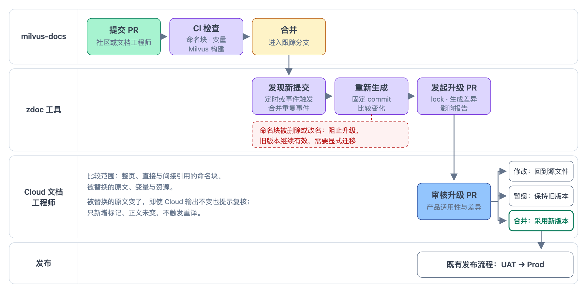

# 06 上游变化的发现与影响报告

milvus-docs 合并新提交后，Cloud 要自动得知，并自己决定是否采用、何时采用。本篇定义怎样发现上游变化、怎样发起上游更新 PR，以及 PR 中给审核人看的影响报告。

**参与方**：milvus-docs（新提交）、zdoc 中的“上游更新”工作流（发现、生成、发起 PR）、Cloud 文档工程师（审核）。

**状态**：已定义，待文档负责人确认。接入、下线与提升这几种由 Cloud 发起的 PR 见 [04](./04-channels-and-lock.md#写入与提升)。

## 约定

### 流程

图 1 · 上游变化怎样成为 Cloud 的上游更新 PR

- **上游更新 PR 就是一个普通的 zdoc PR。** 审核与批准沿用 GitHub PR，不另建审批记录。合并后，master 推送触发 Fetch（见 [05](./05-publish-handoff.md#运行位置与触发)），新版本随后在 UAT 可见。
- **跟踪分支只用于发现变化**，正式生成使用 lock 中的 commit，见 [04](./04-channels-and-lock.md#共享来源配置与跟踪分支)。

### 发现与运行

zdoc 新增“上游更新”工作流：

- **每天定时运行一次，也可以手动触发。** 读取 milvus-docs 跟踪分支的最新提交，与每个共享页 lock 中的 `next` 比较；已下线（`next: none`）的页面不检查。一天内的多个提交由同一次运行一并处理。
- **手动触发时可以指定页面与目标提交。** 同样的输入得到同样的结果；结果没有变化时，不产生新的提交。
- **执行身份是 zdoc 仓库自带的 `GITHUB_TOKEN`**，与现有的 master→dev 同步工作流相同：用它推送分支、开 PR，开好后显式触发校验工作流（用 `GITHUB_TOKEN` 开的 PR 不会自动触发其他工作流）。
- 读取 milvus-docs 不需要凭据。生成是候选运行（见 [05](./05-publish-handoff.md#pr-校验)），不上传图片，不需要任何 Cloud 凭据。milvus-docs 中的社区 PR 不会运行 zdoc 的任何代码。

### 每页一个滚动更新的 PR

| 情况 | 做法 |
|---|---|
| 某页的输入有变化（原文、用到的片段），且还没有它的上游更新 PR | 开一个新 PR，把这一页的 `next` 改为最新提交 |
| 这一页已有一个未合并的上游更新 PR | 更新这个 PR：`next` 改为更新的提交，重新生成报告；不另开 PR |
| 这一页的输入没有变化 | 不处理，lock 不动 |
| 几页在同一批提交中互相依赖（例如一页改了标题，另一页改了指向它的链接） | 合进同一个 PR，一起采用 |
| 这一页的 lock 在 PR 开出后被改过（提升或下线 PR 已合并） | 下一次运行按新的 lock 重建这个 PR；lock 中 `current` 与 `next` 是相邻的两行，不重建会产生 Git 冲突 |
| 这一页已下线（`next: none`），上游更新 PR 还开着 | 下一次运行关闭这个 PR，并写明“页面已下线” |

审核人暂缓某一页时，这一页的 PR 保持打开，之后的上游修改继续累积到这个 PR 中，不影响其他页面。

### 上游变化的处理

| 上游变化 | 行为 |
|---|---|
| 新增合法的命名块 | 自动进入命名块清单，不自动更新或发布 |
| 移动块或修改标题，ID 不变 | 身份保持，检查内容和上下文变化 |
| 块改名或删除 | 校验失败，见“出错时” |
| 被 Cloud 替换的原文发生变化 | 即使 Cloud 输出不变，也提示复核 |
| 被 Cloud 按行定位的代码行被修改 | `lines` 匹配失败，校验失败，见“出错时” |
| Cloud 规则只在 `next` 上失效 | 校验失败并指出通道，见“出错时” |
| 类型、上下文或语言变化 | 检查兼容性，不静默组装 |
| 只新增标记，正文未变 | 更新身份与依赖，不触发重译 |
| 标题改名 | 报告改名与受影响的链接，处理见 [04](./04-channels-and-lock.md#标题改名与锚点) |
| 原文被改名或删除 | 校验失败，见“出错时” |

### PR 的内容

| 部分 | 内容 |
|---|---|
| 改动 | 工具只改对应页面 `lock.yaml` 中的 `next`；生成失败时，文档工程师可以在同一个 PR 中修改页面配置或 Cloud 内容文件 |
| 标题 | 例如 `shared-docs: update openai to milvus-docs b2c3d4e` |
| 上游范围 | milvus-docs 从旧 `next` 到新 `next` 的对比链接 |
| 影响报告 | 每页一节，见下表 |
| 校验 | 见 [05](./05-publish-handoff.md#pr-校验)，必须通过才能合并 |

影响报告每页一节：

| 内容 | 说明 |
|---|---|
| UAT 将看到的变化 | 新旧两个 `next` 的生成结果差异，折叠显示 |
| 需要复核 | 被 Cloud 替换的原文有变化；标题改名与受影响的链接；新增或变化的图片，附原地址 |
| 失败 | 哪条规则、哪个通道失败，应改哪个文件 |
| 一起采用的原因 | 合并了多页时，说明它们之间的依赖 |
| 翻译 | Cloud 输出是否变化，即是否会触发重新翻译 |

代码组报告完整代码组的上下文，Markdown 块报告页面上下文，按行定位的规则随所在代码组报告。摘要只能发现变化，不能判断语义是否一致，首期提示可以保守。

## 出错时

| 情况 | 结果 |
|---|---|
| 生成失败：命名块被删或改名、`lines` 匹配不到、Cloud 规则只在 `next` 上失效 | 照样开或更新 PR，校验标为失败，报告写明原因与修改建议：通常是把原规则标为 `channel: current`，再按新原文加一条 `channel: next` 的规则（见 [02](./02-page-config.md#只对一个通道生效的规则)）。文档工程师在同一个 PR 中修改，校验通过后才能合并；未合并前 lock 不变，旧版本继续有效 |
| 原文被改名或删除 | 照样开或更新 PR，校验失败，报告写明原因。删除时建议下线这一页；改名时由文档工程师在同一个 PR 中改 `source.file`，首期不提供专门写法 |
| 工作流本身出错（如网络问题） | 下一次定时运行自动重试；失败情况沿用 zdoc 现有的飞书通知 |
| milvus-docs 跟踪分支的历史被改写，lock 中的 commit 不再在分支上 | 失败并通知，需要人工处理（见 04 的出错规则） |

## 例子

OpenAI 的上游更新 PR

milvus-docs 在 `b2c3d4e` 中给 OpenAI 页 “Choose an embedding model” 一节的模型表加了一行，并在被 Cloud 整节替换的 “Configure credentials” 中补充了一条要求。

- **标题**：`shared-docs: update openai to milvus-docs b2c3d4e`
- **改动**：`shared-docs/pages/openai/lock.yaml` 中 `next: a1…` 改为 `next: b2c3d4e…`
- **影响报告**：
  - UAT 将看到的变化：模型表新增一行。
  - 需要复核：`before-you-start` 替换的原文有变化，Cloud 页面没有变化；请确认 `before-you-start.md` 是否也要补充这条要求。
  - 翻译：Cloud 输出有变化，合并后会触发重新翻译。
- **校验**：通过。审核人确认 Cloud 内容文件不需要修改后合并。

## 设计理由

展开设计理由

**为什么定时检查，而不是事件触发。** milvus-docs 与 zdoc 属于不同的 GitHub 组织。事件触发要在 Milvus 的公开仓库中放一个能操作 zdoc 的跨组织凭据，管理与安全成本都高。milvus-docs 是公开仓库，zdoc 不需要凭据就能读取；上游修改本来就要等 Cloud 审核，晚几个小时发现没有影响。`v3.0.x` 近 30 天有 33 个提交，集中在 11 天内，单日最多 9 个，按天处理比每个提交开一个 PR 合理。

**为什么用 `GITHUB_TOKEN`。** zdoc 现有的 master→dev 同步工作流已用它开 PR 并显式触发校验，有现成的做法可以照搬，不必新增机器人账号或 GitHub App。zdoc 是公开仓库，来自外部 fork 的 PR 拿不到仓库的 secrets；上游更新工作流在 zdoc 内部定时运行，也不需要 Cloud 凭据。PR 中的影响报告是公开的，其内容来自公开的 milvus-docs 与 zdoc master，不会多暴露信息。

**为什么每页一个滚动更新的 PR。** 不同页面的上游修改，Cloud 可能在不同时间采用；一页暂缓不应拖住其他页面。同一页的新提交累积到已有的 PR 中，审核人只需看一个 PR。互相依赖的页面合进同一个 PR，避免 UAT 上只更新了其中一页。

**为什么原文改名或删除不提供专门写法。** milvus-docs 调整导航结构改的是目录结构文件，不必移动原文；Cloud 页面在导航中的位置也由 Cloud 自己决定（首期在飞书目录中）。原文本身改名或删除很少：`v3.0.x` 近一年改名 2 次、删除 9 次。改名后新旧文件的相似度只有 51% 和 61%，Git 未必能识别为改名，工具只能报告“找不到原文”。为此新增字段不划算，遇到时人工处理。

**为什么失败也开 PR。** 失败多半意味着 Cloud 的配置需要跟着上游调整，例如为被修改的代码行加一条只对 `next` 生效的新规则。把失败和修改建议放进 PR，文档工程师可以直接在同一个 PR 中修好，再走正常审核。

## 验收

- **T05**：被替换的原文变化仍然提示；上游变化只生成 PR，不自动采用；PR 合并前的生成结果不进入正式发布。
- **T12**：完整旅程中采用或拒绝上游更新。
