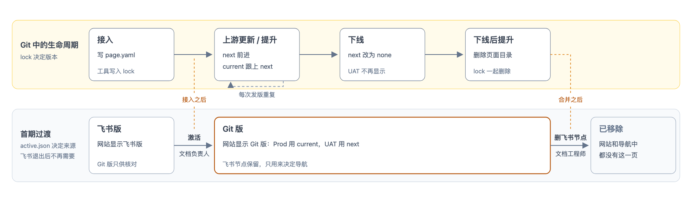

# 接口设计

本目录面向 [zdoc](https://github.com/zilliztech/zdoc) 与 [md2md](https://github.com/zilliztech/md2md) 的维护者，是 Phase 1 各接口的唯一定义，也是接口评审的议程。为什么改、整体怎么做见[方案总览](../proposal.md)；文档作者怎么写见[共享页面的写法与配置](../consumption-schema.md)；实施顺序、验收与各接口的状态见[Phase 1 实施计划第 6.1 节](../phase-1.md#61-待确认的接口)。

生产实现与集成验收尚未完成。Phase 1 分两个阶段（见[Phase 1 实施计划](../phase-1.md)）：Phase 1a 跑通整篇复用，例子用 Delete Entities；Phase 1b 加入差异、上游更新与切换，例子用 OpenAI。术语见[术语表](./glossary.md)。

## 接口地图

图 1 · Cloud 页面生成流水线

| 流水线中的位置 | 接口 |
|---|---|
| ① 按 lock 中的 commit 获取 milvus-docs 原文 | [04 通道与 commit 记录](./04-channels-and-lock.md) |
| ② 定位命名块，生成命名块清单 | [01 命名块的定义与解析](./01-named-blocks.md) |
| ③ 按页面配置执行 add、replace、remove | [02 共享页配置](./02-page-config.md) |
| ④ 展开变量与片段 | [03 md2md 提供的接口](./03-md2md-interfaces.md) |
| ⑤ 产品过滤 | 沿用 zdoc 现有能力，见 [02 共享页配置](./02-page-config.md#变换) |
| ⑥ 站点适配，其中的链接与图片 | [02b 链接与图片](./02b-links-and-images.md) |
| 两个版本合并为一份页面 | [04 通道与 commit 记录](./04-channels-and-lock.md) |
| PR 校验，以及生成结果进入 zdoc 发布 | [05 生成结果交给发布](./05-publish-handoff.md) |
| 页面从飞书切换到 Git，或从 Git 下线 | [05b 页面切换与归属](./05b-cutover-and-ownership.md) |
| milvus-docs 有新提交时，触发整条流程 | [06 上游变化的发现与影响报告](./06-upstream-changes.md) |

两条横跨多个接口的规则：

- **顺序是约束，不是实现细节。** 命名块必须在变量展开之前定位，因为标记只存在于原文中；Cloud 内容文件在变换（第 ③ 步）中插入后，与原文一起在展开变量与片段（第 ④ 步）时展开。本地原型也按这个顺序实现。
- **站点适配（第 ⑥ 步）不承担业务差异。** 它只负责 Tabs、提示组件、链接、图片和元数据，不为某种业务差异增加专门的处理。

## 一页的生命周期

流水线讲的是一次生成怎样进行；本节讲一个共享页从接入到下线要经过哪些步骤。先讲改造的目标做法，即一页在 Git 中的生命周期；再讲 Phase 1 飞书还没退出时，多出来的两步。各步怎样操作见“详见”一列。

图 2 · 一个共享页的生命周期

### Git 中的生命周期

一页在 Git 中用哪个 milvus-docs 版本，由这一页的 lock 记录：`current` 给 Prod，`next` 给 UAT。lock 只由工具写入，下表每一步都是一个 zdoc PR，合并后生效。

| 步骤 | 谁做 | lock | 网站上的变化 | 详见 |
|---|---|---|---|---|
| 接入 | 文档工程师开 PR 新增 `page.yaml`，工具补上 lock | `current` 与 `next` 都是最新提交；功能未上线时 `current: none` | 无；Phase 1 要激活后才上网站，见下节 | [04](./04-channels-and-lock.md#接入一页) |
| 上游更新 | 工具每天自动开 PR，文档工程师审核 | `next` 改为新提交 | UAT 显示新版本，Prod 不变 | [06](./06-upstream-changes.md) |
| 提升 | 功能上线时，文档工程师运行工作流，工具开 PR | `current` 改成 `next` 的值 | Prod 跟上 UAT | [04](./04-channels-and-lock.md#提升) |
| 下线 | 文档工程师运行工作流，工具开 PR | `next` 改为 `none` | UAT 不再显示，Prod 照常 | [04](./04-channels-and-lock.md#下线一页) |
| 下线后提升 | 同提升 | `current` 也成为 `none`，页面目录连同 lock 一起删除 | 两边都不再显示；Phase 1 要等飞书节点删除，见下节 | [04](./04-channels-and-lock.md#下线一页) |

上游更新与提升随 milvus-docs 的新提交和 Cloud 的每次发版反复进行。

### Phase 1 过渡：飞书还在

Phase 1 飞书还不能退出：每一页原本都在飞书中编写，导航也仍由飞书目录决定。所以需要一份清单记录哪些页面已经交给 Git，这就是 **`active.json`（生效配置）**：在清单中的页面由 Git 生成，其余仍由飞书生成（见 [05b](./05b-cutover-and-ownership.md#生效配置activejson)）。这带来两件只在 Phase 1 才有的事：

| 步骤 | 什么时候 | 谁做 | 网站上的变化 | 详见 |
|---|---|---|---|---|
| 激活 | 接入之后，一页只做一次 | 文档负责人运行 Fetch，先比较、再激活 | 这一页从飞书版换成 Git 版 | [05b](./05b-cutover-and-ownership.md#切换与激活) |
| 删除飞书节点 | 下线后提升合并之后 | 文档工程师在飞书目录中删除 | 这一页从网站和导航中消失 | [05b](./05b-cutover-and-ownership.md#下线完成) |

- **接入不等于上线。** 接入让 Git 能生成这一页，激活才让网站改用它。
- **激活与提升是两件事。** 激活决定这一页由飞书还是 Git 生成，一页只做一次；提升决定 Prod 用哪个 Git 版本，每次发版都做。

飞书退出后，这两步都不再需要。

## 阅读顺序

按下表顺序阅读：先看一个版本的页面怎样生成（01、02、02b、03；编号带 b 的是同一个接口的第二篇，02b 接着 02 讲文档工程师还要维护的链接映射表），再看两个版本怎样共存（04），然后是交给发布与页面切换（05、05b），最后是上游变化时怎样再走一遍（06）。

| 编号 | 文章 | 解决什么 | 所属阶段 |
|---|---|---|---|
| 01 | [命名块的定义与解析](./01-named-blocks.md) | 原文中怎样标出可处理的一段，分哪两类，什么算写错 | Phase 1a |
| 02 | [共享页配置](./02-page-config.md) | 文档工程师在 zdoc 中为一个共享页写什么：目录、`page.yaml`、变换 | 目录在 Phase 1a，变换在 Phase 1b |
| 02b | [链接与图片](./02b-links-and-images.md) | 原文中的链接与图片怎样变成 Cloud 可用的地址 | Phase 1a |
| 03 | [md2md 提供的接口](./03-md2md-interfaces.md) | md2md 为命名块的解析与清除、变量与片段的展开提供哪些接口 | Phase 1a |
| 04 | [通道与 commit 记录](./04-channels-and-lock.md) | Prod 与 UAT 各读哪个版本，lock 由哪些 PR 写入，两个版本怎样合并 | 记录格式与接入在 Phase 1a，提升在 Phase 1b |
| 05 | [生成结果交给发布](./05-publish-handoff.md) | 生成结果怎样经过 PR 校验、进入 zdoc 现有的发布流程 | Phase 1a 设计，Phase 1b 接入 |
| 05b | [页面切换与归属](./05b-cutover-and-ownership.md) | 一页怎样从飞书交给 Git、怎样下线，导航 Phase 1 怎样处理 | Phase 1b |
| 06 | [上游变化的发现与影响报告](./06-upstream-changes.md) | milvus-docs 有新提交后，怎样发起上游更新 PR | Phase 1b |

## 每篇的结构

| 小节 | 内容 | 谁读 |
|---|---|---|
| 开头 | 这个接口解决什么，参与方有哪些，当前状态 | 所有人 |
| 约定 | 格式、字段与规则 | 实现者 |
| 出错时 | 错误情形与结果 | 实现者 |
| 例子 | Delete Entities 或 OpenAI，折叠 | 按需 |
| 设计理由 | 为什么这样定、不采用哪些做法、依据的数据，折叠 | 想了解原因时 |
| 验收 | 对应[Phase 1 实施计划](../phase-1.md)中的 T 编号 | 实现者与评审人 |
