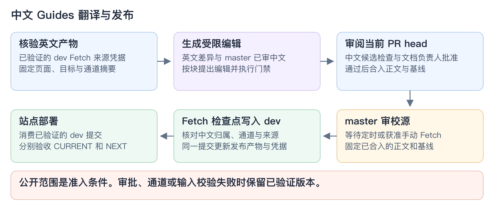
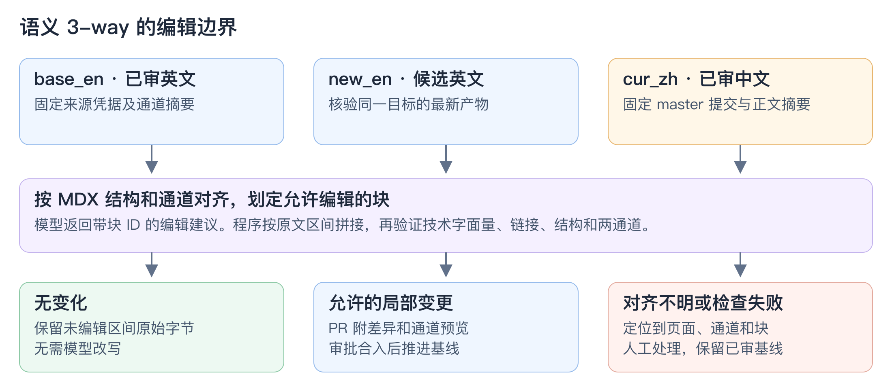
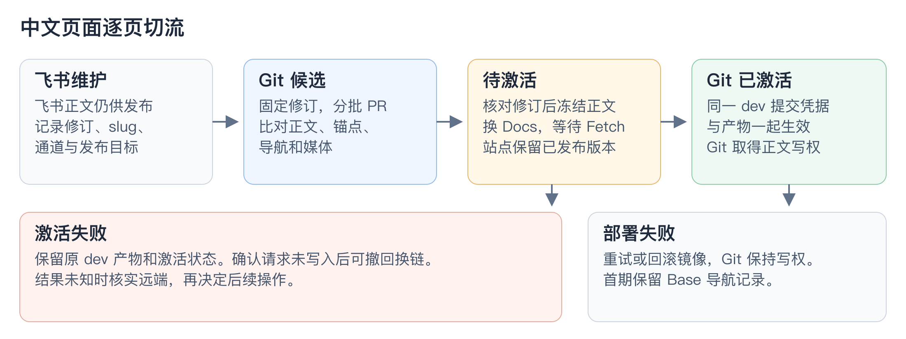

# Zilliz Cloud 中文 Guides 翻译与发布设计

中文 Guides 正文逐页从飞书迁入 zdoc。文档工程师在 GitHub 审校中文，模型根据已采用的英文版本起草局部更新，Fetch 将已激活页面组装并发布到 dev。首期保留飞书的导航与切流开关。本文定义实施和验收契约。中文路由、校验和分支保护须在试点中验证，通过后才允许生产激活。

## 1. 生产准入

| 必须满足 | 实施约定 | 验收证据 |
|---|---|---|
| 文档工程师审批当前版本 | 为 `localized-docs/zh-CN/guides/` 配置文档团队 CODEOWNERS，并在 `master` 分支保护或规则集中强制代码所有者审批和中文候选检查。候选代码、审批和检查均绑定当前 PR head。推送审阅相关变更后撤销旧审批并重跑检查。机器人无合并或绕过权限。手写修订、迁移导入与 Promote 中的中文变更同样受保护。 | 未获文档团队批准、旧 head 已批准、候选检查失败、机器人尝试合并四种情形均无法合入。机器人开 PR 和追加提交后，必需检查能在相应 head 上启动并回报结果。 |
| 通道完整性 | 使用 `<NextChannel action="include">` 和 `<NextChannel action="exclude">`，由程序构造或保留边界。校验块归属，并验证 CURRENT 与 NEXT 的实际站点输出，详见第 4 节。 | 属性错误、块换位、未闭合、遗漏整页通道和代码指令错置均被拦截。故意置入的 NEXT 哨兵在 CURRENT 可见输出中缺失，在 NEXT 预期位置出现。 |
| 可提前公开 | zdoc 是公开仓库。共享镜像将 NEXT 正文随浏览器 JS 交付，中文搜索索引还可能显示 NEXT 整页标题。页面所有者须确认正文、媒体和审校材料均可提前公开，才能进入这条流水线。需保密的内容使用受限来源与独立预览产物，按批准的数据范围处理。 | 敏感内容在进入公开分支、PR、日志、产物、媒体存储或模型请求前被拦截。对需要保密的预览产物做独立发布验证。 |

当前 zdoc 的 `master` 尚未强制文档负责人审批。现有 `shared-docs-validate` 和 `site-validation.yml` 的 master PR 路径也不能为中文候选提供所需覆盖。新增必需检查由受信任的工作流对拟合入的中文稿运行只读生成、通道检查和中文站点验证，并校验相关英文输入仍有效。候选检查不授予 PR 内容生产凭据。可以用受限 GitHub App 自动触发检查，或使用显式派发并验证检查回报的 SHA。发布前必须选定一种方式并验证真实分支保护下的通过与拒绝路径。

[GitHub 分支保护](https://docs.github.com/en/repositories/configuring-branches-and-merges-in-your-repository/managing-protected-branches/about-protected-branches) · [zdoc 通道运行手册](https://github.com/zilliztech/zdoc/blob/master/runbook/release-channel-gating.md)

## 2. 数据流与所有权

图 1 · 英文输入、中文审校与 Fetch 发布

| 阶段 | 权威输入及写入边界 |
|---|---|
| 英文输入 | 共享页读 dev 上已验证的英文 Fetch 来源凭据及其输出，并按页面和发布目标验摘要。未来 Git 化的 Cloud 独有英文页也接入同一产物契约。 |
| 中文审校 | `master:localized-docs/zh-CN/guides/<page-id>/index.md` 保存中文版，旁边的 `.baseline.json` 记录其已审英文基线。稳定页面 ID 独立于文件路径、标题和站点 slug。活动 PR 只写入受控的候选分支。 |
| 中文发布 | 下一次定时或获准手动运行的 Fetch 固定 master 输入和 dev 基线。按中文 Base 记录与已提交的中文激活状态选择来源，将通过校验的产物和来源凭据写入 dev。部署消费已验证的 dev 提交。 |

`localized-docs/` 位于 `devOwnedPaths` 外，随现行 `sync-master-tooling-to-dev.yml` 同步。dev 的 `content/zh-CN/`、生成导航和发布状态仍由发布流程写入。中文草稿任务不持有 `docs-production-dev` 锁。master 合入会触发现有同步，同步、Fetch 与翻译发布共用生产队列。试点记录同步及发布等待时间，避免每个翻译 PR 合入后额外触发一次生产 Fetch。

`translate-codex.yml` 与 `publish-translation.yml` 继续使用现有选集和写入路径。首期中文迁移选集排除 Guides 首页、`content/zh-CN/guides/tutorials/tools/` 和 Reference。必须以实际生产者、发布者及恢复路径的写入集合验证隔离，其中 `zh-CN-reference` 仍有 Guides tutorials 路径映射。中文入口可以复用内容保护与 MDX 解析，中文 Guides 的审批基线、来源凭据和校验独立于自动 Translation 的状态。

[分支所有权契约](https://github.com/zilliztech/zdoc/blob/master/deploy/contracts/master-tooling-sync.json) · [英文发布交接设计](../design/05-publish-handoff.md)

## 3. 英文基线与语义 3-way

图 2 · 语义 3-way 的输入及编辑约束

### 3.1 输入身份与基线推进

| 输入 | 取值及核验 |
|---|---|
| `base_en` | 上次审校接受的英文产物。按 `.baseline.json` 的英文 dev 提交、来源凭据、输出路径、手册与 CURRENT/NEXT 投影摘要取回原文。来源凭据须可复核其锁定的生成输入。 |
| `new_en` | 本次扫描选定的、已有有效发布凭据的英文产物，带完整提交 SHA 和同一组产物身份。共享页可能同时输出 Guides 和 BYOC，必须显式声明每个中文目标对应哪份英文输出。首期一个中文页面绑定一个经确认的英文目标。 |
| `cur_zh` | 本次生成固定的 master 提交中的已审中文。记录正文摘要，并与基线声明的中文摘要比对。已有活动 PR 的人工修改按第 5 节处理。 |

`.baseline.json` 记录 schema 版本、页面 ID、目标映射、每个通道的英文来源身份、已审中文正文摘要，以及英文块到中文块的对应关系。发布凭据另外记录可追溯的 PR、head 和合入提交。这样正文摘要可在合并前核验。缺少有效英文凭据、历史快照无法读取、匹配目标不明、中文摘要不符或仅有旧飞书稿时，保留原基线，进入人工对齐。

建仓时记录飞书导出修订与摘要，并审核英文对齐情况。已对齐的部分建立基线，历史漂移标为待确认，中文独有内容和有意偏离由负责人确认并记录。审核纯中文修订时更新中文摘要，沿用原英文基线。只有包含对应正文与基线的已审批 PR 合入 `master`，才能推进英文基线。生成草稿、失败、取消及关闭 PR 均不推进。

### 3.2 确定性编辑门禁

1. **划定编辑范围。** 解析三份 MDX，按稳定块 ID 或唯一结构匹配定位变化。保留语言与通道归属。列表、表格、提示框和代码组按结构整体处理。格式归一只允许白名单中的非语义差异。数字、单位、否定、默认值、参数、链接目标及代码变更必须显式进入审阅。
2. **提供上下文，限制模型输出。** 给模型变更块、必要的相邻上下文和中文术语。输出限于带块 ID 的增、删、改或移动提案。拆并段、标题重命名、多个候选匹配、跨段指代不明或中文独有内容受影响时，标记为人工处理。正文作为数据传入，模型输出不得执行代码或写入仓库。
3. **按原文区间拼接并复核。** 程序对照 `cur_zh` 的原始字节，只应用获准区间的变更，并核验其余区间逐字保留。保护占位符、链接、资源、锚点、代码、JSX 与 front matter。结构或技术字面量确需更新时，使用明确的变更记录并经人审。校验变更块的通道归属、实际渲染和上下文完整性。
4. **失败时冻结候选。** 来源摘要冲突、越界编辑、非法结构或对齐不明时，保留已发布内容与基线，生成定位到页面、通道和块的报告。候选检查对当前 PR head 重跑，人工修订也经同一检查。

例如英文把免费集群的集合限额从 5 改为 10。报告应显示数字变化，中文只更新对应句，已有的“免费集群”“集合”和相邻段落原样保留。

## 4. 通道与 Promote

### 4.1 CURRENT 与 NEXT

- `action="exclude"` 只在 CURRENT 显示，`action="include"` 只在 NEXT 显示。CURRENT 块的英文输入和对应已审中文均未变时，逐字复用。CURRENT 热修单独生成并审核，当前修正与未上线的 NEXT 内容保持隔离。
- 模型不生成通道边界。门禁核验块 ID、通道、顺序与结构位置，区分成对变更、单侧增删及作者手写块。拒绝 `variant`、非法嵌套、未闭合、包错正文，以及整页 NEXT 或 RETIRE-IN-NEXT 与冗余块门禁混用。中文独有块同样要有明确通道归属。
- 分别验证两份站点视图。检查正文、导航与锚点、TOC、代码显示及复制行为，以及 CURRENT 的静态 HTML、Markdown、描述和 `llms.txt`。整页 `Release Channel` 另行核对。对中文搜索标题和共享 JS 的已知残留按第 1 节的公开范围约束处理。

### 4.2 Promote 的交接

1. 提升候选从 `lock.yaml` 固定拟采用的英文 `next`，按 [04](../design/04-channels-and-lock.md#提升) 的规则重建目标手册和通道。对照已审中文 NEXT 对应的英文产物及投影摘要，确认是同一拟发布版本，并检查候选提升结果的差异。仅锁文件 SHA 相同不足以通过，Cloud 规则、片段或资源也可能变化。
2. 同一次提升提交保留已审的中文 NEXT 正文，解包由生成器添加的 `include`，删除对应的旧 `exclude`。作者手写的通道块只随对应功能的显式发布决定移除。检查两个通道的锚点与入链。整页 NEXT 要上线时，由负责人在同一次发布中协调 Base 的 `Release Channel`，Fetch 核对实际值后才发布该中文提升。
3. 英文 `next` 推进、无对应中文批准、Base 通道提前变化或候选验证失败时，保留上次已验证的中文产物和通道状态，并报告阻断原因。英文若可独立发布，记录中文暂缓。要求双语同时上线的页面由发布负责人等到两边证据齐全后再放行。Fetch 使用已固定的输入重验，通过后在同一个中文检查点提交中更新正文、导航、通道和来源凭据。

[04 的双版本生成和提升规则](../design/04-channels-and-lock.md) · [zdoc 通道运行手册](https://github.com/zilliztech/zdoc/blob/master/runbook/release-channel-gating.md)

## 5. 滚动 PR 与日常审校

工作日北京时间 09:30 扫描，也可手动指定页面进行补跑或热修。扫描从上次成功位置继续，并对尚未处理成功的页面保留待办。定时和手动使用同一并发与去重规则，按页面、目标和输入产物摘要去重。周末、延迟或中断后补扫。相同输入复用已有候选，正文和基线无变化时不产生新提交。

| 情形 | 必须发生的行为 |
|---|---|
| 新变更且无活动 PR | 每个稳定页面 ID 至多一个活动翻译 PR，分支采用 `translate/zh-guides-<page-id>`。报告列出英文输入身份、中文改动、两通道预览、需人工确认事项。 |
| 英文再次更新，或 master 上有新的中文修订 | 固定最新已审的三个输入，重算增量并对照现有 PR 的人工修订。按页面串行，在预期旧 head 仍匹配时追加提交。保留无冲突的人工修订。重叠或无法证明互不干扰时暂停自动写入，由审校人合并。保留已有提交历史。 |
| 生成期间 head、基线、Promote 状态或相关英文产物变化 | 旧结果不得写入，也不能作为当前版本的通过证据。重新核对相关输入，生成新候选，并在最新 head 重跑必需检查、重新审批。合入时检查相关输入仍有效。 |
| 页面重命名、下线或链接跨页联动 | 重命名沿用页面 ID，显示路径、导航和链接差异。下线后停止生成更新，由负责人处理活动 PR。相互依赖的页面使用同一 PR 或同一受控发布批次，记录依赖原因。 |

仅当中文 PR 已通过第 1 节的必需检查并由文档负责人批准，才进入 master 的审校源。09:30 出稿及审校耗时作为试点指标，发布时延另计 Fetch 和部署。

[06 的滚动 PR 和跨页依赖规则](../design/06-upstream-changes.md#每页一个滚动更新的-pr)

## 6. 逐页切流与 Fetch 接线

图 3 · 中文页面的逐页激活与恢复

| 状态 | 转换条件与可验证结果 |
|---|---|
| 飞书维护 | 飞书是发布来源。记录原 Base 记录 ID、旧 Docs 链接和修订、slug、通道与发布目标。 |
| Git 候选 | 从固定飞书修订导出，按第 3 节对齐并走 PR。只读比较将候选与 dev 当前产物逐目标比较，验证旧飞书入链、锚点别名、导航、中文站点渲染与媒体。文档负责人比对最近一次飞书修订，处理差异并在换链窗口冻结该页正文。 |
| 待激活 | 确认显式 `canonical`、可发布状态和原记录 ID，再把该中文 Base 记录的 `Docs` 改为 `https://github.com/zilliztech/zdoc/tree/master/localized-docs/zh-CN/guides/<page-id>`。该修改是激活请求。Fetch 用固定的 master、dev 和 Base 路由证据重新校验，部署继续使用最近已发布版本。 |
| Git 已激活 | Fetch 只在原 dev 发布前提仍成立时提交。同一个 dev 提交写入中文正文、导航、旧链接与锚点映射、逐页来源凭据和中文 `active.json`，同时将正文写权交给 Git。验证 Git 提交与部署后，停用旧正文编辑。首期继续保留负责导航的 Base 记录。 |

接线借鉴 [05b](../design/05b-cutover-and-ownership.md)，现有 shared-docs 路由和激活记录只服务英文。中文须增加站点限定的 Git 来源类型、独立激活记录和来源凭据。目录 URL 只用于选源，按 Fetch 固定的 master SHA 读取仓库内受控路径，禁止跨站、重复所有者、路径逃逸和符号链接。保持 Base 记录、页面 ID、发布目标与实际写入路径可核对。快照和缓存身份包含已审批中文及所需资源的摘要。飞书记录无变化而 Git 正文、配套资源或归属变化时，也要重新生成或核验。中文候选还要贯通媒体处理、表格渲染、组装、检查点、发布和恢复。凭据至少记录使用的 master/dev 提交、Base 记录与通道、正文、导航及媒体摘要和 Fetch 运行 ID。

激活前的失败保留原 dev 产物及状态。若要撤回请求，先确认旧请求已结束且未写入，再由负责人恢复原链接和编辑权。结果未知时停下并核实远端。激活后的全量抓取、缓存恢复与删除流程均须遵守 Git 写权。误改链接、删记录、重命名或拟下线时按归属保护处理，修复记录或走受控下线路径。部署失败走现有重试或镜像回滚，编辑权仍归 Git。逐页验证可独立完成，任何新步骤都不得持有生产队列锁去等待另一个生产写入任务。

## 7. 实施顺序与试点验收

1. **完善门禁，做三页只读试点。** 选一页普通更新（如 `delete-entities` 中经确认可对应的中文页）、一页双通道且有 CURRENT 热修的页面、一页有飞书历史锚点与媒体的页面。验证未授权区间逐字保留，覆盖错放通道块、拆并段、热修、提升、人工与机器人并发编辑及旧审批。
2. **验证真实 Fetch 交接。** 补齐代码到测试矩阵与路径过滤，运行变更选择器给出的测试、中文站点构建及发布契约测试。先用 `group=guides`、`publish=false`、`run_translations=false`、`media_upload_mode=skip` 验证只读候选，再用真实保留的 Fetch 检查点与隔离 bare remote 回放，记录固定输入、产物摘要和终态。覆盖冷热缓存、飞书未变但 Git 已变、切流失败、重复激活、重命名、删除保护与已审 NEXT 提升。核对英文、日文和 REST 的写入边界。
3. **分批建仓，小批激活。** 约 89 篇底稿拟分 6～8 批审校入库，激活按每页证据推进。试点通过且部署验收后再扩大批次。测量出稿时间、人工耗时、关键事实漏改、术语一致性、非授权改写、冲突率和同步排队时间，再确定模型与批次节奏。最后退役飞书中文正文编辑，后续导航迁移另行评审。

实现阶段预计新增 `translate-zh-guides.yml` 与中文 Guides CLI，复用现有的内容保护和 MDX 校验能力，并扩展中文 Fetch 与 PR 校验契约。试点必须先证明路由、审校和发布证据连通，再开展生产切流。
