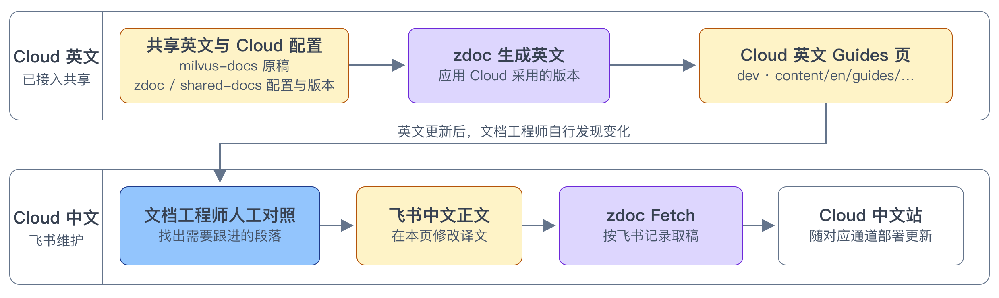

# Zilliz Cloud 中文 Guides 改造方案

**草案 · 待文档团队评审**

今天，Cloud 英文 Guide 改了一条操作说明，负责中文版的文档工程师要自己发现变化，找到飞书里的那一页，再决定怎么改。下一位同事接手时，很难看出中文上次审到了哪一版英文。

我们建议把中文正文逐页迁到 Git。**已切换的页面，文档工程师在 GitHub 审中文；仍由飞书维护的页面，继续在飞书改。** Cloud 采用新的英文后，工具给该页负责人开一个审校请求（PR），列出英文变了什么，并用模型在现有中文上起草修改。负责人可以改稿、批准或暂缓。批准的稿件随对应站点部署上线。

## 1. 改《删除 Entity》时，我该打开哪份文件？

这篇 Guide 的英文与 Milvus 共享。共同的操作步骤在 `milvus-docs` 改。Cloud 在 zdoc 的 `shared-docs` 中选择采用的英文版本、配置 Cloud 差异，按需补写专用英文片段。目前，负责中文版的文档工程师要自己对照生成的 Cloud 英文，再改飞书正文。[Delete Entities 的共享原稿](https://github.com/milvus-io/milvus-docs/blob/3e6b7499cbfcb6b5a365fb1f084a74836f625fc2/site/en/userGuide/insert-and-delete/delete-entities.md) · [Cloud 的页面配置](https://github.com/zilliztech/zdoc/blob/7ee39054f37047b586ad789d876b2047c6f2c465/shared-docs/guides/pages/delete-entities/page.yaml)



**翻译时看 Cloud Guides 实际采用的英文。** Delete Entities 的同一份共享原稿会生成 Guides 和 BYOC 两份文件。负责中文 Guides 就打开对应版本的 **Guides 英文文件**，其中已经包含这本手册使用的产品名、示例和链接。[查看 Guides 英文](https://github.com/zilliztech/zdoc/blob/5a62906a45a4e3250c619a5efcfa4de3f83a8eb6/content/en/guides/tutorials/development/insert-and-delete/delete-entities.md) · [查看两份英文的生成记录](https://github.com/zilliztech/zdoc/blob/5a62906a45a4e3250c619a5efcfa4de3f83a8eb6/generated/en/manifests/shared-pages/guides/delete-entities.json)

**改中文时看迁移清单上的编辑入口。** 拟为每篇接入的中文建一个目录。假设团队确认《删除 Entity》的中文页面 ID 为 `delete-entities`，切换后就到 zdoc 的 `master` 分支改这个文件：

```text
localized-docs/zh-CN/guides/delete-entities/index.md
```

打开 `index.md` 就能看到整篇《删除 Entity》，包括标题、操作步骤、代码和链接。只想修一个中文术语，也可以直接给这个文件提 PR。Fetch 是 zdoc 的取稿流程；页面切换后，它负责把已审中文送入 `dev` 分支，供中文站部署。


<details>
<summary>为什么中文放在 localized-docs？日文为什么放在 i18n？</summary>

日文随英文站构建，`i18n/ja-JP/` 存放日文翻译流水线的产物。中文有独立站点，从 `content/zh-CN/` 构建。按 zdoc 的分支约定，这两处发布内容都由 `dev` 管理。方案在 `master` 新增 `localized-docs/`，让文档工程师在固定位置维护已审中文。[站点与目录分工](https://github.com/zilliztech/zdoc/blob/1ceb4eb30e49c105634d313ee374b491b0eb3007/README.md#L169-L188) · [分支所有权契约](https://github.com/zilliztech/zdoc/blob/1ceb4eb30e49c105634d313ee374b491b0eb3007/deploy/contracts/master-tooling-sync.json)

</details>

## 2. 第一次接入，怎样把飞书这一页交给 Git？

**选页。** 文档负责人从 `shared-docs/guides/pages/` 已注册且已生成 Cloud Guides 英文的页面中选试点。每选一篇，在迁移清单里记下英文共享页 ID 和手册、对应的中文飞书记录、拟用的中文 ID 和主审。遇到一条飞书记录供多本手册使用，先核对所有发布目标。缺中文的列为“待首译评估”；缺少可核对的英文或有拆页、合页的，保留现有维护方式，等负责人确认。

**给中文页定 ID。** 它是这篇中文在 Git 中的固定目录名，今后改标题或网址都保留。建议中英文一一对应且名称可用时沿用英文 ID；已有不同的稳定中文 ID 或遇到重名时，登记两者的对应关系。这项命名约定待团队确认。

**审第一份底稿。** 方案拟复用 Fetch 读取最新飞书中文，记下修订版本，生成导入 PR。文档工程师打开同一手册的英文逐段核对。例如，在同一次发布提交中，英文删除示例写的是 `red_7025` 和 `purple_4976`，中文写的是 `red` 和 `green`。主审要结合最新飞书稿和示例代码，决定保留哪种写法。确认过的段落记录对应的英文版本，欠译另列待办。**此时即使导入 PR 已合并，正文仍在飞书改。** [核对该版本的英文](https://github.com/zilliztech/zdoc/blob/5a62906a45a4e3250c619a5efcfa4de3f83a8eb6/content/en/guides/tutorials/development/insert-and-delete/delete-entities.md) · [核对同一版本的中文](https://github.com/zilliztech/zdoc/blob/5a62906a45a4e3250c619a5efcfa4de3f83a8eb6/content/zh-CN/guides/tutorials/development/insert-and-delete/delete-entities.md)

**交接编辑入口。** 文档负责人通知大家短暂停改这一页，补齐导出后新增的飞书修改，核对正文、图片和旧链接，再把飞书记录的 `Docs` 链接指向 Git 目录。等 Fetch 的发布记录确认已采用 Git，才把迁移清单的编辑入口改为 Git。部署后，从原网址打开并检查图片和段落链接，通过后将旧稿标为“已迁移”。过渡期导航仍在飞书维护。


若切换结果不明，该页继续停改，负责人核实发布记录。确认尚未接管时，可以撤回请求、恢复飞书编辑；Git 已接管后若部署失败，恢复站点时仍以 Git 为正文编辑入口。

## 3. 下次英文更新，谁审？读者什么时候看到？

**文档工程师审一页的累计变化。** 拟在工作日北京时间 09:30 汇总 Cloud 已采用的更新，补上周末或上次遗漏的变化；急修可按页提前发起。工具比较这页上次审过的英文与本次英文，在 Git 已审中文上拟出修改。PR 给出两版英文的差异、中文改稿和预览，标出数字、限制、命令与链接变化。段落对应不清时交给主审判断，无关段落保留原文。

例如，周一的英文给“按条件删除”加了限制，你已经在 PR 中润色了中文。周二英文又修正示例，打开**同一个 PR** 就能看到新差异及周一的修改。两次修改碰到同一句时，由你处理冲突。最终稿需要重新批准，批准合入后才记为已审；暂缓的页面留在待办中。

| 审过的是哪种修改？ | 读者什么时候看到？ |
|---|---|
| 已上线功能的中文修订 | Fetch 取到已审稿，正式站（Prod）部署成功后可见。同页还有待发功能时，旧操作的急修可单独发布。 |
| 随下一版本上线的新说明 | 先在预发布站（UAT）核对。发版时，发布负责人确认英文仍与已审稿对应，再把验收过的中文提升为当前版（Promote）。Prod 部署成功后可见。 |
| 发版前英文又改了，或中文尚未批准 | 中文保留上一份可用版本，只有预览稿的新页继续隐藏。要求双语同步的页面等两边都通过再发布。 |

公开 PR 和预览只接收可提前公开的内容。需保密的发版说明继续在受限渠道协作。

## 4. 文档团队这次要定什么？

1. **选三篇试点，指定主审和备份。** 普通更新页验证英文连续改两次时能否保住人工润色，并记录审一页用时。待发功能页验证 UAT 有新说明时能否单独修正 Prod。有旧锚点和图片的页面验证切换失败时原网址仍可用、切换成功后原链接仍指向正确段落。
2. **确认每页怎样交接。** 确认中英文的对应关系和 ID 命名约定，安排单页停改窗口，指定负责核实 Fetch 结果、更新清单及验收网站的人。
3. **与发布负责人约定哪些页须双语同步。** 对试点走一次 Promote，确认 Prod 展示 UAT 审过的版本；验收后英文又改时，能指出应暂缓的页面和原因。

试点通过后，约 89 篇存量 Guides 拟分 6～8 批审校入库，仍按页确认切换。Guides 首页、工具教程（`tutorials/tools/`）、Reference 和日文沿用现行流程。Cloud 独有页待能提供可核对版本的英文文件后再接入。

[共享文档改造方案](./proposal.md) · [Phase 1 产品需求](./prd.md) · [中文 Guides 技术设计与验收契约](./design/11-zh-cn-translation-pipeline.md)
