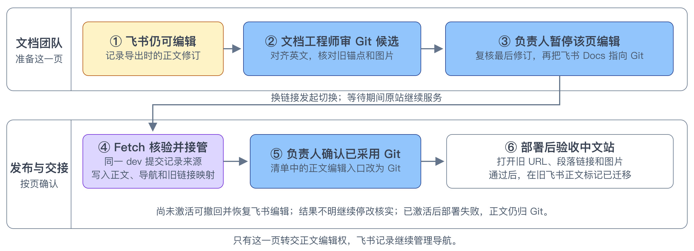

# Zilliz Cloud 中文 Guides 改造方案

**状态**　待文档团队评审。英文共享页已在使用；本文提议逐页迁移中文正文，并引入 GitHub 审校。

当 Cloud 采用一处英文更新时，负责中文版的人应能直接看到这次要审哪几段、哪些中文可以保留，以及批准后读者何时能看到。下面用一篇真实的共享页 **Delete Entities** 说明文档工程师在改造前后怎样工作。文中的英文文件可查，中文迁移和审校流程是拟议方案。

## 1. 今天，英文和中文分别在哪里改？

图 1 · 已接入共享英文、中文仍在飞书维护的一页

**英文已能复用。** 修改 Delete Entities 的通用删除步骤，作者去 `milvus-io/milvus-docs` 改英文原稿；Cloud 团队在 `zilliztech/zdoc` 的 `shared-docs` 里决定采用哪个上游版本、放进哪本手册。若一节只有 Cloud 的操作不同，对应的规则和英文片段也在 zdoc 维护。zdoc 把这些输入组装成 Cloud 英文页。[共享文档改造方案](./proposal.md)

**中文仍需人工跟进。** 负责中文的工程师发现 Cloud 英文有变后，找到飞书多维表格中该页的记录，打开它链接的中文正文，对照英文更新译文。Fetch 按记录取稿，部署成功后读者看到修改。容易漏的是两次英文更新之间又改过的地方，也很难从飞书正文追溯某段中文上次审到哪版英文。

首期面向 Zilliz Cloud 中文 Guides 正文。按页确认中英文对应关系后再接入，Guides 首页、工具教程（`tutorials/tools/`）、Reference 和日文沿用现行流程。飞书在过渡期继续管理导航。

## 2. 改造后，一篇中文 Guide 从哪里来？

图 2 · 共享页从英文原稿到中文上线。黄色是文件，紫色是工具，蓝色是文档工程师的决定；虚线框标出新增的起草与审校环节。

按图中的 ①–④，跟着 Delete Entities 走一遍。

1. **① zdoc 用 Cloud 选定的原稿版本生成英文页。** 这篇的共享原文是 `site/en/userGuide/insert-and-delete/delete-entities.md`。在 zdoc 的 `master` 上，`shared-docs/guides/pages/delete-entities/page.yaml` 指定原稿和目标手册，同目录的 `lock.yaml` 固定采用的版本。Milvus 合入更新后，Cloud 可以先审上游更新 PR，再决定何时采用。[共享英文原文](https://github.com/milvus-io/milvus-docs/blob/3e6b7499cbfcb6b5a365fb1f084a74836f625fc2/site/en/userGuide/insert-and-delete/delete-entities.md) · [Cloud 页面配置](https://github.com/zilliztech/zdoc/blob/7ee39054f37047b586ad789d876b2047c6f2c465/shared-docs/guides/pages/delete-entities/page.yaml) · [采用版本](https://github.com/zilliztech/zdoc/blob/7ee39054f37047b586ad789d876b2047c6f2c465/shared-docs/guides/pages/delete-entities/lock.yaml)
2. **② 翻译依据是目标手册实际生成的 Cloud 英文文件。** 这篇共享原文生成了 Guides 和 BYOC 两份不同的英文。中文 Guides 对应的是 zdoc 的 `dev` 上已验证版本中的 `content/en/guides/tutorials/development/insert-and-delete/delete-entities.md`。打开这份文件，看到的才是该手册采用的产品说法、示例和链接。即使上游文件名相同，也要核对手册和生成版本。[这次生成的 Guides 英文文件](https://github.com/zilliztech/zdoc/blob/5a62906a45a4e3250c619a5efcfa4de3f83a8eb6/content/en/guides/tutorials/development/insert-and-delete/delete-entities.md) · [两份英文输出记录](https://github.com/zilliztech/zdoc/blob/5a62906a45a4e3250c619a5efcfa4de3f83a8eb6/generated/en/manifests/shared-pages/guides/delete-entities.json)
3. **③ 工具在已审中文上起草本次改动。** 第一次接入时，文档工程师从飞书导入中文，核对它对应哪份英文，标出历史欠译和中文独有的说明。此后，每次都比较这页上次审过的英文与这次已采用的英文，只在当前中文底稿上提出必要的修改。找不到旧英文时，先请工程师补做对齐。遇到段落重组或前后指代不清，工具标出受影响的位置，由审校人决定怎样改。
4. **④ 中文由文档工程师在 GitHub 审校。** 拟在 zdoc 的 `master` 上用 `localized-docs/zh-CN/guides/<页面 ID>/index.md` 保存已审中文。若试点确认此页的中文 ID 为 `delete-entities`，它的编辑入口就是 `localized-docs/zh-CN/guides/delete-entities/index.md`。工程师在 PR 中修改、批准或暂缓。该页完成切换后，Fetch 才从这里取稿，写入 `dev` 的 `content/zh-CN/` 供站点部署。

所以，只改中文术语时，已切换的页直接改 `localized-docs`。要改 Cloud 采用的英文内容才回到英文编辑源。对于 Cloud 独有页，英文由 Cloud 作者维护；等它能提供同样可核对的英文文件和版本，就能从图 2 的②接入翻译。

## 3. 英文再次更新，谁审？什么时候上线？

**工作日，文档工程师审一页的累计改动。** 拟于工作日北京时间 09:30 汇总自上次成功处理以来的英文变化，按页给负责的工程师开一个滚动 PR。周末积累的变更一并补上，急修可按页提前发起。待审项列出负责人、英文改动摘要、中文差异、预览和需要判断的段落。

以 Delete Entities 做一个验收演练：假设英文为“按条件删除”补了一条适用限制，工程师已在 PR 中润色译文。这时英文又修正了同节的示例。

- **打开原 PR**，应能看到新增限制、修正的示例和两次改动的累计结果。数字、否定、命令和链接目标的变化都要能看见；无关段落的已审措辞逐字保留。
- **继续审稿**，先前的人工润色应仍在。若新示例影响了正在改的句子，工具停在冲突处，交由工程师决定。最终稿变化后重新审批。仅在获批合入后，才把这次英文记为已审；暂缓或关掉 PR 的页面下次仍能找到。
- **只需修中文**，工程师也可以直接改这页的中文编辑源。经审校合入的措辞成为下一次的底稿，上次已审的英文版本沿用。

**合入后，普通修订随站点部署生效；新功能先在 UAT 验收。** 对已切换的页，Fetch 采用已审稿后，文档工程师在预发布站（UAT）核对页面。若上述示例只适用于下一版本，当前正式站（Prod）继续提供原操作。此时若旧操作需要急修，可单独审校、发布该处更正，同时核对 UAT 的待发内容。

**发版时，由发布负责人确认 Promote（将已验收的下一版升为当前版）。** 确认拟发布英文与中文审校所依据的版本仍相符，再把 UAT 已审的中文随本次发版提升。部署成功后，读者在 Prod 看到这份说明。英文在验收后又变，或中文尚未获批，就保留上一份可用中文，只有预览版本的新页继续隐藏。要求中英文同步发布的页面等两边都就绪。公开 PR 和预览只承载可提前公开的内容，保密材料沿用受限渠道。

## 4. 什么时候停止在飞书改这一页？

图 3 · 一页一次交接。迁移清单显示负责人、当前编辑入口和切换状态。

1. **准备候选稿时，照常在飞书编辑。** 文档工程师记录导出修订，审校 Git 中的中文候选，对照当前站点核对正文、图片、导航和旧链接指向的段落。候选 PR 合入后，原发布流程仍从飞书取稿。
2. **申请切换时，只暂停这一页。** 文档负责人通知编辑者暂停，复核飞书最后一次修订；有新改动就补入候选并重新验收。然后把原飞书记录的 `Docs` 链接改为这页的 Git 目录。此时状态为“等待切换确认”，站点继续服务，编辑者暂缓写入两边。
3. **Fetch 确认采用 Git 后，在清单中把编辑入口切到 Git。** 负责人应能查到该次发布记录，确认同一次提交已经接管这页的正文、导航和旧链接映射。部署后打开原 URL 和旧段落链接，检查图片，验收通过再给旧飞书正文标记“已迁移”。飞书记录继续管导航。
4. **切换异常时，先查谁持有正文。** 确认尚未激活，可撤回请求、恢复原链接并通知大家继续改飞书。结果不明时，保持单页停改并查发布记录。Git 已接管后若部署失败，按现有机制恢复站点，后续正文仍在 Git 修改。

## 5. 怎样决定可以扩大迁移？

先挑三页：一页普通更新（可从 Delete Entities 核对中英文对应关系），一页同时有待发功能和正式站急修，一页带飞书旧锚点和图片。由实际负责该页的人完成下面的验收，再决定是否扩大批次。

| 谁来验收 | 要能当场演示什么 |
|---|---|
| 文档工程师 | 从待审项找到对应的 Cloud 英文；同页英文再改一次，能在原 PR 看清新增差异、保留人工修订。记录审一页用时和需要手工补改的位置。 |
| 发布负责人 | UAT 有下一版说明时，Prod 可以单独修错；Promote 后 Prod 显示验收过的版本。若英文在验收后变化，可以指出暂缓的是哪一页、原因是什么。 |
| 文档负责人 | 对照迁移清单找到唯一编辑入口；演练一次切换未成功，原 URL 仍可访问；成功后旧锚点和图片可用，旧飞书正文的修改不影响网站。 |

试点通过后，拟将约 89 篇存量 Guides 分 6～8 批审校入库，再逐页确认切换。对齐会上请文档团队确定试点页、主审和备份、单页停改窗口，并与发布负责人明确哪些页面要求双语同步上线。

[共享文档方案总览](./proposal.md) · [Phase 1 产品需求](./prd.md) · [中文 Guides 技术设计与验收契约](./design/11-zh-cn-translation-pipeline.md)
