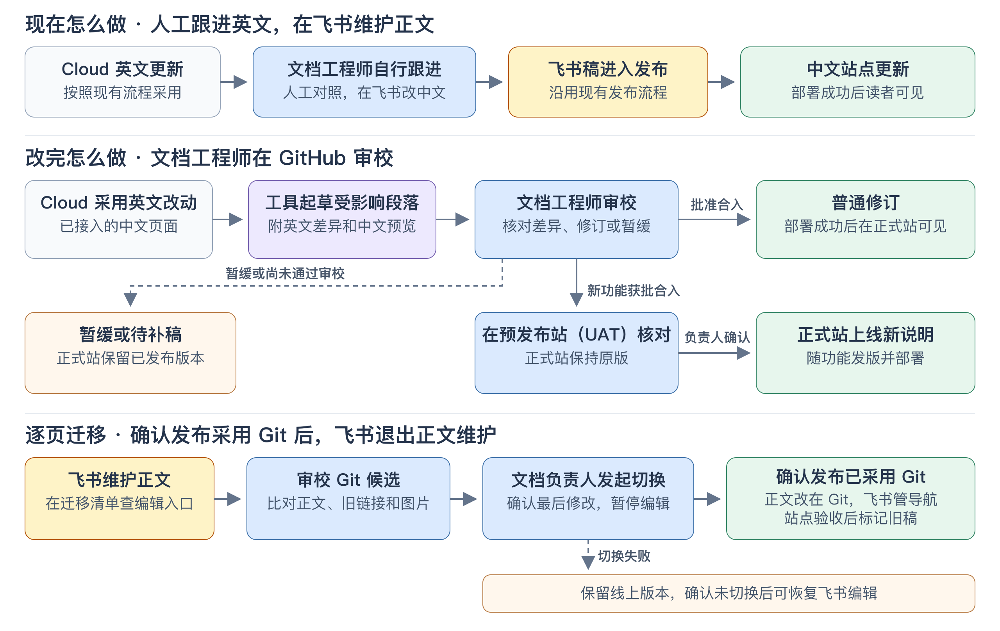

# Zilliz Cloud 中文 Guides 改造 · 产品需求

**状态**　草稿，供文档团队对齐。

## 1. 现状与目标工作流

Cloud 采用新的英文内容后，文档工程师需要主动发现改动，到飞书找到对应段落，再手工更新。这个过程中容易漏掉参数、限制或操作步骤。若每次重翻整页，已经审过的术语、中文独有的示例和人工润色也容易被覆盖。

改造后，已切换的中文页面在 Git 维护。工具根据 **Cloud 已采用的英文改动**，用模型起草受影响的中文段落，文档工程师在 GitHub 审校并决定采纳、修改或暂缓。中文合入后，仍按现有发版节奏上线。飞书按页退出正文维护，过渡期继续管理导航。

图 1 · 日常更新的前后对比，以及飞书正文逐页交接

## 2. 首期范围与角色

首期验证三件事：文档工程师能从英文改动直接进入对应的中文审校，已审过的中文能保留，已迁移页面能在不影响读者访问的情况下改由 Git 维护。范围是 Zilliz Cloud 中文 Guides 正文。飞书导航、日文及 Reference 沿用各自现有流程。

| 角色 | 负责的决定 |
|---|---|
| 文档工程师 | 核对事实和措辞，决定中文草稿如何改、是否可以合入，对中文有意保留的差异作说明。 |
| 文档负责人 | 确定试点页面、安排逐页切换、确认正文编辑入口，并更新迁移清单。 |
| 发布负责人 | 确认发版时用的是 UAT 已验证的中文，处理中文未就绪及要求中英文同步的页面。 |
| 工具 | 发现已采用的英文变化，提供中文草稿、可审阅的差异和预览，提示需要人工判断的内容。 |

## 3. 文档团队的四个工作场景

### 场景 1｜审核英文带来的中文更新

**谁来做**　负责该页的文档工程师。

**用户故事**　我希望看到这一页的英文到底变了什么，以及中文跟着改了哪里。我只审受影响的内容，可以继续保留已校对的表述。

**怎样操作**

1. 工作日上午看待审列表。工具按页汇总 Cloud 已采用的英文更新。每条待审项应有页面名、改动摘要、负责审校的人和对应 PR。日常一般一页一条 PR，有链接或发版依赖的页面可以一起审。
2. 在 PR 中查看旧英文、新英文、拟修改的中文和页面预览。数字、默认值、限制、命令和操作步骤的变化要醒目标出。碰到中文独有的说明、段落重排或无法对应的旧译时，结合上下文手工调整。
3. 确认可以采用时，批准最终稿。需要修改时，在原 PR 修订后再批准。暂缓时注明原因，页面继续使用已发布的版本。

**系统行为**

- 只有 Cloud 已采用、且能对应到本次范围内中文页面的英文变化才进入待审。未接入的页面照现行方式维护。待审和暂缓的更新都应可继续查到。遇到整理延期或失败，恢复后补上此前未处理的变化。
- 草稿保留未受影响的已审中文。无法确认对应关系时，列出需要复核的位置，由工程师决定是否改以及怎么改。审校人可以保留适合中文读者的说明和示例。
- 同页英文在审阅期间再变，沿用原 PR 并标出这次新加的变化。保留人工修改。若两次修改碰到同一处，工具提示冲突，由审校人处理。最终稿发生变化须重新批准。

**验收例**　假设英文把免费集群的集合限额从 5 改到 10。PR 要展示原限制、新限制和对应中文。对于确实不受影响的段落，原有用词和说明逐字保留。如果另一段也引用了旧限额，应提示工程师一并复核。

### 场景 2｜直接修中文，或紧急修正线上说明

**谁来做**　发现问题的文档工程师和该页的审校人。

**用户故事**　我发现中文版有错字、过期的示例，或正式站有一个误导用户的步骤，希望直接修正，不必等英文改动或下一次例行整理。

**怎样操作**

1. 先查迁移清单。仍由飞书维护的页面按原流程处理。已切换的页面在 Git 提交中文修订，注明要更正的问题。
2. 线上急修单独说明需要修复的正式站内容，按页发起，并请审校人核对和批准。急修来自已采用的英文改动时，可提前为这一页生成草稿。
3. 合入后走现有发布流程。部署成功后，检查正式站上的实际修订。

**系统行为**

- 纯中文修订可以独立审校和发布。后续英文更新时，这次已经审过的修订仍是中文底稿的一部分。
- 正式站急修可以独立发布。若同页已有在预发布站（UAT）等待上线的新功能说明，急修只改变正式站需要改的内容。预发布说明仍按自己的发版节奏上线。

**验收例**　某页已经在 UAT 展示新操作，但 Prod 的旧操作有个错误参数。审校人可以批准旧操作的更正。部署后 Prod 显示正确参数，仍看不到新操作。

### 场景 3｜发版时确认哪份中文可以上线

**谁来做**　文档工程师核对 UAT，发布负责人确认上线。

**用户故事**　我希望功能发布前能看到完整的中文预览，也能在发版时确认正式站将显示的就是那份审过的说明。

**怎样操作**

1. 在 GitHub 审过新功能的中文稿。合入并部署到 UAT 后，核对页面正文、导航和相关链接。功能发布前，正式站（Prod）继续提供原说明。
2. 发版时，发布负责人确认要上线的中文与 UAT 验收稿一致，并确认这次要发布哪些页面。功能发版且对应文档部署成功后，读者才在 Prod 看到新说明。
3. 如果发版时中文还没审过，或英文在验收后又改了，负责人应能看到哪些页面还欠哪一步。拟默认保留上一份可用中文。要求中英文同步的页面须等两份稿均通过审校，并与功能发布安排对齐。

**系统行为**

- PR 通过、UAT 可预览以及 Prod 已上线是三个不同的结果。文档团队能知道一页到哪一步，并找到对应稿件。
- 英文说明仍仅用于预发布时，对应中文也只进入预发布。正式发布使用与这次功能版本相符、已获批准的中文。校验未通过或确认尚未完成时，继续提供上一份已上线内容。部署失败时，按现有发布流程保留或恢复上线版。对于只有预览版本的新页面，正式站继续隐藏。
- 只允许可提前公开的材料进入公开 GitHub PR 和现有预览流程。仍需保密的说明继续在受限渠道协作。

**验收例**　工程师已验收中文预览，发版前英文说明又新增一条限制。发布负责人能看到中文尚待复核。该页不会因为之前审过旧稿，就把旧稿当作这次发版的已验收中文。

### 场景 4｜把一页从飞书切换到 Git

**谁来做**　文档工程师审候选稿，文档负责人发起并验收切换。

**用户故事**　我想把一页逐步交给 Git 维护，确保期间没有人改错位置，也不丢掉最近的飞书修改、旧链接或图片。

**怎样操作**

1. 从飞书导出中文。文档工程师核对它与现有英文的对应关系，把中文独有的说明和仍待补对齐的地方标出来。走 PR 审过这份候选稿。准备期间正文仍在飞书维护。
2. 文档工程师把 Git 候选与当前网站对照，核对正文、图片、导航和旧链接指向的段落。文档负责人确认最近一次飞书修订已带入，通知相关编辑者暂停修改该页，然后发起切换。
3. 等待发布确认采用 Git 后，文档负责人把迁移清单的编辑入口改为 Git。站点验收通过后，将旧飞书正文标为已迁移。飞书仍用于管理导航。

**系统行为**

- 迁移清单至少显示页面、负责人、当前编辑入口和状态。状态能区分飞书维护、候选审阅、等待切换确认及已切换。候选稿被合入后，只有发布确认采用 Git，正文入口才切换。
- 切换失败时继续提供原网站内容。负责人可以修正后重试，或在确认未切换后恢复飞书编辑。结果未确认时继续暂停该页编辑，并核实发布结果。
- 确认 Git 已接管以后，旧飞书正文的改动不能覆盖网站。若后续部署失败，按现有流程重试或回滚站点，正文继续在 Git 维护。

**验收例**　某页有其他页面指向它的段落，也有嵌入图片。候选稿如果遗漏其中一个链接目标，切换应停住，原页面继续可用。修复并验证切换后，旧链接仍到达正确段落，图片正常显示，同事从清单知道要去 Git 改正文。

## 4. 试点与分批迁移

先用三类页面走完上述场景。普通变更页验证从英文更新到人工批准。双通道页验证新功能先预览，以及它等待上线时仍能修正正式站错误。有飞书历史链接和图片的页面验证切换与恢复。试点应有一次真实的审校修改、一次英文在审校期间再次更新，以及一次失败后页面仍可访问的演练。

试点验收时，请实际参与的工程师记录处理一页所需时间、需要手工补改的内容和遇到的冲突。文档负责人核对审校后的正文、通道行为、切换记录和线上链接。试点验收通过后，再安排现有约 89 篇 Guides。拟分 6～8 批审校导入，逐页确认后切换。审校批次和切换批次可以不同。

## 5. 本次对齐会上要确认的决定

1. **待审分工和急修。** 确定谁接收工作日待审列表、如何安排主审和备份、由谁发起并核对急修。工作日集中出稿是首期提议，具体时段看团队的审校习惯。
2. **中文跟不上发版时怎么做。** 确认哪些页面可先保留旧中文，哪些页面要求中英文同步，发布负责人在哪里查看待确认的中文。
3. **试点范围和切换窗口。** 选定三类试点的具体页面和负责人，约定何时通知编辑者暂时停改、谁验收网站、怎样用试点数据决定扩量。

[共享文档方案总览](./proposal.md) · [Phase 1 产品需求](./prd.md) · [中文 Guides 技术设计](./design/11-zh-cn-translation-pipeline.md)
