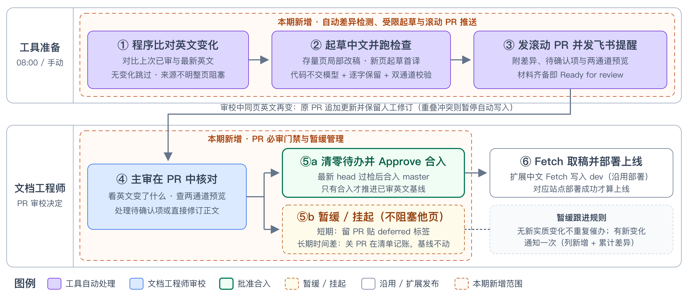

# Zilliz Cloud 中文 Guides 增量翻译方案

**草案 · 待文档团队与工程团队联合评审**

## 1. 为什么改、要做到什么、首期范围

### 为什么改

Cloud 英文文档正在推进共享改造：共享正文在 `milvus-docs` 维护，Cloud 专属配置写在 zdoc 的 `shared-docs/`，英文正文已退出飞书，发布产物落在 zdoc `dev` 分支的 `content/en/guides/`。

但中文文档目前仍留在飞书维护，形成了明显的双轨割裂：文档工程师只能拿 `dev` 上生成的英文正文去人肉对照、修改飞书中文——**既没有版本管理，也看不出中文落后了几个英文版本**；交接时下一位编辑很难分辨哪些差异是欠译、哪些是有意保留的中文写法，术语和文体也缺乏统一约束。


### 要做到什么

改造后，中文 Guides 正文迁入 Git，同步承接 **UAT（预发布）与 Prod（线上正式）双通道**。Cloud 采用新的英文 Guide 后，工具在已有已审中文上起草局部修改，给负责这页的文档工程师开一个按页滚动的 GitHub PR。主审打开它，应能直接回答三个问题：

1. **英文在哪个通道变了什么？**
2. **网站读者在 UAT 和 Prod 分别会看到怎样的中文？**
3. **哪一处还需要我拍板决定？**

**四条落地原则：**
- **人审必经，合入推进基线，部署才算上线**：来源可信且材料齐备即直接请求 review（来源无法确认则整页阻塞）；待确认项清零、最新稿过检并获批准才可合入；只有合入才推进已审英文基线，对应站点部署成功才算上线。
- **代码块不交 LLM 翻译，同时保护中国站定制**：英文侧优先使用地域无关占位符（如 `YOUR_CLUSTER_ENDPOINT`）；中文侧无定制差异的代码块（含英文注释）由程序从英文**原样同步**；涉及域名/地域等固定差异按规则换算；已有页面级人工定制的代码块**绝不强行覆盖**，在 PR 中并排给 diff 由主审决定。
- **建立轻量的术语与风格载体**：在 `master` 维护中文 Guides 术语与风格契约（首期基于现有 `config/translation/zh-CN-reference.json` 提炼，统一用“您”，后续逐步补充），注入 LLM 并在审校中持续沉淀。
- **控制台 UI 词与普通正文隔离**：开源 `milvus-docs` 无控制台界面，UI 界面词只出现在 `zdoc` 侧的 Cloud 定制内容中。建议在 `zdoc` 英文源用轻量语义标签（如 `<UI>Create Cluster</UI>`）标记界面词，翻译时不交 LLM 自由发挥，首期保留原词并在 PR 中集中交主审按中文控制台实况替换，避免与正文普通短语混淆。

### 首期范围

首期聚焦 **`shared-docs/guides/pages/` 共用文档**（其中约 99% 为 `development/` 内核开发文档），包含两个方向：

1. **存量共享页搬迁与增量同步**：将已有飞书中文底稿迁入 Git、对齐最新 Cloud 英文 Guides，并将中文发布源切换至 Git，后续按已审基线走日常局部增量同步；
2. **新增共享页按需注册与首译同步**：`shared-docs` 新增英文页面后，由中文负责人**人工确认中国站需要并登记**，再在 Git 触发整篇首译 PR 审校入库并建立基线，之后统一转入日常增量同步，不再回飞书新建正文。

先从上述两类页面中选择试点（3 页存量页 + 1 页新增共享页或模拟新页首译）。**本期明确不做**：**Cloud 独有文档（Cloud Only）**因英文侧也仍在飞书维护、尚未 Git 化，暂不在本期改造范围内；Guides 首页、`tutorials/tools/`、Reference 和日文沿用现行流程；过渡期目录导航继续由飞书表格管理（新增共享页上线前需在飞书表格登记导航记录）。

## 2. 日常怎么运转：从英文变化到主审决定



### 2.1 一次英文更新怎样进入审校

1. **找变化（对比“上次已审英文”与“最新通过验证英文”）。** 拟在工作日北京时间 **08:30（UTC 00:30）** 自动扫描（刚好承接凌晨 02:00 英文 Fetch 生成的产物，错开上午 10:00 的 Fetch 与巡检高峰；具体时间可在试点微调，急修支持手动按页触发）。
   - **什么是两个对比版本？** “**最新通过验证的英文**”指 `zdoc` `dev` 分支中最新生成并过检的 Cloud Guides 英文正文；“**上次已审的英文**”指上次中文获批合入时绑定的那版旧英文（存量飞书页在首次建仓对齐时建立第一个基准锚点，详见附录）。
   - **存量增量页**：程序先比对同一手册的新旧英文在正文及双通道（Prod / UAT）上的差异；无实质变化（如只改了 BYOC 示例或可忽略格式）直接跳过。周末累积的实质变化一并算起。
   - **新增共享页**：对在清单中由人工确认并登记为“待首译”的新页面，直接读取最新的 Cloud Guides 英文触发首译 PR（与“已接入页基线缺失”严格区分：后者按异常整页阻塞，防止误覆盖人工润色）。
2. **程序定位 + 模型局部起草，保护人工润色与代码。** 日常增量绝非全靠大模型盲猜，而是分三步把控：
   - **程序先划定范围**：工具按标题、段落和代码块对新旧英文做确定性比对，精准圈出真正发生变化的区间，并直接继承英文的 `<NextChannel>` 双通道标签体系（不让模型自行编造通道边界）。
   - **分类起草与保护**：受影响的正文段落连同相邻中文上下文和 Guides 术语表交给 LLM（复用 zdoc 现有 SDK Reference 已跑通的模型调用链路）起草局部中文；**代码块不交 LLM 翻译**（无定制原样同步，有中国站定制则保留并标出 diff 给主审）；**`<UI>` 界面词不交 LLM 自由翻译**，首期保留原词并列入待确认项。遇到段落拆并、指代不清或中文独有说明，**保留原中文文字不删改**（原夹层位置消失时可提议候选位置），列入待确认项。新页首译则参考术语表与相邻页风格起草整篇初稿。
   - **程序回填并核验**：工具将局部译文拼回原中文，逐字节校验未涉及段落是否一字未动、双通道与 MDX 结构是否完整。
3. **备齐材料直接送审 + 飞书群提醒。** 每页至多一个活动滚动 PR。来源可核对且以下三项材料齐备后，工具直接以 **Ready for review** 请求主审，并在每日扫描结束后往文档团队**飞书群发送一条日报汇总**（含当日新开/更新 PR 链接与对应主审），确保不漏审（材料缺失或渲染检查未产出前保持草稿）：
   - **读者正文与评审问题严格分离**：只有面向网站读者的中文写入中文正文文件；审校问题、依据与回复只留在 PR 描述和评论里。
   - **页首交代来源与关键变化**：写明新旧英文版本及 Prod / UAT 各自是否有变，明示数字、限制、代码、链接、步骤有无变化（无变化也写“无”），引用疑点时附前后上下文（含相关代码示例）与英文双通道分段。
   - **附齐检查与双通道预览**：附上绑定当前 PR head 的自动检查状态，以及 UAT / Prod 候选预览（或渲染检查结果）和各通道预期视图。稿件更新后同步刷新。
4. **审校与合入。** 主审在原 PR 内逐项处理待确认项、必要时微调中文正文，满足以下四项条件即可合入 `master`：
   - 全部待确认项已记录结论并清零（未清零时合入检查拦截）；
   - 对应的英文输入仍有效；
   - 当前 PR 最新 head 通过全部必需检查；
   - 获文档团队审批人批准（稿件再变时自动撤销旧审批并重跑检查）。

**支持文档工程师随时直接写中文（人永远是最高编辑权威）：**
- **局部增补与改写**：文档工程师随时可以直接提 PR 修改或新增中文正文（如修正术语、重写表述、补充中国站专属说明），走同一套必需检查和审批合入。合入后已审英文基线沿用不变；下次英文更新时，手写的中文独有内容会被程序保留，若英文改到相邻结构则列为待确认项交主审决定，绝不静默覆盖。
- **中英文差异极大页（手工维护模式）**：若整篇文档的中英文结构或产品逻辑差异极大、不适合自动跟翻，可在接入清单中将其标为“手工维护模式”——文档工程师直接在 Git 编写并提 PR 发布，工具不再对该页自动起草翻译 PR（如需参考英文动态，仅发轻量更新提醒）。

### 2.2 暂缓与时间差怎样处理（不阻塞他页、不留僵尸 PR）

因为是**按页独立 PR**，单页暂缓**不会阻塞其他页面的翻译和发布**，也不妨碍同页单独提一个小 PR 做 Prod 线上急修。针对不同长度的等待周期，暂缓分为两档：

- **短期等待（几天～2 周，如等产品确认文案、等下周中文控制台就绪）**：保留原 PR，贴上 `deferred` 标签，在评论写明**原因**和**跟进人**（**复核日期可选**）。已审英文基线停在上次合入的版本。
- **长期时间差（如海外已发版，但中国站 1 个月以上暂不上线）**：**无需一直开着 PR**——直接关闭该 PR，并在页面清单记为“暂不跟进（原因 + 跟进人）”。因为未合入，已审英文基线仍停在旧版不丢账；待中国站准备就绪时，手动触发一次重新开 PR 即可。

| 短期暂缓期间 | 工具和主审怎样跟进 |
|---|---|
| 英文没有实质变化，也未到复核日期 | 保留原 PR、原因和跟进人，日常扫描**不重复请求 review 或催办**。 |
| 同页英文有新的实质变化 | 在原 PR 单列**“自上次暂缓以来的新变化”**，同时保留**“自上次合入以来的累计变化”**，针对这批新变化**通知一次**。主审可恢复审校、更新暂缓记录点继续暂缓，或转入“关闭 PR 记账”。 |
| 到了复核日期，或等待的条件已经满足 | 到期时工具在原 PR 提醒并重新请求 review；等外部确认时，由跟进人拿到结论后手动恢复审校。 |

### 2.3 异常与并发底线

任何异常、冲突或来源不明，都遵循同一底线：**不静默覆盖已有人工修订，不推进英文基线，不影响线上内容（Prod / UAT）。**

<details>
<summary>展开查看：5 类异常与并发处理明细（英文再变、两人改同一句、基线缺失阻塞、段落对应不清、急修与待发共存）</summary>

| 异常 / 并发情形 | 谁处理、怎么处理 | 已有人工修改会怎样 | 线上内容（Prod / UAT）会怎样 |
|---|---|---|---|
| **审校中同页英文再次变化** | 工具在原滚动 PR 追加提交，标出本次新增差异与累计差异，刷新预览并重跑必需检查；若原 PR 已获批准，自动撤销旧审批，由主审重审。 | 未与新英文变化重叠的人工修订自动保留。 | 不受影响，仍为上次已部署版本。 |
| **两个人改到同一句**（含：英文再变与 PR 内人工编辑重叠；同期纯中文术语 PR 合入 `master` 改到同一句；两名编辑同改一 PR） | 工具检测到重叠或冲突即**暂停自动写入**，在 PR 中标出冲突位置，交由主审手动合并解决后重跑检查和审批；两名编辑同改一 PR 按 Git 冲突处理。 | 全部保留在对应分支或提交历史中，不静默覆盖任何一方。 | 不受影响。 |
| **英文基线缺失或来源不可核实**（找不到上次英文、目标手册不唯一、来源摘要不符） | **整页阻塞。** 工具不开出错误翻译 PR，转而生成一条阻塞待办（列出页面、缺失材料与负责人），由文档负责人补齐或重新确认基线后再起草。 | 保留原 `master` 已审中文与 `.baseline.json` 不动。 | 不受影响。 |
| **段落对应不清**（段落拆并、跨段指代不明、中文独有说明） | 来源可信前提下，在同一个滚动 PR 中交付其余可靠改动，并在待确认项中列出疑点位置、上下文和问题，由主审决定并记录结论。 | 疑点处原有中文文字逐字保留（必要时提议候选位置），不丢失。 | 未清零前合入检查拦截，线上不受影响。 |
| **待发内容还不能进 Prod**（同页既有待发功能，又有线上急修） | 线上急修只修改当前版（CURRENT / Prod）区间并独立审核上线；待发功能留在下一版（NEXT / UAT）区间，不随急修放出。详见第 5 节。 | 两通道的已审中文互相隔离保留。 | 急修部署后仅更新 Prod 对应说明；未获准 Promote 的待发内容继续在 Prod 隐藏。 |

</details>

## 3. 系统怎么接：工具链、归属与改造边界

整体沿用上游英文生产和下游站点部署，只把中间“人工发现变化 → 飞书对照翻译”的环节升级为 Git 内的增量起草、PR 校验与人审。


**两个核心接入点与分支归属：**
- **上游读 `dev`（英文已验证产物）**：工具读取 zdoc `dev` 分支固定提交下的 `content/en/guides/` 正文及生成记录，而不是直接扫 `master` 的 `shared-docs` 提交，确保翻译输入与 Cloud Guides 读者看到的英文完全一致。
- **中文编辑源归 `master`，发布产物归 `dev`**：已审中文保存在 `master` 的 `localized-docs/zh-CN/guides/<中文页面 ID>/`（含正文 `index.md` 与英文基线记录 `.baseline.json`），避开 `dev` 独占的发布目录。页面切换后，中文 Fetch 从固定 `master` 提交取稿，将正文、导航、旧链接映射和来源记录写入同一 `dev` 提交。

**改造边界速览：**
- **沿用**：Cloud 英文生成、现有站点构建与 UAT / Prod 部署、内容保护与 MDX 校验模块、以及现有日文与 Reference 自动翻译流程。
- **新增**：翻译调度工作流（`translate-zh-guides.yml`）、中文 Guides 增量起草 CLI 与受限模型调用、中文 Guides 术语与风格载体（基于 `zh-CN-reference.json` 提炼）、`zdoc` 侧轻量 `<UI>` 界面词组件、**`master` 上的中文候选 PR 检查（含双通道预览/渲染校验）与文档团队 CODEOWNERS 审批保护**，以及一次性飞书底稿导入脚本。
- **扩展**：现有中文 Fetch（为已切换页读取固定 `master` 的 Git 中文，未切换页继续读飞书）。
- **不动**：不修改日文/Reference 的选页与发布规则，不改动 `milvus-docs` 或 `md2md`；翻译任务不持有生产发布锁，也不因单个翻译 PR 合入额外触发生产 Fetch。

<details>
<summary>展开查看：为什么 shared-docs 有提交不一定触发翻译，而 Cloud 配置变化反而会触发？</summary>

- **为什么 `shared-docs` 有提交不一定触发？** 一方面，`master` 上改了工具脚本、注释、未激活页面，或只改了 `guides-byoc` 手册的差异时，`guides` 手册的英文输出并未变化；另一方面，`master` 上的改动须先经英文 Fetch 生成并验证写入 `dev` 才成为正式产物，翻译工具只比对 `dev` 上 `guides` 手册的新旧产物校验值（含 Prod / UAT 两通道投影）。
- **为什么上游 `milvus-docs` 没变，Cloud 配置变化也可能触发？** 即使上游 commit 未变，只要 `shared-docs` 中的变量、页面配置或 Cloud 专用英文片段更新并经英文 Fetch 生成到 `dev`，`content/en/guides/` 下的正文或通道内容就会变化，工具会捕捉到差异并起草中文跟进。

</details>

<details>
<summary>展开查看：工程职责分工、目录结构、分支归属与同步队列边界（供研发估量）</summary>

#### 中文权威目录结构（`master`）

```text
localized-docs/zh-CN/guides/<中文页面 ID>/
├── index.md        整篇面向网站读者的中文正文（标题、步骤、代码、链接）；文档工程师在 PR 中审改
└── .baseline.json  该页绑定的英文手册、已审英文版本（dev 提交与通道校验值）及段落对应关系；随已审正文合入更新
```

#### 各环节职责、现状与输入输出

| 环节 / 角色 | 现状与本期安排 | 输入 → 输出 | 完成条件 |
|---|---|---|---|
| **英文生成**（现有英文 Fetch） | **沿用**（已存在） | `milvus-docs` + `master:shared-docs/` → `dev:content/en/guides/` 与生成记录 | 英文 Fetch 通过检查并写入 `dev` |
| **首次飞书取底稿**（一次性建仓，见附录） | **沿用**中文 Fetch 取稿 + **新增**一次性导入脚本（与日常增量完全独立） | 飞书固定修订中文 + 对应 `dev` 英文 → 建仓导入 PR（不发布、不改网站） | 导入 PR 经主审核对并合入 `master`，正文此时仍在飞书维护 |
| **翻译调度**（`translate-zh-guides.yml`） | **新增** GitHub Actions 工作流（不改动日文/Reference 自动翻译） | 定时/手动触发 + 接入页清单 → 调用起草工具，创建或更新按页滚动 PR | 无新变化跳过；来源不明记阻塞待办；材料齐备时以 Ready for review 请求主审 |
| **增量起草工具**（中文 Guides CLI） | **新增**命令行工具（复用现有内容保护和 MDX 校验，不改日文状态） | 同手册旧/新英文 + `master` 已审 `index.md` 与 `.baseline.json`（或显式注册为“待首译”的新共享页英文） → 局部改稿（或整篇首译初稿）、差异摘要与待确认项 | 增量模式仅改动受影响区间、未涉及段落经程序校验逐字保留；新页首译显式声明模式，不与基线缺失异常混淆 |
| **大语言模型（LLM）** | **新增**受限模型调用（具体模型在试点评估） | 变更段落、邻接上下文、术语与对应中文 → 带段落定位的局部改稿建议 | 仅产出受限文本提案；不得直接写仓、执行代码或自行改动通道边界 |
| **PR 候选检查与双通道预览** | **新增**必需校验工作流与分支保护（现状 `site-validation.yml` 对 `master` PR 跳过内容检查，`shared-docs-validate.yml` 不覆盖中文，`master` 也尚未配置文档团队 CODEOWNERS 强制审批） | PR 最新 head 的 `index.md` / `.baseline.json` + 对应英文输入 → 通道/MDX/链接校验结果、UAT 与 Prod 候选预览（或渲染检查结果） | 所有必需检查在当前 PR head 通过，且未决待确认项清零；稿件更新自动重跑并撤销旧审批 |
| **人工审校**（文档工程师） | **新增**逐页审校与审批门禁 | PR 差异、待确认项与两通道预览 → 修订、批准合入或暂缓 | 主审逐条记录待确认项结论并批准当前最新 head，合入 `master` 后推进英文基线 |
| **中文取稿与发布交接**（中文 Fetch） | **扩展**现有中文 Fetch（现状仅英文支持 shared-docs Git 选源） | 固定 `master` 提交 + 飞书表格路由记录 → 同一 `dev` 提交写入中文正文、导航、旧链接映射与来源记录 | 已切换页读取 Git 中文，未切换页继续读飞书；校验通过后原子提交到 `dev` |
| **站点构建与部署** | **沿用**（验证新来源） | 通过验证的 `dev` 提交 → 中文 UAT / Prod 站点部署 | 对应环境部署成功并验证原网址、通道内容与图片后，才算上线 |

#### 分支契约、队列与写入隔离备忘

- **目录所有权**：日文随英文站构建（`i18n/ja-JP/`），中文有独立站点（`content/zh-CN/`），两者发布产物均属于 `devOwnedPaths`。`localized-docs/` 位于 `devOwnedPaths` 之外，归 `master` 维护。
- **同步与生产队列**：合入 `master` 会随现行 `sync-master-tooling-to-dev.yml` 同步工具与源码。为避免争抢 `docs-production-dev` 并发锁，翻译调度与 PR 校验不持有该锁，也不因单个翻译 PR 合入额外触发生产 Fetch；已审正文由下一次定时或获准手动 Fetch 统一取稿写入 `dev`。
- **路径写入隔离**：现有 `zh-CN-reference` 映射仍含 `content/zh-CN/guides/tutorials`（服务 `tutorials/tools/`），试点须核实写入隔离，防止自动翻译与人工中文互踩。

参考：[站点与目录分工](https://github.com/zilliztech/zdoc/blob/1ceb4eb30e49c105634d313ee374b491b0eb3007/README.md#L169-L188) · [分支所有权契约](https://github.com/zilliztech/zdoc/blob/1ceb4eb30e49c105634d313ee374b491b0eb3007/deploy/contracts/master-tooling-sync.json) · [现有中文 Guides 抓取任务](https://github.com/zilliztech/zdoc/blob/75e79b0205ce7f9f7b842f163472e64eada35e71/.github/workflows/fetch-docs.yml#L333-L396) · [中文 Guides 技术设计](./design/11-zh-cn-translation-pipeline.md)

</details>

## 4. 完整示例：收到一份翻译 PR 怎么审（删除 Entity）

下面以真实页面《删除 Entity》的小节 `/delete-entities#delete-entities-by-filtering-conditions` 为例，演示主审收到一份 `Ready for review` PR 时实际看到的全部材料（该共享页同时生成 Guides 和 BYOC，本 PR 仅跟进 Guides 手册）。

> **区分原则**：下方“① 页首信息”和“② 待主审决定”**只留在 PR 里给主审看**，不会发布到网站；“③ 候选预览摘录”才是 `index.md` 在两个通道的读者可见正文。

---

### ① PR 页首信息与变更摘要（只给主审）

- **页面与目标手册**：`delete-entities`（Cloud Guides）
- **英文版本对比**：上次已审 `dev@5a62906`（Prod 与 UAT 一致） ➔ 本次采用 `dev@<最新已验证SHA>`（**Prod 无变化；仅 UAT 合并两段并新增 1 步检查**）
- **关键事实变化**：数字/限制（无） · 代码（无） · 链接（无） · 操作步骤（**UAT 新增 1 步**）
- **自动检查状态**（当前 PR head）：✅ 未涉及段落逐字保留 · ✅ MDX 与双通道边界校验 · ✅ 链接与图片校验 · ⏳ 待确认项（1 项未清零，合入已拦截）
- **候选预览入口**（锚点 `#delete-entities-by-filtering-conditions`）：
  - **Prod 候选预览** — 预期：与现网完全一致，**不出现**新增检查句，保留原有两段操作及中间提示。
  - **UAT 候选预览** — 预期：两段合并并出现新增句“提交删除请求前，请核对过滤表达式。”，中文独有的颜色提示拟移至代码示例正上方。

### ② 改稿说明与待主审决定（只留在 PR）

- **可靠改动（已起草至 UAT 通道）**：英文在 UAT 通道将两段操作合并并新增检查句，工具已译为“提交删除请求前，请核对过滤表达式。”，其余未涉及段落逐字保留。
- **待你决定（1 项，清零前拦住合入）**：
  - [ ] **确认中文独有提示的摆放位置**：原中文两段之间有一句写给中文读者的提示，解释下方示例里的颜色值。因 UAT 英文合并了这两段，原夹层位置已不存在。工具**保留了提示原文一字未改**，在 UAT 候选稿中拟将其挪到代码示例正上方（Prod 保持原位）。请对照下方预览与代码示例确认位置，或直接在 `index.md` 调整。

<details>
<summary>核对翻译与通道依据：展开查看英文改前、改后的双通道分段</summary>

**上次已审 · Prod & UAT（两段）**

> Use a filter expression to select the entities to delete.
>
> Submit the delete request with that expression.

**本次采用 · Prod / 当前版（未变，仍为两段）**

> Use a filter expression to select the entities to delete.
>
> Submit the delete request with that expression.

**本次采用 · UAT / 下一版（合并为一段，加粗标出新增句）**

> Use a filter expression to select the entities to delete. **Check the filter expression before submitting the delete request.** Submit the delete request with that expression.

</details>

### ③ 对照中文页面：网站读者会看到什么？（候选预览摘录）

**Prod 候选预览 · 当前版**

> 使用过滤表达式选中要删除的 Entity。
>
> **提示：** 下方示例中的颜色值仅作演示，请按目标 Collection 中的实际取值替换。
>
> 使用该表达式提交删除请求。
>
> ```python
> res = client.delete(
>     collection_name="quick_setup",
>     filter="color in ['red_7025', 'purple_4976']"
> )
> ```

**UAT 候选预览 · 下一版**

> 使用过滤表达式选中要删除的 Entity。提交删除请求前，请核对过滤表达式。使用该表达式提交删除请求。
>
> **提示：** 下方示例中的颜色值仅作演示，请按目标 Collection 中的实际取值替换。
>
> ```python
> res = client.delete(
>     collection_name="quick_setup",
>     filter="color in ['red_7025', 'purple_4976']"
> )
> ```

### ④ 主审如何判断并回复？

主审按三步核验：① 对照英文 UAT 新增句，译文准确、术语一致；② 紧随其后的 `filter="color in ['red_7025', 'purple_4976']"` 直接印证了提示解释的是代码演示值，放在代码示例正上方更清晰；③ 核对两通道预览，Prod 未出现新增句、UAT 中新增句只出现一次且在“提交删除请求”之前。确认无误后勾选待确认项并回复（只留在 PR）：

> 译文准确。颜色提示解释的是下方 `color in [...]` 示例，同意在 UAT 中挪到代码示例正上方。已对照英文双通道分段核对 Prod / UAT 预览，通道正确，关闭此待办并批准合入。

待办清零、必需检查绿灯并获 Approve 后即可合入 `master` 并推进 `.baseline.json`。若发现 Prod 误出现了新增句，则不批准，先修通道并刷新两份预览；若需等产品确认，则在原 PR 写明暂缓原因与跟进人。

---

真实参考文件：[Cloud 页面配置](https://github.com/zilliztech/zdoc/blob/7ee39054f37047b586ad789d876b2047c6f2c465/shared-docs/guides/pages/delete-entities/page.yaml) · [两份英文输出记录](https://github.com/zilliztech/zdoc/blob/5a62906a45a4e3250c619a5efcfa4de3f83a8eb6/generated/en/manifests/shared-pages/guides/delete-entities.json) · [英文正文](https://github.com/zilliztech/zdoc/blob/5a62906a45a4e3250c619a5efcfa4de3f83a8eb6/content/en/guides/tutorials/development/insert-and-delete/delete-entities.md) · [同一提交的中文正文](https://github.com/zilliztech/zdoc/blob/5a62906a45a4e3250c619a5efcfa4de3f83a8eb6/content/zh-CN/guides/tutorials/development/insert-and-delete/delete-entities.md)

## 5. 上线时机、试点推进与评审会待拍板

### 5.1 何时上线

**部署成功才算上线。** 若发版窗口到来时中文仍在暂缓，发布负责人应能看到页面、原因和跟进人，并按该页的双语发布约定处理。公开 PR、预览和模型请求只接收可提前公开的内容；保密材料继续走受限渠道。

| 发版情形 | 权责与预期结果 |
|---|---|
| 修订已上线功能（Prod 急修） | 文档工程师审校合入 `master` → 下一次 Fetch 写入 `dev` → Prod 部署成功后可见。同页有待发功能时可单独修正当前说明，不带出待发内容。 |
| 新说明随下个版本上线（Promote） | 先在 UAT 验收中文。发版时，发布负责人确认拟发英文仍与已审中文一致，通过受保护的 `master` PR 将已审 UAT 中文提升为当前版（解包待发标记、移除旧说明），经 Fetch 写入 `dev` 并在 Prod 部署成功后可见。 |
| 英文验收后又变，或中文仍待审批 | 保留上一份可用中文，阻断不匹配的提升；仅预览的新页在 Prod 继续隐藏；要求双语同步发布的页面等两边就绪再放行。 |

### 5.2 推进顺序与试点验收

先用试点页（3 页存量页 + 1 页新增共享页或模拟新页首译）做只读试点，验证起草、候选检查与人工审校，再对已审稿跑通一次完整的 Fetch 交接与 UAT / Prod 验收。两处交接均可追溯且通过全部 7 类试点场景后，再将约 89 篇存量 Guides 分 6～8 批审校入库，逐页切换；后续 `shared-docs` 新增页面按同样规则直接注册并首译同步。

<details>
<summary>展开查看：试点通过条件明细（7 类必验场景）</summary>

| 试点场景 | 通过条件 |
|---|---|
| 普通更新页 | 取一处已知的英文限制或参数变化。主审能在 PR 中找到对应中文改动，未受影响段落经程序核验逐字保留。审稿中英文再次变化时，原 PR 保留人工修订、撤销旧审批并重跑必需检查。记录漏改、额外改写及审校用时。 |
| 新增共享页首译接入 | 登记一页无飞书旧稿的新注册共享页（显式声明为“待首译”）。工具生成整篇首译 PR 而非误报基线缺失；主审审校合入后自动建立 `index.md` 与 `.baseline.json`；在飞书表格新增导航记录指向 Git 目录后，Fetch 正常编入中文站，后续英文更新自动转入局部增量模式。 |
| 同 PR 交付可靠改动与疑点，并演练暂缓 | 一处可靠改动和一处疑点同 PR 送审，疑点未清零时合入检查应拦截。暂缓后重复扫描不催办；英文再变时只通知一次，同时展示“自暂缓以来的新变化”与“自上次合入以来的累计变化”。恢复审校、处理疑点并获批合入后，英文基线才推进。 |
| 来源无法确认或英文基线缺失 | 构造已接入页基线缺失或目标手册不唯一的情形。工具整页阻塞并产出阻塞待办，不发错误翻译 PR，保留原有基线与线上中文（严禁把异常基线缺失误当成新页首译）。 |
| 并发冲突（两个人改到同一句） | 模拟英文再变与 PR 内人工修改重叠（或同期纯中文术语 PR 冲突）。工具暂停自动写入并标出冲突位置，已有人工修订不丢失，线上内容不受影响。 |
| 同时有待发功能和线上急修的页面 | Prod 能单独修正旧说明而不泄露 UAT 内容。Promote 后 Prod 展示 UAT 已验收的版本；验收后英文变化时能指出阻断原因并保留旧版。 |
| 有飞书历史链接和图片的页面 | 切换失败时原网址仍可访问；确认切换后，原链接、锚点和图片可用，旧飞书正文的修改不会覆盖网站，且与 `zh-CN-reference` 写入互不冲突。 |

</details>

### 5.3 本次评审会待拍板的 5 件事

以下事项需团队在评审会上确认，不在方案中写成既定事实：

| 待定事项 | 可选方案与取舍 | 建议 |
|---|---|---|
| **1. “待确认项清零”的合入拦截方式** | **A. PR 描述结构化勾选清单 + CI 检查**：在 GitHub PR 直接勾选回复，门槛低，需防误改 PR 正文。<br/>**B. 仓内审校记录文件随 PR 提交**：全入 Git 审计，但每次回复都要改文件提交，摩擦大。 | 推荐 **A**，配合评论留痕与必需检查。 |
| **2. 试点期 PR 双通道预览形态** | **A. 校验工作流输出双通道渲染检查报告 + 静态差异/可下载产物**：交付快、零额外托管运维，但不能一键打开在线网页。<br/>**B. 建设每 PR 独立的 UAT / Prod 在线预览环境**：体验最好，但需额外搭建托管与清理机制，工期长。 | 试点期先走 **A** 验证流程与质量，再决定全量阶段是否投入 **B**。 |
| **3. 中文页面 ID 命名规则** | **A. 默认沿用英文共享页 ID**，重名或已有稳定中文 ID 时独立登记：对应直观。<br/>**B. 全部新建独立中文 ID**：彻底解耦命名，但查表与排障成本更高。 | 推荐 **A**。 |
| **4. 试点分工与发布约束** | 需确定：首批试点 3 页、每页主审与备份、单页停改窗口时长、哪些页面须双语同步发布。 | 评审会现场认领并登记。 |
| **5. 翻译模型选型** | 不同模型在术语遵循、通道结构和审校耗时上差异明显。 | 不在评审前写死，在只读试点中用真实样本（事实漏改、非授权改写、审校耗时）对比后定型。 |

## 附录：存量迁移与新增共享页接入

> **注意区分**：本附录说明两类页面的**一次性初始化与交接动作**，均与前文的日常增量翻译彼此独立。

### A. 存量页面（已有飞书旧稿）的底稿建仓与编辑权交接

1. **确认对应关系。** 文档负责人登记英文共享页 ID、目标手册和英文文件、中文飞书记录、中文页面 ID 与主审。中文 ID 用作固定目录名，页面改标题或网址时仍沿用。若一条记录供多本手册使用，先核对所有目标。缺英文或存在拆页、合页的，维持原有维护方式，等待确认。
2. **建立第一份已审底稿。** 首次建仓沿用中文 Fetch 取得飞书中文材料，经一次性导入脚本生成导入 PR（不发布候选稿、不改网站）。导入 PR 须能追溯飞书修订，主审逐段核对该稿与固定版本的 Cloud 英文。已确认的部分记下对应英文，历史欠译另列待办，中文独有的说明由主审确认保留。导入 PR 合入 `master` 后，正文仍在飞书维护。
3. **逐页切换。** 文档负责人暂停该页飞书编辑，核对并补齐导出后的最后修订，再将原飞书记录的 `Docs` 链接指向 Git 目录（`https://github.com/zilliztech/zdoc/tree/master/localized-docs/zh-CN/guides/<中文页面 ID>`）。**只有 Fetch 确认已采用 Git，才将清单上的编辑入口改为 Git。** 部署后用原网址检查正文、图片和段落链接，验收通过后标记旧稿。


切换结果未知时，保持该页停改，核实发布记录。确认尚未接管可撤回请求并恢复飞书编辑。Git 已接管后发生部署故障，按现有流程恢复站点，编辑入口仍为 Git。

### B. 新增共享页（无飞书旧稿）的注册与首译同步

当 `shared-docs/guides/pages/` 新增一篇尚未有中文稿的页面时，无需先去飞书建正文，直接按三步接入：

1. **登记新页为“待首译”**：文档负责人在中文接入清单中登记英文共享页 ID、目标手册（`guides`）、中文页面 ID 与主审，显式标记为新页首译。
2. **审校首译 PR 并建立基线**：工具在英文产物写入 `dev` 后起草整篇中文首译 PR，经文档工程师审校、过检并 Approve 合入 `master`，生成第一份 `index.md` 与 `.baseline.json`（此后自动转入第 2 节的日常增量模式）。
3. **登记导航并发布**：过渡期飞书仍管理导航，负责人在中文飞书表格中新增一条记录，填好目录层级、`Release Channel`（如 `NEXT` 或 `CURRENT`），并将 `Docs` 链接直接指向 `https://github.com/zilliztech/zdoc/tree/master/localized-docs/zh-CN/guides/<中文页面 ID>`，由下一次 Fetch 编入中文站发布。

[共享文档改造方案](./proposal.md) · [Phase 1 产品需求](./prd.md) · [中文 Guides 技术设计与验收契约](./design/11-zh-cn-translation-pipeline.md)
