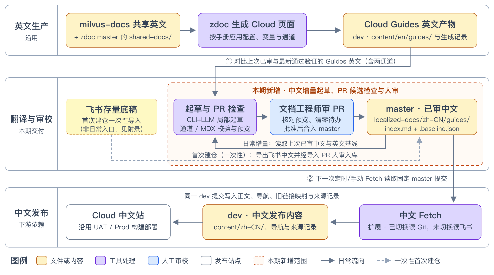

# Zilliz Cloud 中文 Guides 增量翻译方案

**草案 · 待文档团队与工程团队联合评审**

## 1. 问题、交付目标与首期范围

目前，Cloud 采用新的英文 Guide 后，文档工程师需要自己发现变化、找到对应的飞书中文稿，再逐段核对。交接时，下一位编辑很难判断中文上次审到哪版英文，也很难分辨哪些差异是欠译，哪些是为中文读者有意保留的写法。


Cloud 采用新的英文后，工具在已有已审中文上起草局部修改，给负责这页的文档工程师开一个按页滚动的 GitHub PR。主审打开它，应能直接回答三个问题：英文在哪个通道变了什么？网站读者在 UAT 和 Prod 分别会看到怎样的中文？哪一处还需要我决定？

**交付原则：** 来源和英文基线可信、审校材料齐备即直接请求 review；待确认项全部处理、最新稿通过必需检查并获批准后才可合入；**只有合入才推进已审英文基线，对应站点部署成功才算上线。** 来源无法确认时，整页阻塞，不发错误 PR。

**首期范围**为已有飞书中文底稿、能对应到已生成 Cloud Guides 英文的页面正文，先从 `shared-docs/guides/pages/` 已注册的共享页中选择试点。Guides 首页、工具教程（`tutorials/tools/`）、Reference 和日文沿用现行流程（注意现有 `zh-CN-reference` 映射仍含 `guides/tutorials` 路径，试点须核实写入隔离，避免自动翻译与人工中文互踩）。Cloud 独有页可在具备可核对版本的英文产物后接入。过渡期飞书继续管理导航。

## 2. 工具链、职责分工与变更范围

现有流程中，英文和中文各有一条来源链。英文作者在 `milvus-docs` 维护共享原文，Cloud 团队在 zdoc 的 `master` 维护 `shared-docs/guides/` 下的页面配置、采用的上游版本及 Cloud 专用英文片段；zdoc 英文 Fetch 用这两处输入生成 Cloud 英文写入 `dev`。中文 Fetch 则按飞书记录取稿。把某次英文变化带入中文并确认已跟进，是目前需要文档工程师手工完成的一段工作。



**① 在 Cloud 英文生成并验证后接入（读 `dev`，按手册取双版本）。** 工具从 zdoc 的 `dev` 分支读取固定提交下 `content/en/guides/` 中的英文正文，并核对该页的生成记录（`generated/en/manifests/shared-pages/guides/<page>.json`）。每次比对的是同一本手册（`guides`）下的两个固定版本：**旧版英文**取该页 `.baseline.json` 记录的上次获批合入版本，**新版英文**取 `dev` 上最近通过验证的产物，先比正文及 CURRENT（Prod）/ NEXT（UAT）两通道的校验值，有实质差异再起草。

- **为什么 `shared-docs` 有提交不一定需要翻译？** 一方面，`master` 上改了工具脚本、注释、未激活页面，或只改了 `guides-byoc` 手册的差异时，`guides` 手册的英文输出并未变化；另一方面，`master` 上的改动须先经英文 Fetch 生成并验证写入 `dev` 才成为正式产物，翻译工具不直接扫 `master` 的 `shared-docs` 提交。
- **为什么上游 `milvus-docs` 没变，Cloud 配置变化也可能触发翻译？** 即使上游 commit 没变，只要 `shared-docs` 中的变量、页面配置或 Cloud 专用英文片段更新并经英文 Fetch 重新生成到 `dev`，`content/en/guides/` 下的实际正文或通道内容就变了，中文读者会遇到这些变化，工具也会自动捕捉并起草跟进。

**② 在中文发布前交付（编辑源归 `master`，发布产物归 `dev`）。** 页面切换后，Fetch 从固定 `master` 提交读取已审稿，将中文正文写入 `dev` 的 `content/zh-CN/`，并在同一 `dev` 提交中更新导航、旧链接映射和来源记录。每个接入的中文页在 `master` 有固定目录：

```text
localized-docs/zh-CN/guides/<中文页面 ID>/
├── index.md        整篇面向网站读者的中文正文（标题、步骤、代码、链接）；文档工程师在 PR 中审改
└── .baseline.json  该页绑定的英文手册、已审英文版本（dev 提交与通道校验值）及段落对应关系；随已审正文合入更新
```

只修中文术语时，也可直接提 PR 修改 `index.md`（走同一必需检查和审批）；获批合入后，下次增量起草使用这份中文，已审英文版本沿用。

> **关于同步与发布队列：** `localized-docs/` 不在 `devOwnedPaths` 中，合入 `master` 后会随现行 `sync-master-tooling-to-dev.yml` 同步工具与源码。为避免与生产队列（`docs-production-dev`）争抢，翻译调度与 PR 校验**不持有**生产锁，且**不因单个翻译 PR 合入额外触发一次生产 Fetch**；已审中文正文由下一次定时或获准手动 Fetch 统一取稿写入 `dev`。

### 职责分工与改造边界（现状 vs 本期新增 / 扩展）

| 环节 / 角色 | 现状与本期安排 | 输入 → 输出 | 完成条件 |
|---|---|---|---|
| **英文生成**（现有英文 Fetch） | **沿用**（已存在） | `milvus-docs` + `master:shared-docs/` → `dev:content/en/guides/` 与生成记录 | 英文 Fetch 通过检查并写入 `dev` |
| **首次飞书取底稿**（一次性建仓，见附录） | **沿用**中文 Fetch 取稿 + **新增**一次性导入脚本（与日常增量完全独立） | 飞书固定修订中文 + 对应 `dev` 英文 → 建仓导入 PR（不发布、不改网站） | 导入 PR 经主审核对并合入 `master`，正文此时仍在飞书维护 |
| **翻译调度**（`translate-zh-guides.yml`） | **新增** GitHub Actions 工作流（不改动日文/Reference 自动翻译） | 定时/手动触发 + 接入页清单 → 调用起草工具，创建或更新按页滚动 PR | 无新变化跳过；来源不明记阻塞待办；材料齐备时以 Ready for review 请求主审 |
| **增量起草工具**（中文 Guides CLI） | **新增**命令行工具（复用现有内容保护和 MDX 校验，不改日文状态） | 同手册旧/新英文 + `master` 已审 `index.md` 与 `.baseline.json` → 局部改稿、差异摘要与待确认项 | 仅改动受影响区间，未涉及段落经程序校验逐字保留；疑点不删改原中文文字 |
| **大语言模型（LLM）** | **新增**受限模型调用（具体模型在试点评估） | 变更段落、邻接上下文、术语与对应中文 → 带段落定位的局部改稿建议 | 仅产出受限文本提案；不得直接写仓、执行代码或自行改动通道边界 |
| **PR 候选检查与双通道预览** | **新增**必需校验工作流与分支保护（现状 `site-validation.yml` 对 `master` PR 跳过内容检查，`shared-docs-validate.yml` 不覆盖中文，`master` 也尚未配置文档团队 CODEOWNERS 强制审批） | PR 最新 head 的 `index.md` / `.baseline.json` + 对应英文输入 → 通道/MDX/链接校验结果、UAT 与 Prod 候选预览（或渲染检查结果） | 所有必需检查在当前 PR head 通过，且未决待确认项清零；稿件更新自动重跑并撤销旧审批 |
| **人工审校**（文档工程师） | **新增**逐页审校与审批门禁 | PR 差异、待确认项与两通道预览 → 修订、批准合入或暂缓 | 主审逐条记录待确认项结论并批准当前最新 head，合入 `master` 后推进英文基线 |
| **中文取稿与发布交接**（中文 Fetch） | **扩展**现有中文 Fetch（现状仅英文支持 shared-docs Git 选源） | 固定 `master` 提交 + 飞书表格路由记录 → 同一 `dev` 提交写入中文正文、导航、旧链接映射与来源记录 | 已切换页读取 Git 中文，未切换页继续读飞书；校验通过后原子提交到 `dev` |
| **站点构建与部署** | **沿用**（验证新来源） | 通过验证的 `dev` 提交 → 中文 UAT / Prod 站点部署 | 对应环境部署成功并验证原网址、通道内容与图片后，才算上线 |

<details>
<summary>目录选择依据：中文编辑源与现有目录分工</summary>

日文随英文站构建，`i18n/ja-JP/` 存放日文翻译产物；中文有独立站点，从 `content/zh-CN/` 构建。这两处发布内容均归 `dev` 管理（`devOwnedPaths`）。方案在 `master` 新增 `localized-docs/` 供文档团队通过 PR 维护中文正文，避免与发布分支写入冲突。[站点与目录分工](https://github.com/zilliztech/zdoc/blob/1ceb4eb30e49c105634d313ee374b491b0eb3007/README.md#L169-L188) · [分支所有权契约](https://github.com/zilliztech/zdoc/blob/1ceb4eb30e49c105634d313ee374b491b0eb3007/deploy/contracts/master-tooling-sync.json) · [现有中文 Guides 抓取任务](https://github.com/zilliztech/zdoc/blob/75e79b0205ce7f9f7b842f163472e64eada35e71/.github/workflows/fetch-docs.yml#L333-L396)

</details>

## 3. 一次英文更新怎样进入审校

1. **找变化。** 拟在工作日北京时间 09:30 扫描已接入的中文页，急修可手动按页触发。旧版英文取该页上次获批合入时记录的版本，新版英文取 `dev` 上同一手册最近通过验证的产物。先比正文和各发布通道的校验值，有实质差异再逐段核对。只改了 BYOC 示例、Guides 输出相同，或只有确认可忽略的格式变化，就跳过。周末累积的实质变化从上次已审版本一并算起。
2. **在已审中文上起草。** 程序定位受影响的段落，把英文变化、相邻上下文和对应中文交给模型，再由程序核验修改范围外的文字是否逐字保留。页面和英文基线明确时，能可靠定位的改动直接起草进候选稿。遇到段落拆并、指代不清或中文独有说明，**保留原中文文字不删改**；若原位置因段落合并已不存在，工具可给出候选摆放位置，并在同一 PR 的待确认项中写明原位、拟移位置、原因和需要主审回答的问题。
3. **备齐审校材料，直接请求 review。** 一般每页至多一个活动滚动 PR。来源可核对、有可审的改动或具体问题，并备齐以下材料后，工具直接以 **Ready for review** 请求该页主审（材料缺失或渲染检查未产出前，保持草稿并在原 PR 补齐）：

   - **严格区分“给读者看的正文”与“给主审看的问题”。** 只有面向网站读者的中文写入 `index.md`；审校问题、依据和建议处理方式只写在 PR 描述与评论里，绝不混入正文。
   - **页首交代来源与关键事实。** 标明英文新旧版本（及 CURRENT / NEXT 通道各自是否有变化）、累计差异，并明确列出数字、限制、代码、链接、步骤是否有变化（无变化也明示“无”）。引用疑点时标明版本和小节，贴出疑点原句、前后上下文（含相关代码示例片段）及英文改前、改后的双通道分段。
   - **附齐自动检查与双通道预览。** 附上绑定当前 PR head 的自动检查状态（未涉及段落逐字保留、通道与 MDX 校验、链接与图片校验），以及 UAT、Prod 两个通道的候选预览链接（或相应的渲染检查结果），标明页面锚点及每个通道**预期看到什么**。稿件更新后同步刷新。

4. **交付主审与处理异常并发。** 审校与发布期间的异常和并发情形按以下规则处理，任何异常都不破坏已有人审成果和线上内容：

| 异常 / 并发情形 | 谁处理、怎么处理 | 已有人工修改会怎样 | 线上内容（Prod / UAT）会怎样 |
|---|---|---|---|
| **审校中同页英文再次变化** | 工具在原滚动 PR 追加提交，标出本次新增差异与累计差异，刷新预览并重跑必需检查；若原 PR 已获批准，自动撤销旧审批，由主审重审。 | 未与新英文变化重叠的人工修订自动保留。 | 不受影响，仍为上次已部署版本。 |
| **两个人改到同一句**（含：英文再变与 PR 内人工编辑重叠；同期有纯中文术语 PR 合入 `master` 改到同一句；两名编辑同改一 PR） | 工具检测到重叠或冲突即**暂停自动写入**，在 PR 中标出冲突位置，交由主审手动合并解决后重跑检查和审批；两名编辑同改一 PR 按 Git 冲突处理。 | 全部保留在对应分支或提交历史中，不静默覆盖任何一方的修订。 | 不受影响。 |
| **英文基线缺失或来源不可核实**（找不到上次英文、目标手册不唯一、来源摘要不符） | **整页阻塞。** 工具不开出错误翻译 PR，转而生成一条阻塞待办（列出页面、缺失材料与负责人），由文档负责人补齐或重新确认基线后再起草。 | 保留原 `master` 已审中文与 `.baseline.json` 不动。 | 不受影响。 |
| **段落对应不清**（段落拆并、跨段指代不明、中文独有说明） | 来源可信前提下，在同一个滚动 PR 中交付其余可靠改动，并在待确认项中列出疑点位置、上下文和问题，由主审决定并记录结论。 | 疑点处原有中文文字逐字保留（必要时给出候选位置供确认），不丢失。 | 未处理完前合入检查拦截，线上不受影响。 |
| **待发内容还不能进 Prod**（同页既有待发功能，又有线上急修） | 线上急修只修改当前版（CURRENT / Prod）区间并独立审核上线；待发功能留在下一版（NEXT / UAT）区间，不随急修放出。详见第 6 节。 | 两通道的已审中文互相隔离保留。 | 急修部署后仅更新 Prod 对应说明；未获准 Promote 的待发内容继续在 Prod 隐藏。 |

## 4. 主审如何决定合入或暂缓

**能当场决定的问题，在原 PR 解决并合入。** 主审逐项核对英文与中文，在 PR 中为每条待确认项记录结论（如采纳候选位置、改译、保留中文写法及理由）。合入须同时满足四项条件：

1. 所有待确认项均已记录处理结论并清零（只要仍有未解决项，合入检查应拦住该 PR）；
2. 该 PR 对应的英文输入仍有效；
3. 当前 PR 最新 head 通过全部必需检查（格式、通道边界、未涉及段落保护与预览/渲染检查）；
4. 获文档团队审批人批准（稿件再变时自动撤销旧审批并重跑检查）。

只有获批并合入 `master`，工具才随同一次提交推进 `.baseline.json` 中的已审英文基线。关闭 PR、保持草稿或暂缓均不推进基线。

**需要等外部确认时，暂缓整页。** 在原 PR 写明暂缓原因和跟进人，复核日期按需填写。PR 留在待办队列，已审英文基线停在上次合入的版本。

| 暂缓之后 | 工具和主审怎样跟进 |
|---|---|
| 英文没有实质变化，也未到复核日期 | 保留原 PR、原因和跟进人，日常扫描**不重复请求 review 或催办**。 |
| 同页英文有新的实质变化 | 在原 PR 单列**“自上次暂缓以来的新变化”**，同时保留**“自上次合入以来的累计变化”**，针对这批新变化**通知一次**。若暂缓前 PR 内已有人工修订且与新变化重叠，暂停自动写入交主审处理。主审决定恢复审校，或更新暂缓记录点继续暂缓（更新后未再有新变化不再重复提醒）。 |
| 到了复核日期，或等待的条件已经满足 | 到期时工具在原 PR 提醒并重新请求 review；等待产品确认等外部结果时，由跟进人拿到结论后手动恢复审校。 |

## 5. 完整示例：一份真实结构的翻译 PR（删除 Entity）

以下示例模拟文档工程师收到一份 `Ready for review` 翻译 PR 时实际看到的全部审校材料，用于检验第 3、4 节的规则是否闭环。本例对应真实页面《删除 Entity》的小节 `/delete-entities#delete-entities-by-filtering-conditions`（该共享页同时生成 Guides 和 BYOC，本 PR 仅跟进 Guides 手册）。

> **区分原则**：下方“PR 页首与待确认项”**只留在 PR 中给主审看**，不会发布到网站；“网站读者会看到什么”才是 `index.md` 在两个通道的候选渲染正文。

---

### ① PR 页首信息与变更摘要（只给主审）

- **页面与目标手册**：`delete-entities`（Cloud Guides）
- **英文版本对比**：
  - 上次已审：`dev@5a62906`（CURRENT 与 NEXT 一致）
  - 本次采用：`dev@<最新已验证SHA>`（**CURRENT / Prod 无变化；仅 NEXT / UAT 合并两段并新增 1 步检查**）
- **关键事实变化**：数字/限制（无） · 代码（无） · 链接（无） · 操作步骤（**NEXT 新增 1 步**）
- **自动检查状态**（当前 PR head）：✅ 未涉及段落逐字保留 · ✅ MDX 与双通道边界校验 · ✅ 链接与图片校验 · ⏳ 待确认项（1 项未清零，合入已拦截）
- **候选预览入口**（绑定当前 PR head，锚点 `#delete-entities-by-filtering-conditions`）：
  - **Prod 候选预览（CURRENT）** — 预期：与现网完全一致，**不出现**新增检查句，保留原有两段操作及中间提示。
  - **UAT 候选预览（NEXT）** — 预期：两段合并并出现新增句“提交删除请求前，请核对过滤表达式。”，中文独有的颜色提示拟移至代码示例正上方。

### ② 改稿说明与待主审决定（只留在 PR）

- **可靠改动（已起草至 UAT 通道）**：英文在 NEXT 通道将两段操作合并，并在中间新增一句检查步骤。工具已译为“提交删除请求前，请核对过滤表达式。”，其余未涉及段落逐字保留。
- **待你决定（1 项，清零前拦住合入）**：
  - [ ] **确认中文独有提示的摆放位置**：原中文两段之间有一句写给中文读者的提示，解释下方示例里的颜色值。因 UAT 英文合并了这两段，原夹层位置已不存在。工具**保留了提示原文一字未改**，在 UAT 候选稿中拟将其挪到代码示例正上方（Prod 通道保持原位）。请对照下方两份预览与代码示例，确认是否同意该位置，或直接在 `index.md` 调整。

<details open>
<summary>核对翻译与通道依据：查看英文改前、改后的双通道分段</summary>

**上次已审 · CURRENT & NEXT（两段）**

> Use a filter expression to select the entities to delete.
>
> Submit the delete request with that expression.

**本次采用 · CURRENT / Prod（未变，仍为两段）**

> Use a filter expression to select the entities to delete.
>
> Submit the delete request with that expression.

**本次采用 · NEXT / UAT（合并为一段，加粗标出新增句）**

> Use a filter expression to select the entities to delete. **Check the filter expression before submitting the delete request.** Submit the delete request with that expression.

</details>

### ③ 对照中文页面：网站读者会看到什么？（候选预览摘录）

**Prod 候选预览 · 当前版（CURRENT）**

> 使用过滤表达式选中要删除的 Entity。
>
> **提示：** 下方示例中的颜色值仅作演示，请按目标 Collection 中的实际取值替换。
>
> 使用该表达式提交删除请求。
>
> ```python
> res = client.delete(
>     collection_name="quick_setup",
>     filter="color in ['red_7025', 'purple_4976']"
> )
> ```

**UAT 候选预览 · 下一版（NEXT）**

> 使用过滤表达式选中要删除的 Entity。提交删除请求前，请核对过滤表达式。使用该表达式提交删除请求。
>
> **提示：** 下方示例中的颜色值仅作演示，请按目标 Collection 中的实际取值替换。
>
> ```python
> res = client.delete(
>     collection_name="quick_setup",
>     filter="color in ['red_7025', 'purple_4976']"
> )
> ```

### ④ 主审如何判断并回复？

主审按三步核验：
1. **核对译文**：对照英文 NEXT 新增句，中文“提交删除请求前，请核对过滤表达式。”准确、术语一致，可接受。
2. **核对待确认项**：结合紧随其后的 `filter="color in ['red_7025', 'purple_4976']"` 代码片段，提示说明的是代码中的演示颜色值，放在代码示例正上方比夹在操作步骤中间更清晰，可接受。
3. **核对双通道预览**：对照英文 CURRENT / NEXT 分段，确认 Prod 预览未出现新增句、UAT 预览中新增句只出现一次且位于“提交删除请求”之前。

确认无误后，主审在 PR 勾选待确认项并回复（该回复只留在 PR）：

> 译文准确。颜色提示解释的是下方 `color in [...]` 示例，同意在 UAT 中挪到代码示例正上方。已对照英文双通道分段核对 Prod / UAT 预览，通道正确，关闭此待办并批准合入。

待办清零、必需检查绿灯并获 Approve 后即可合入 `master`，同时推进 `.baseline.json`。若核对时发现 Prod 误出现了新增句，则不批准，先修通道并刷新两份预览；若需等产品确认该提示是否仍适用，则在原 PR 写明暂缓原因与跟进人。

---

真实参考文件：[Cloud 页面配置](https://github.com/zilliztech/zdoc/blob/7ee39054f37047b586ad789d876b2047c6f2c465/shared-docs/guides/pages/delete-entities/page.yaml) · [两份英文输出记录](https://github.com/zilliztech/zdoc/blob/5a62906a45a4e3250c619a5efcfa4de3f83a8eb6/generated/en/manifests/shared-pages/guides/delete-entities.json) · [英文正文](https://github.com/zilliztech/zdoc/blob/5a62906a45a4e3250c619a5efcfa4de3f83a8eb6/content/en/guides/tutorials/development/insert-and-delete/delete-entities.md) · [同一提交的中文正文](https://github.com/zilliztech/zdoc/blob/5a62906a45a4e3250c619a5efcfa4de3f83a8eb6/content/zh-CN/guides/tutorials/development/insert-and-delete/delete-entities.md)

## 6. 上线时机、试点验收与待拍板事项

**部署成功才算上线。** 若发版窗口到来时中文仍在暂缓，发布负责人应能看到页面、原因和跟进人，并按该页的双语发布约定处理。

| 发版情形 | 权责与预期结果 |
|---|---|
| 修订已上线功能（CURRENT 急修） | 文档工程师审校并合入当前版修订到 `master`；下一次 Fetch 取稿写入 `dev`，正式站（Prod）部署成功后可见。同页有待发功能时，允许单独修正当前线上说明，不把待发内容带入 Prod。 |
| 新说明随下个版本上线（Promote） | 文档工程师先在预发布站（UAT）验收中文。发版时，发布负责人确认拟发布英文仍与已审中文一致，通过受保护的 `master` PR 将已审 UAT 中文提升为当前版（解包待发标记、移除旧版说明），经 Fetch 写入 `dev` 并在 Prod 部署成功后可见。 |
| 英文验收后又变，或中文仍待审批 | 保留上一份可用中文，阻断不匹配的提升。只有预览稿的新页在 Prod 继续隐藏；要求双语同步发布的页面等两边均就绪后再放行。 |

公开 PR、预览和模型请求只接收可提前公开的内容（zdoc 为公开仓库，且共享镜像会将 NEXT 文案打入浏览器 JS）。需保密的材料继续在受限渠道协作。

### 试点通过条件

| 试点场景 | 通过条件 |
|---|---|
| 普通更新页 | 取一处已知的英文限制或参数变化。主审能在 PR 中找到对应中文改动，未受影响段落经程序核验逐字保留。审稿中英文再次变化时，原 PR 保留人工修订、撤销旧审批并重跑必需检查。记录漏改、额外改写及审校用时。 |
| 同 PR 交付可靠改动与疑点，并演练暂缓 | 一处可靠改动和一处疑点同 PR 送审，疑点未清零时合入检查应拦截。暂缓后重复扫描不催办；英文再变时只通知一次，同时展示“自暂缓以来的新变化”与“自上次合入以来的累计变化”。恢复审校、处理疑点并获批合入后，英文基线才推进。 |
| 来源无法确认或英文基线缺失 | 构造基线缺失或目标手册不唯一的情形。工具整页阻塞并产出阻塞待办，不发错误翻译 PR，保留原有基线与线上中文。 |
| 并发冲突（两个人改到同一句） | 模拟英文再变与 PR 内人工修改重叠（或同期纯中文术语 PR 冲突）。工具暂停自动写入并标出冲突位置，已有人工修订不丢失，线上内容不受影响。 |
| 同时有待发功能和线上急修的页面 | Prod 能单独修正旧说明而不泄露 UAT 内容。Promote 后 Prod 展示 UAT 已验收的版本；验收后英文变化时能指出阻断原因并保留旧版。 |
| 有飞书历史链接和图片的页面 | 切换失败时原网址仍可访问；确认切换后，原链接、锚点和图片可用，旧飞书正文的修改不会覆盖网站，且与 `zh-CN-reference` 写入互不冲突。 |

### 待评审会拍板的事项

以下事项需团队在评审会上拍板确认，不在本方案中写成既定事实：

| 待定事项 | 可选方案与取舍 | 建议 |
|---|---|---|
| **1. “待确认项清零”的合入拦截方式** | **A. PR 描述结构化勾选清单 + CI 检查**：文档工程师直接在 GitHub PR 勾选并回复，操作门槛低，但需防范误编辑 PR 正文。<br/>**B. 仓内审校记录文件随 PR 提交**：可完全入 Git 审计，但编辑每次回复都要改文件提交，审校摩擦大。 | 推荐 **A**，结合评论留痕与必需检查，降低日常审校摩擦。 |
| **2. 试点期 PR 双通道预览形态** | **A. 校验工作流输出双通道渲染检查报告 + 可下载/静态差异预览**（不新建独立托管服务）：交付快、维护面小，但主审无法一键点开在线网页。<br/>**B. 建设每 PR 独立的 UAT / Prod 在线预览环境**：体验最好，但需额外搭建托管与清理机制，工期较长。 | 建议试点期先走 **A** 验证流程与质量，同时评估是否值得为全量阶段投入 **B**。 |
| **3. 中文页面 ID 命名规则** | **A. 默认沿用英文共享页 ID**，仅在重名或已有稳定中文 ID 时独立登记：对应关系最直观。<br/>**B. 全部新建独立中文 ID**：彻底解耦中英命名，但查表与排障成本更高。 | 推荐 **A**。 |
| **4. 试点分工与发布约束** | 需确定：首批试点 3 页、每页主审与备份、单页停改窗口时长、哪些页面须双语同步发布。 | 评审会现场认领并登记到试点清单。 |
| **5. 翻译模型选型** | 不同模型在术语遵循、通道结构和审校耗时上差异明显。 | 不在评审前写死，在只读试点中用真实数据（事实漏改、非授权改写、人工审校耗时）对比后定型。 |

推进顺序：先用只读试点验证起草、候选检查和人工审校，再对已审稿做一次完整的 Fetch 交接和 UAT / Prod 验收。两处交接都能追溯到相应稿件后，再将约 89 篇存量 Guides 分 6～8 批审校入库。每一页按自己的验收结果切换。

## 附录：存量页面的底稿与编辑权交接

> **注意区分**：本附录描述的是存量页面从飞书迁入 Git 的**一次性初始化与交接流程**，与前文的日常增量翻译彼此独立。建仓导入 PR 合入后，页面正文仍归飞书维护，直到第 3 步切链且 Fetch 确认接管后才转交编辑权。

1. **确认对应关系。** 文档负责人登记英文共享页 ID、目标手册和英文文件、中文飞书记录、中文页面 ID 与主审。中文 ID 用作固定目录名，页面改标题或网址时仍沿用。若一条记录供多本手册使用，先核对所有目标。缺中文的页面列为待评估首译；缺英文或存在拆页、合页的，维持原有维护方式，等待确认。
2. **建立第一份已审底稿。** 首次建仓沿用中文 Fetch 取得飞书中文材料，经一次性导入脚本生成导入 PR（不发布候选稿、不改网站）。导入 PR 须能追溯飞书修订，主审逐段核对该稿与固定版本的 Cloud 英文。已确认的部分记下对应英文，历史欠译另列待办，中文独有的说明由主审确认保留。导入 PR 合入 `master` 后，正文仍在飞书维护。
3. **逐页切换。** 文档负责人暂停该页飞书编辑，核对并补齐导出后的最后修订，再将原飞书记录的 `Docs` 链接指向 Git 目录（`https://github.com/zilliztech/zdoc/tree/master/localized-docs/zh-CN/guides/<中文页面 ID>`）。**只有 Fetch 确认已采用 Git，才将清单上的编辑入口改为 Git。** 部署后用原网址检查正文、图片和段落链接，验收通过后标记旧稿。


切换结果未知时，保持该页停改，核实发布记录。确认尚未接管可撤回请求并恢复飞书编辑。Git 已接管后发生部署故障，按现有流程恢复站点，编辑入口仍为 Git。

[共享文档改造方案](./proposal.md) · [Phase 1 产品需求](./prd.md) · [中文 Guides 技术设计与验收契约](./design/11-zh-cn-translation-pipeline.md)
