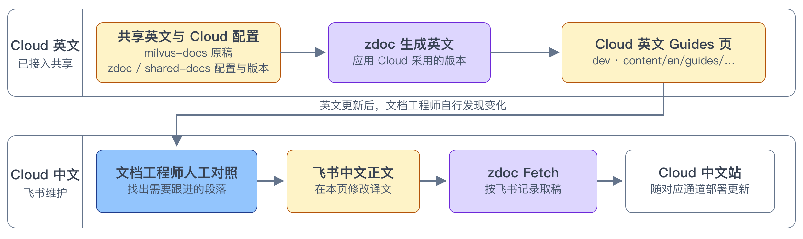
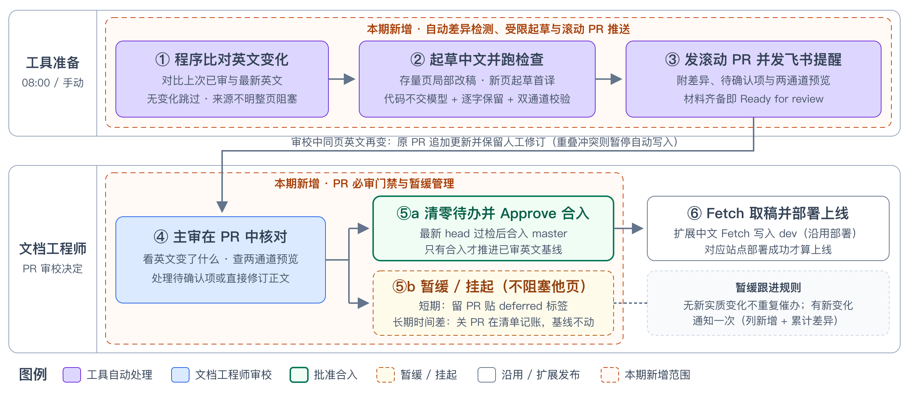
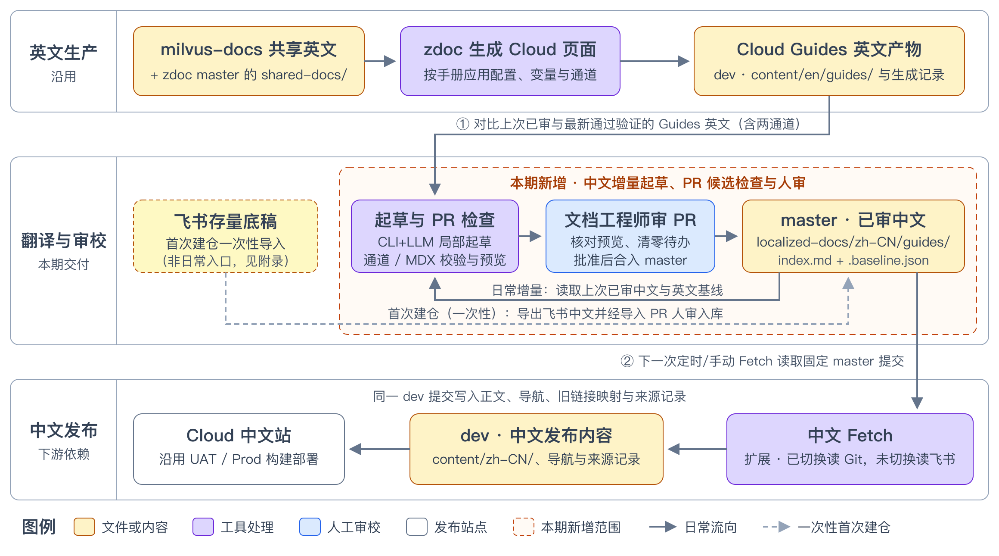
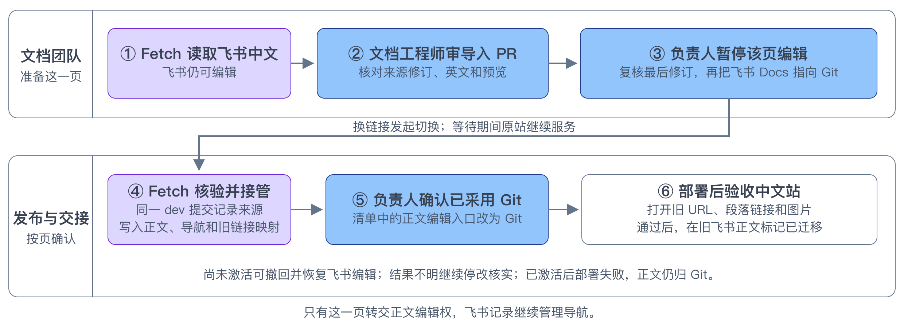

# Zilliz Cloud 中文 Guides 翻译方案（对齐稿）

**草案 · 供文档团队与工程团队评审对齐** · 详细目录样例、异常兜底、PR 模板与验收契约见[中文 Guides 技术设计](./design/11-zh-cn-translation-pipeline.md)

## 1. 为什么改与目标体验

Cloud 英文文档正在推进共享改造：共享正文在 `milvus-docs` 维护，Cloud 专属配置写在 zdoc 的 `shared-docs/`，已注册的共享英文正文已退出飞书维护，发布产物落在 zdoc `dev` 分支的 `content/en/guides/`。

但中文文档目前仍留在飞书维护，形成了明显的双轨割裂：文档工程师只能拿 `dev` 上生成的英文正文去人肉对照、修改飞书中文——**既没有版本管理，也看不出中文落后了几个英文版本**；交接时下一位编辑很难分辨哪些差异是欠译、哪些是有意保留的中文写法，术语和文体也缺乏统一约束。

改造后，中文 Guides 正文迁入 Git，同步承接 **UAT（预发布）与 Prod（线上正式）双通道**。Cloud 采用新的英文 Guide 后，工具在已有已审中文上起草局部修改，给负责这页的文档工程师开一个按页滚动的 GitHub PR。主审打开它，应能直接回答三个问题：

1. **英文在哪个通道变了什么？**
2. **网站读者在 UAT 和 Prod 分别会看到怎样的中文？**
3. **哪一处还需要我拍板决定？**

**核心底线：** 人审必经，待确认项清零、最新稿过检并获批准才可合入；**只有合入才推进已审英文基线，对应站点部署成功才算上线。** 来源无法确认时整页阻塞，不发错误 PR。

## 2. 首期范围与四条内容原则

### 2.1 首期做什么、不做什么

首期聚焦 **`shared-docs/guides/pages/` 共用文档**，包含两个方向：

1. **存量共享页搬迁与增量同步**：将已有飞书中文底稿迁入 Git、对齐最新 Cloud 英文 Guides，并将中文发布源切换至 Git，后续按已审基线走日常局部增量同步；
2. **新增共享页按需注册与首译同步**：`shared-docs` 新增英文页面后，由中文负责人**人工确认中国站需要并登记**，再在 Git 触发整篇首译 PR 审校入库并建立基线，之后统一转入日常增量同步，不再回飞书新建正文。

**本期明确不做**：**Cloud 独有文档** 因英文侧也仍在飞书维护、尚未 Git 化，暂不在本期范围内；Guides 首页、`tutorials/tools/`、Reference 和日文沿用现行流程；过渡期目录导航继续由飞书表格管理。

### 2.2 四条内容与质量原则

- **未改动段落逐字保留**：程序先对新旧英文按标题、段落和代码块做确定性比对，只把真正变动的段落交给大模型起草，再由程序逐字节核验未涉及段落一字未动；遇到段落拆并、指代不清或中文独有说明，保留原中文文字不删改，列为待确认项交主审定。
- **代码块不交 LLM 翻译，同时保护中国站定制**：英文侧优先使用地域无关占位符（如 `YOUR_CLUSTER_ENDPOINT`）；中文侧无定制的代码块（含英文注释）由程序原样同步，涉及域名/地域等固定差异按规则换算，已有页面级中国站定制绝不强行覆盖，给 diff 交主审决定。
- **建立轻量的术语与风格载体**：在 `master` 维护中文 Guides 术语与风格契约（首期基于现有 `zh-CN-reference.json` 提炼，统一用“您”及保留英文词），注入 LLM 并在审校中持续沉淀。
- **控制台 UI 词与正文隔离**：开源 `milvus-docs` 无控制台界面，UI 词只出现在 `zdoc` 侧的 Cloud 定制内容中。建议在 `zdoc` 英文源用轻量语义标签（如 `<UI>Create Cluster</UI>`）标记，翻译时不交 LLM 自由发挥，首期保留原词在 PR 中集中交主审对照中文控制台替换。

> 详细触发逻辑、代码块三档保护、术语与 UI 规则见[技术设计 §3](./design/11-zh-cn-translation-pipeline.md#3-英文基线增量起草代码块与术语规则)。

## 3. 文档团队每天怎么工作

日常运转围绕 **4 个自然动作** 展开：

1. **每日定时发现变化 + 飞书群日报提醒**：拟在工作日北京时间 **08:00** 自动扫描（承接凌晨 02:00 英文 Fetch，错开 10:00 高峰，急修支持手动触发），对比“上次已审英文”（上次中文合入时绑定的旧英文）与“最新通过验证英文”（`dev` 最新英文 Guides）。无实质变化跳过；来源不明整页阻塞；扫描完成后往文档飞书群发一条当日待审日报。
2. **按页滚动 PR 送审**：每页至多一个活动 PR，**读者可见中文正文与给主审看的评审问题严格分离**。页首交代新旧英文版本、关键变化（数字、限制、代码、链接、步骤）与自动检查结果，并附 UAT / Prod 两通道预览（直接继承英文的 `<NextChannel>` 标签）。材料齐备即直接发 Ready for review；审校中英文再变则在原 PR 追加更新并保留人工修订。
3. **主审做决定：合入 or 两档暂缓**：待确认项清零、最新稿过检并获批准才可合入 `master`（只有合入才推进已审英文基线）。遇外部等待按周期分两档，**绝不阻塞其他页面和同页 Prod 急修**：
   - **短期等待（几天～2 周）**：留原 PR、贴 `deferred` 标签写明原因与跟进人（复核日期可选）；无新变化不催办，有新实质变化通知一次（同时列“自暂缓后新变化”和“自上次合入累计变化”）。
   - **长期时间差（如海外已上、中国站 1 个月以上暂不上）**：直接关闭 PR 并在清单记账，基线停在旧版不丢账、不留僵尸 PR，待中国站就绪再手动重开。
4. **人永远是最高编辑权威**：常规页随时可直接提 PR 修改或增补中文独有段（沿用原英文基线，下次增量不覆盖手写内容）；若整篇中英文差异极大，可在清单标为 **“手工维护模式”**，完全由文档工程师直接写 PR 发布。

> 完整 PR 结构示例（《删除 Entity》）见[技术设计 §5.3](./design/11-zh-cn-translation-pipeline.md#53-参考示例一份翻译-pr-的实际结构)；完整异常与并发处理规则（如英文再变、两人改到同一句、基线缺失阻塞）见[技术设计 §5.2](./design/11-zh-cn-translation-pipeline.md#52-异常与并发处理矩阵)。

## 4. 怎么接进现有系统

整体沿用上游英文生产和下游站点部署，只把中间“人工发现变化 → 飞书对照翻译”的环节升级为 Git 内的增量起草、PR 校验与人审。

- **上游读 `dev` 英文产物**：直接消费已通过验证的 Cloud Guides 英文正文与生成记录，确保翻译对象与英文站一致。
- **中间归 `master` 独立编辑源**：所有中文编辑资产收口在 `master` 的 `localized-docs/zh-CN/guides/` 下（含人维护的接入清单与术语载体、以及每页的正文和工具自动维护的英文锚点），避开 `dev` 独占的发布目录。
- **下游扩展中文 Fetch 写 `dev`**：已切换页由下一次定时或手动 Fetch 从固定 `master` 取稿，将正文、导航、旧链接映射和来源记录写入同一 `dev` 提交，沿用现有 UAT / Prod 构建部署。

| 改造分类 | 涉及范围 |
|---|---|
| **沿用** | Cloud 英文生成、现有站点构建与 UAT / Prod 部署、内容保护与 MDX 校验模块、以及现有日文与 SDK/CLI Reference 翻译底座。 |
| **新增** | ① **翻译调度工作流**（新增 GitHub Actions 工作流 `translate-zh-guides.yml`，负责工作日 08:00 定时扫描、手动按页触发、自动开/更新 PR 及推送飞书群日报） ② **中文 Guides 起草工具与 `<UI>` 组件**（在 `docs-tooling` 新增命令行脚本负责程序比对、代码块同步与受限 LLM 起草；在 `zdoc` 前端新增轻量 `<UI>` 界面词组件） ③ **中文候选 PR 检查与审批保护**（新增 GitHub Actions 校验工作流负责双通道/MDX 检查与候选预览，并在 `master` 配置文档团队 CODEOWNERS 强制审批） ④ **中文编辑目录与一次性导入脚本**（在 `master` 新建 `localized-docs/zh-CN/guides/`，以及首次从飞书导出建仓的导入脚本） |
| **扩展** | 现有中文 Fetch（已切换页读固定 `master` 的 Git 中文，未切换页继续读飞书）。 |
| **不动** | 不改日文/Reference 规则，不改 `milvus-docs` 和 `md2md`；翻译调度不持有生产发布锁，也不因单个翻译 PR 合入额外触发生产 Fetch。 |

> 完整目录结构、`registry.yaml` / `.baseline.json` 样例见[技术设计 §2.2](./design/11-zh-cn-translation-pipeline.md#22-目录结构与配置样例)；各环节详细输入输出、同步队列与路径隔离契约见[技术设计 §2.3](./design/11-zh-cn-translation-pipeline.md#23-职责分工与研发边界)。

## 5. 平滑迁入与推进路线

### 5.1 怎么平滑迁入并上线

- **存量页逐页迁入**：先用导入 PR 以飞书旧中文为底稿、对照最新英文（工具辅助补齐历史欠译）经人审建立第一个已审基线锚点（此时正文仍在飞书）；再短暂停改、在飞书表格将 `Docs` 链接换为 Git 目录，**只有 Fetch 确认已接管才将编辑入口改为 Git**，零停机、不断旧链接。
- **新增共享页直接接入**：人工确认登记为待首译 → 首译 PR 审校合入建立基线 → 飞书表格补一条导航记录指向 Git 目录即可发布。

**上线与发版原则：** 部署成功才算上线。发版窗口到来时，发布负责人能直接看到处于短期 `deferred` 或长期 `paused` 状态的页面原因与跟进人；`manual` 手工维护页按文档工程师合入 `master` 的节奏发布。公开 PR 和模型请求只接收可提前公开的内容，保密材料继续走受限渠道。

| 发版情形 | 权责与预期结果 |
|---|---|
| 修订已上线功能（Prod 急修） | 文档工程师审校合入 `master` → 下一次 Fetch 写入 `dev` → Prod 部署成功后可见。同页有待发功能时可单独修当前说明，不带出待发内容。 |
| 新说明随下个版本上线（Promote） | 先在 UAT 验收中文；发版时发布负责人确认拟发英文与已审中文一致，通过受保护的 `master` PR 将已审 UAT 中文提升为当前版，经 Fetch 写入 `dev` 并在 Prod 部署后可见。 |
| 英文验收后又变，或中文仍待审批 | 保留上一份可用中文，阻断不匹配的提升；仅预览的新页在 Prod 继续隐藏；要求双语同步发布的页面等两边就绪再放行。 |

### 5.2 三步推进路线

1. **只读试点**：选 **3 页存量页 + 1 页新增共享页**（或模拟新页首译），跑通起草、候选检查、飞书提醒与人工审校；
2. **真实 Fetch 交接与双通道验收**：对已审稿跑通一次完整 Fetch 交接和 UAT / Prod 验收，通过全部 8 类试点场景；
3. **分批建仓与逐页切换**：将约 89 篇存量 Guides 分 6～8 批审校建仓、按页切链；后续 `shared-docs` 新增页按需登记首译同步。

> 存量建仓切链与新增接入操作细则见[技术设计 §6](./design/11-zh-cn-translation-pipeline.md#6-存量迁仓新增接入与-fetch-接线)；8 类试点通过条件及实施前待定细项见[技术设计 §7](./design/11-zh-cn-translation-pipeline.md#7-实施顺序与试点验收明细)。

---

相关文档：[共享文档改造方案](./proposal.md) · [Phase 1 产品需求](./prd.md) · [中文 Guides 技术设计与验收契约](./design/11-zh-cn-translation-pipeline.md)
