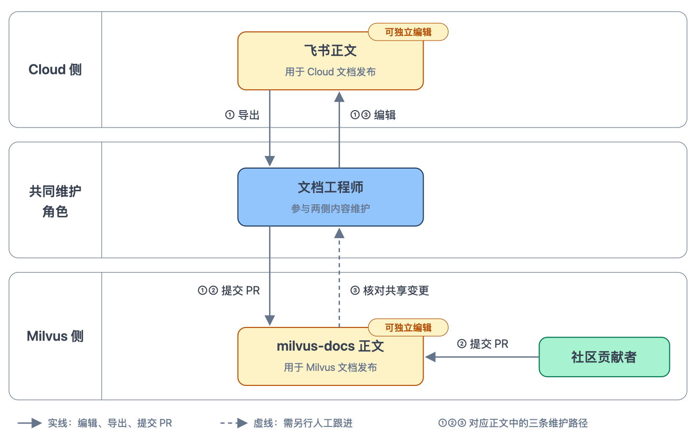
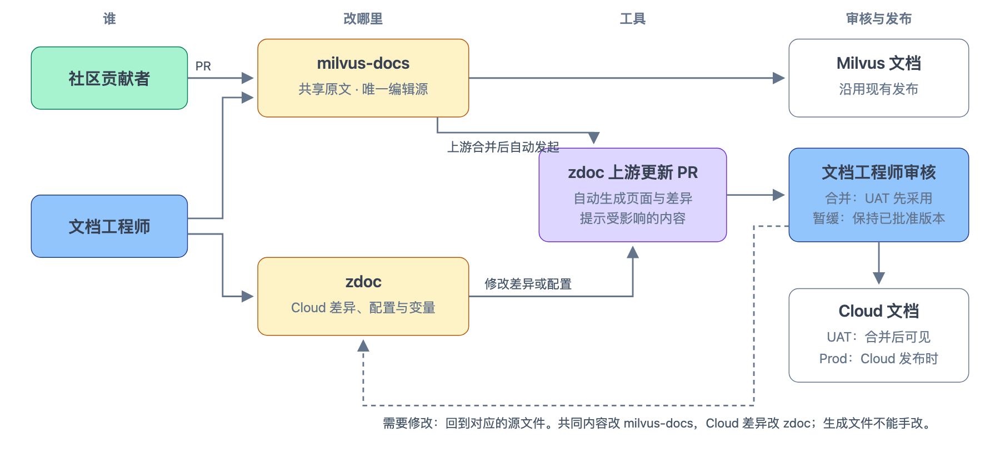
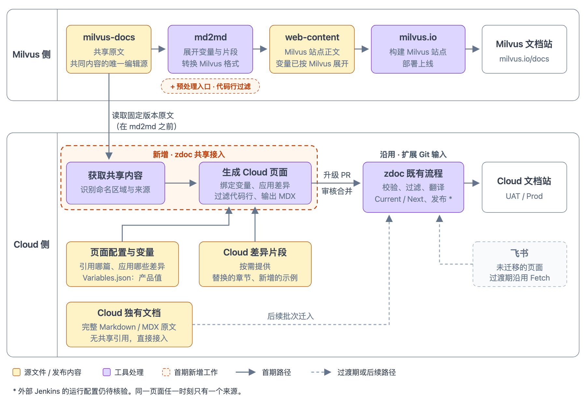
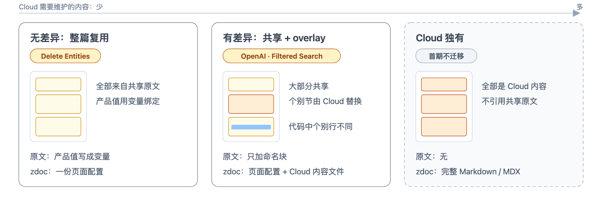
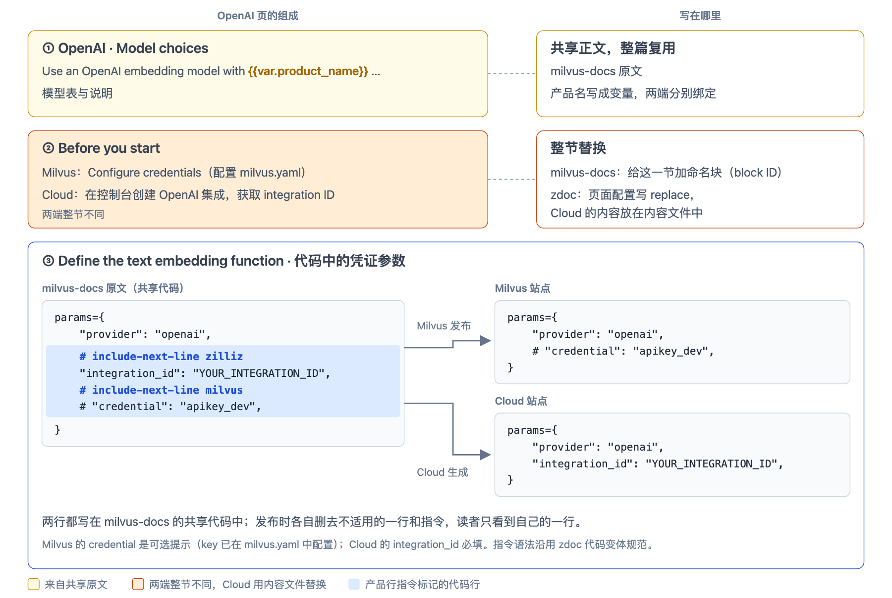
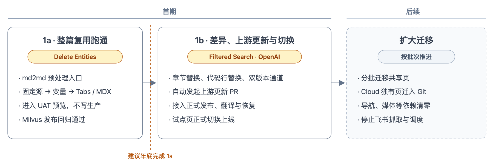
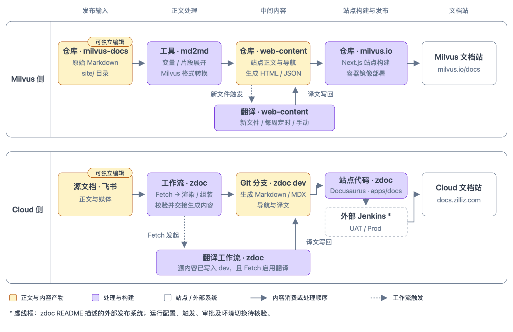

# Milvus × Zilliz Cloud 文档同源：流程与试点方案对齐

**第一次方案对齐会 · 讨论稿**

本文说明为什么改、改完后大家怎样协作、工具链怎样接入，以及先从哪些页面试点。本次会议对齐方向与范围，需要拍板的事项见[第 6 节](#6-本次需要拍板的事项)；配置字段、接口签名等实现设计留到后续会议。

范围是 User Guide 等功能文档的共享与试点迁移。SDK Reference（原文仍在 web-content 维护）、全量迁移及飞书全面退役不属于首期。

> **当前验证状态。** 方案尚未接入生产。Delete Entities 与 Filtered Search 两篇样例已在本地生成验证；真实 md2md / zdoc 接入、站点构建、发布保护与翻译接入尚未实现。现有工具链按固定源码修订核对，外部 Jenkins 的运行配置、生产权限和恢复保留策略仍待核验。依据见 [research/](../research/)。

## 1. 现状与改造要求

### 1.1 现状：两份正文都能改，靠人工同步



图 1 · 现状：共享内容的三条维护路径
- 三条路径中，只有 ③“把 Milvus 的修改抄回飞书”是虚线：它没有提醒，也没有固定检查，两边冲突时也没有约定以哪一侧为准。
- 社区修订尚未抄回飞书时，下次从飞书导出可能把旧说明带回 Milvus，覆盖社区的修改。现有流程允许这种情况发生，尚未核实是否出现过事故。
- 长期分开维护会造成漂移。例如 OpenAI embedding 页，两端的真实差异只有前提条件和凭证参数，但标题、示例语言和覆盖步骤也已经不同（见第 4 节）。

### 1.2 改造需要满足的要求

1. **共享内容只有一个编辑源**，社区仍可直接提交 PR。
2. **Cloud 自主决定何时采用上游修改**，而不是 Milvus 一合并就跟着变。
3. **Milvus 已上线、Cloud 尚未上线的内容可以先隐藏**：沿用单镜像下的 Current / Next，UAT 可见，Prod 不显示。
4. **能表达真实的产品差异**，例如前提条件、凭证参数和 Cloud 独有的示例。
5. **上游新增或修改页面时，Cloud 能自动得知**，而不是靠人工发现。
6. **不再经过飞书中转**，同时保留多语言代码、内容过滤、翻译、UAT / Prod 审核和恢复能力。

后文的设计逐条对应这些要求。

## 2. 目标：共享正文只改一处，Cloud 以 overlay 维护差异

**共享正文在 milvus-docs 维护一份，以 Git 为准；Cloud 在 zdoc 中维护建在其上的差异层（overlay），飞书按页退出文档生产链。**



图 2 · 目标协作方式
- **谁改哪里。** 共同内容改 milvus-docs，Cloud 差异和配置改 zdoc。同一位文档工程师可以两边都改；迁移后的页面不再在飞书编辑。
- **Cloud 怎样控制发布时间（要求 2、5）。** 上游合并后，工具在 zdoc 自动发起升级 PR。合并后新版本先在 UAT 可见，Cloud 发布时才进入 Prod；不合并，两边都继续使用已批准的版本。
- **共享原文由谁把关。** milvus-docs 的 PR 按 Milvus 既有流程审核，不需要 Cloud 参与。如果混入只适用于 Milvus 的内容，Cloud 在升级 PR 中处理：暂缓采用、请求改成两端通用的写法，或在 zdoc 中移除该段。Milvus 贡献说明届时补充共享页的写法。
- **生成文件不能手改。** CI 按固定输入重新生成并比对；发现问题时，回到图中对应的源文件修改。

### 2.1 Cloud 文档工程师的工作方式变化

| 事项 | 现在 | 迁移后 |
|---|---|---|
| 共享页的共同内容 | 在飞书编辑，再导出到 Milvus | 向 milvus-docs 提交 PR |
| 共享页的 Cloud 差异 | 在飞书正文中直接改写 | 在 zdoc 维护页面配置和 Cloud 内容文件 |
| 代码的产品差异、Current / Next 标记 | 写在飞书正文和多维表格中 | 共享页：代码行差异写在页面配置中，Current / Next 由工具按两个版本自动区分，不再手动标记；其余写法不变，写在 Git 中（见第 4 节） |
| 审核与预览 | 飞书内审阅，UAT 查看结果 | GitHub PR 审核，PR 预览与 UAT 查看结果 |
| Cloud 独有页 | 在飞书编辑 | 首期不变；终态在 zdoc 以 Markdown / MDX 维护 |

**终态是 Cloud 文档全部在 Git 中维护。** 首期只迁移试点页。切换前需要为文档工程师准备 Markdown、配置写法和 PR 流程的说明，预览页提供跳转到源文件的编辑入口。

## 3. 工具链：在 zdoc 新增共享接入



图 3 · 目标工具链（待实施）
- **读取点在 md2md 之前。** web-content 中的内容已经按 Milvus 的值展开了变量、清理了命名块标记，Cloud 从那里读取就无法绑定自己的值，也找不到需要差异处理的位置。所以 Cloud 直接读 milvus-docs，与 Milvus 发布链并行。
- **新增工作只在虚线框内**：zdoc 的获取与生成，以及 md2md 的预处理入口和命名块标记清理。右侧的校验、过滤、Current / Next、翻译和发布沿用现有流程，只扩展 Git 输入（要求 3、6）。
- **过渡期两种来源并存。** 未迁移的页面继续从飞书进入，已迁移的页面从 Git 进入，同一页任一时刻只有一个来源。

现有工具链的对照见[附录 A](#附录-a现有发布工具链)。

## 4. 差异怎样表达



图 4 · 三类页面
- **首期只处理前两类。** 无差异的页面最省事：原文把产品名等写成变量，zdoc 写一份页面配置即可。
- **有差异的页面按差异的粒度选择写法**（要求 4），下面以 OpenAI 页展开。另一种常见差异是 Cloud 独有的整个代码示例，例如 Filtered Search 的 CLI，写成 Cloud 内容文件加入对应的代码组。



图 5 · OpenAI 页的差异怎样表达
- **① 和 ② 不需要在原文中写 Cloud 的内容。** 原文只给需要替换的一节加命名块（block ID），Cloud 的内容和替换规则都在 zdoc。
- **③ 也不在原文中写 Cloud 的内容。** 凭证这类差异只有一两行，但每种 SDK 都有。zdoc 按原文中连续的整行定位，只改这几行；不必为每种语言复制整段代码，原文也不用写产品指令。
- **③ 的定位范围很窄，出错时不会悄悄跳过。** 只在指定的代码组和语言内匹配，整行一致、恰好出现一次、最多 5 行，新行沿用原行缩进。上游改了这几行时匹配失败，升级 PR 被拦下，旧版本继续有效。差异更大时替换整个语言示例。
- **不在原文中写 zdoc 的产品行指令**（`include-next-line`）。那样 Milvus 作者改代码时要照顾 Cloud 的行，Milvus 发布链也要新增一套与 zdoc 理解一致的过滤。

### 4.1 Milvus 先上线、Cloud 后上线的内容

**Milvus 先改了共享页，Cloud 还没上线。** 例如，Milvus 发布小版本时，文档工程师改写了共享页 A 中 Introduction 的措辞，又新增一段介绍新参数 X。Cloud 下个月才支持 X。在此之前，Prod 应继续显示旧的 Introduction，不出现 X；UAT 则要能提前看到新内容。

**只给改动的段落打标记，行不通。** 升级后，原文中只剩新的 Introduction。把它包进 `<NextChannel>`，Prod 上这一段会直接消失，而不是显示旧文。此外，每处改动都要先加命名块、再写规则，改动一零碎就难以维护。

**建议：Prod 和 UAT 各固定在 milvus-docs 的一个 commit 上。** Prod 用上次 Cloud 发布时批准的 commit，UAT 用最新批准的 commit。工具用这两个 commit 各生成一遍页面：相同的段落只保留一份，不同的段落自动写成一对：

```mdx
<NextChannel action="exclude">

旧的 Introduction

</NextChannel>

<NextChannel action="include">

新的 Introduction

介绍 X 的新段落

</NextChannel>
```

`exclude` 中的内容只在 Prod 显示，`include` 中的内容只在 UAT 显示，这是 zdoc 现有的用法。原文和 zdoc 都不需要手写这些标记。

| 时间点 | UAT | Prod |
|---|---|---|
| 合并升级 PR 后 | 新的 Introduction 和 X | 旧的 Introduction |
| Cloud 发布，Prod 改用 UAT 的 commit | 不变 | 与 UAT 一致，成对的标记自动消失 |

规则细节见[架构设计第 4 节](./architecture.md#4-发布通道与内容过滤)。

会上需要确认：

- Cloud 的 Next 是否对应下一次 Cloud 发布；
- 共享页的措辞修正，能否等到那时再进入 Prod。

## 5. 试点与路线



图 6 · 项目路线
- **1a 只走最短路径**：用不需要差异的 Delete Entities 验证真实工具链能生成完整页面，生成结果只进入预览，不写生产。
- **1b 才正式切换。** 一页切换意味着：从 Git 输入生成并上线，旧飞书任务不能再写入或删除这一页；切换前核对最新的飞书修订。部署失败按既有机制重试或回滚，编辑来源仍是 Git。
- **未迁移页面照常走飞书。** 范围内的页面和导航、媒体等依赖迁完后，再停用相应的飞书抓取与调度。

| 候选 | 验证什么 | 状态 |
|---|---|---|
| [Delete Entities](../examples/delete-entities/walkthrough.md) | 整篇复用：变量绑定连接值，生成多语言代码 Tabs | 本地样例已验证 |
| [Filtered Search](../examples/filtered-search/walkthrough.md) | 产品名变量；在共享代码组中加入 Cloud CLI | 本地样例已验证 |
| OpenAI（[Milvus](https://milvus.io/docs/openai.md) / [Cloud](https://docs.zilliz.com/docs/openai)） | 前提条件整节替换；凭证参数的代码行替换；先对齐历史漂移 | 候选，未制作样例 |

两篇样例的共享原文含有尚未合入 Milvus 的共同修订和语言补齐，内容与 SDK 适用性仍需审核。OpenAI 跑通后，Cohere、Voyage AI 等同类页面可以照搬。实施细节与验收见 [phase-1](./phase-1.md)。

## 6. 本次需要拍板的事项

| # | 事项 | 建议 |
|---|---|---|
| 1 | 共享原文来源 | 读取 md2md 处理前的 milvus-docs 固定版本原文，不从 web-content 读取 |
| 2 | 飞书退出方式与终态 | 按页切换；终态是共享页与 Cloud 独有页均在 Git 维护 |
| 3 | 差异表达原则 | 段落、章节与代码行差异都写在 zdoc；原文只加中性命名块，不写产品指令 |
| 4 | Current / Next | 沿用 zdoc 渲染时的通道过滤；共享页的 Prod 与 UAT 各固定在 milvus-docs 的一个 commit 上，差异由工具自动包进 `<NextChannel>`（第 4.1 节） |
| 5 | 试点候选 | 1a 用 Delete Entities；1b 用 Filtered Search 与 OpenAI |
| 6 | 首期范围与年底目标 | 首期按 1a、1b 推进；建议年底前完成 1a，并启动 1b |
| 7 | 共享内容把关 | Cloud 不审核 milvus-docs PR，在升级 PR 中把关；补充 Milvus 贡献说明 |
| 8 | 分工 | 推动者负责方案与实现；文档负责人评审 zdoc 接入与试点内容；工程顾问评审 md2md 与 Milvus 构建 |

配置字段（[草案](./consumption-schema.md)）、md2md 与 zdoc 的接口、发布接入细节，在方向确认后另行讨论。

## 附录 A：现有发布工具链

<details>
<summary>展开查看现有工具链与各阶段对照</summary>



图 A · 现有发布工具链。实线表示内容处理顺序，点线表示工作流触发
| 阶段 | Milvus | Cloud |
|---|---|---|
| 发布输入 | milvus-docs 的 `site/` 目录存放原始 Markdown | 飞书提供正文和媒体 |
| 正文处理 | [md2md](https://github.com/zilliztech/md2md) 展开变量、引用片段并转换 Milvus 格式 | [zdoc](https://github.com/zilliztech/zdoc) 的 Fetch 工作流抓取飞书正文和媒体，完成渲染、组装与校验 |
| 中间内容 | [web-content](https://github.com/milvus-io/web-content) 保存站点正文和导航数据 | 生成的正文、导航和译文保存到 zdoc 的 `dev` 分支 |
| 站点构建与发布 | [milvus.io](https://github.com/milvus-io/milvus.io) 构建并部署 | zdoc 的 `apps/docs`（Docusaurus）；外部 Jenkins 负责 UAT / Prod |
| 翻译 | 新文件、每周定时或手动触发，译文保存到 web-content | Fetch 写入 dev 后触发，译文写回 dev |

当前 Cloud Guides 链没有调用 md2md。仓库实现已按固定修订核对，Jenkins 的外部配置和线上运行版本未核验。

</details>
