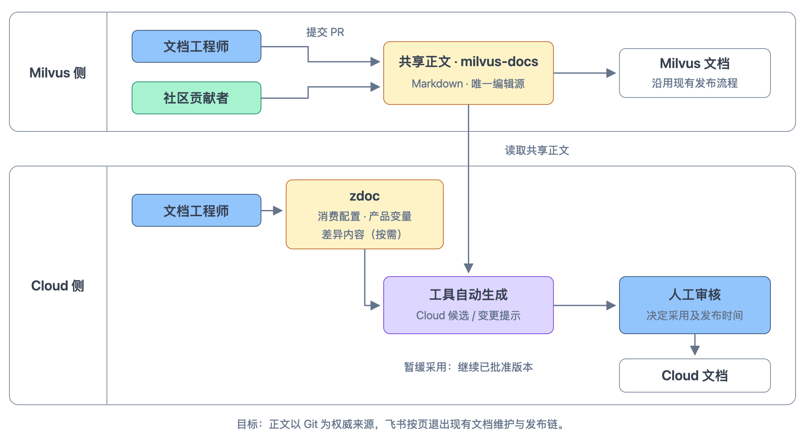
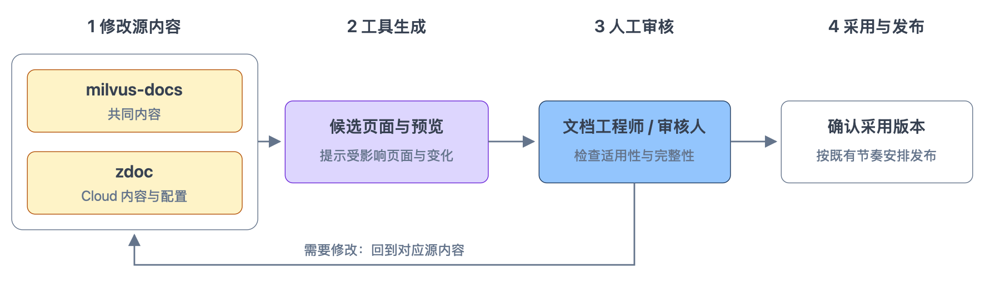

# Milvus × Zilliz Cloud 文档同源：流程与试点方案对齐

**第一次方案对齐会 · 讨论稿**

本文从维护问题出发，说明目标流程、工具链接入和试点安排。当前方案尚未接入生产，两篇样例已做本地生成验证；具体配置和工程要求通过链接按需查看。

## 1. 为什么改，以及希望怎样维护文档

本次讨论 User Guide 等功能文档的共享与试点迁移。SDK Reference、全量迁移及飞书全面退役不属于首期；SDK Reference 原文仍在 web-content 维护。

文中的“多语言代码示例”指 Python、Java 等 SDK/API 示例；“翻译”指文档的自然语言翻译。

### 1.1 内容维护：双向同步依赖人工，缺少同步与冲突处理规则

Milvus 和 Zilliz Cloud 的部分功能文档可以共用。目前，这些内容分别维护在**飞书正文**和 **[milvus-docs](https://github.com/milvus-io/milvus-docs)** 中：前者用于 Cloud 文档发布，后者用于 Milvus 文档发布，两份正文都可以独立修改。

Cloud 侧由文档工程师维护；Milvus 侧由文档工程师和社区贡献者共同维护。

图 1 · 内容维护与同步关系。[查看矢量图](./assets/current-content-flow.svg)

- ① **从飞书发起修改**：文档工程师编辑飞书正文，借助工具导出适用于 Milvus 的内容并提交 PR，经审核合并后更新 milvus-docs。
- ② **直接修改 Milvus 文档**：文档工程师或社区贡献者直接提交 PR，无需先修改飞书。PR 合并后，飞书中的对应正文不会随之更新。
- ③ **将共享修订同步回 Cloud**：文档工程师核对 Milvus 已合并的修改，将适用于 Cloud 的内容手动更新到飞书。图中虚线表示这一步需要另行人工跟进。

问题在于，回同步没有提醒或固定检查，双方修改冲突时也没有约定以哪一侧为准。两端是否一致依赖人工发现、判断和回抄，长期难以维持。已检查流程中未发现跨源分叉检测，是否另有内部工具仍需确认。

例如，社区修订尚未回同步到飞书时，下次导出可能把旧说明带入新的 PR。若审核漏掉这处回退并合并，就会覆盖社区的有效修改。这是现有实现支持的风险，尚未核实发生过此类事故。[核验依据](../research/current-content-flow-audit.md)

### 1.2 目标维护方式：共享正文只改一处，Cloud 差异单独维护

**目标是共享正文只有一份可信来源，以 Git 为准，让飞书按页退出文档生产链。**

共享原文以 Markdown 在 milvus-docs 维护；Cloud 在 zdoc 中维护消费配置、产品变量和必要的差异内容。工具生成 Cloud 候选页面，由文档工程师审核采用并安排发布。

图 2 · 目标内容维护流程，适用于已迁移的共享页面。[查看矢量图](./assets/target-maintenance-overview.svg)

相对于图 1，工作方式有三个变化：

- **共同内容只改一处。** 文档工程师和社区贡献者都向共享原文提交 PR，共享修订不再回抄飞书。
- **工具发现变化并生成候选。** 上游修改后，工具提示受影响页面并提供预览，文档工程师判断是否采用。
- **Cloud 控制产品差异和发布时间。** 两端可以采用不同的源版本，采用记录可追溯；Cloud 暂缓采用时继续使用已批准版本。

Cloud 只单独维护产品能力、配置或适用版本造成的真实差异。历史维护不同步造成的差异应先核对，两端都适用的修订合入共享原文。

图中蓝色节点表示人，黄色节点表示维护的输入；同一位文档工程师可以参与两侧工作。Cloud 独有页面在 zdoc 维护自己的原文，按页迁移安排见第 5 节。

[上次会议](https://zilliverse.feishu.cn/docx/E10LdFMUHo39nixa9eecd3Pjndg)已讨论这一方向，并要求保留内容过滤和版本控制能力。

## 2. 怎样落地：从现有工具链到目标接入方案

为实现上述目标，Cloud 工具链需要增加读取共享原文、应用差异和生成候选的能力。

### 2.1 现有工具链：两份正文分别构建和发布

图 3 的两个“发布输入”就是图 1 中的两份可编辑正文：Milvus 读取 milvus-docs 原始 Markdown；Cloud 从飞书生成 Markdown / MDX。两份正文各自进入一条发布链。

图 3 · 现有发布工具链。实线表示内容消费或处理顺序，点线表示工作流触发。[查看矢量图](./assets/current-publication-chains.svg)

| 阶段 | Milvus | Cloud |
|---|---|---|
| 发布输入 | milvus-docs 的 `site/` 目录存放原始 Markdown。 | 飞书提供正文和媒体，是当前 Cloud 内容生产的输入。 |
| 正文处理 | [md2md](https://github.com/zilliztech/md2md) 展开变量、引用片段并转换 Milvus 格式。 | [zdoc](https://github.com/zilliztech/zdoc) 的 Fetch 工作流抓取飞书正文和媒体，完成渲染、组装与校验。 |
| 中间内容 | [web-content](https://github.com/milvus-io/web-content) 接收转换结果，生成站点需要的正文和导航数据。 | 生成正文、导航和译文保存到 zdoc 的 Git **`dev` 分支**，供后续流程读取。 |
| 站点构建与发布 | [milvus.io](https://github.com/milvus-io/milvus.io) 读取 web-content 内容，构建并部署 Milvus 站点。 | Docusaurus 站点代码位于 zdoc 的 `apps/docs`；仓库说明描述了外部 Jenkins 的 UAT / Prod 发布路径。 |
| 文档站 | [Milvus 文档站](https://milvus.io/docs)。 | [Cloud 文档站](https://docs.zilliz.com)。 |
| 翻译支路 | 新文件处理、每周定时或手动任务触发翻译；译文保存到 web-content。 | Fetch 在源内容成功写入 dev 且启用翻译时发起翻译，译文写回 dev。 |

当前所查 Cloud Guides 链使用 zdoc 的飞书处理工具，未调用 md2md；Git 共享原文需要新增接入。

**核验范围。** 仓库实现已按固定修订核对；外部 Jenkins 的运行配置、触发、审批和环境切换待核验，图中以虚线框标注。尚未验证生产发布或线上运行版本，详细依据见[发布工具链核验附件](../research/current-publication-chains-audit.md)。

### 2.2 目标工具链：共享原文分流，Cloud 按内容来源接入

图 4 展示迁移到 Git 后的目标工具链。首期实现共享页的整篇复用和局部差异；Cloud 独有页标出目标路径，批量迁移留待后续。

图 4 · 目标发布工具链（待实施）。下方标明新增共享接入与既有流程扩展的边界。[查看矢量图](./assets/target-publication-chains.svg)

沿图 4 从原文与配置读到生成、发布：

**milvus-docs → 获取共享内容。** Milvus 继续经 md2md、web-content 和 milvus.io 发布。Cloud 从 milvus-docs 直接读取固定版本的原文，按[注册规则](./architecture.md#3-最少注册规则与自动-registry)获取共享文件并识别命名区域；登记示例见 [modules.yaml](../examples/filtered-search/zdoc/shared/modules.yaml)。

**Cloud 配置与差异片段 → 生成 Cloud 候选页面。** [页面 YAML](../examples/filtered-search/zdoc/filtered-search.page.yaml)说明怎样引用和应用差异，共用的 [Variables.json](../examples/filtered-search/zdoc/Variables.json)提供产品值；需要新增或替换内容时，再提供 Markdown 或代码片段，例如这份 [CLI 片段](../examples/filtered-search/zdoc/fragments/filtered-search/standard-filtering-cli.md)。工具结合这些输入，生成可审核的 [Cloud Markdown / MDX 候选](../examples/filtered-search/generated/filtered-search.mdx)。这部分是新增的 zdoc 接入能力，其中变量和文件引用复用 md2md，需增加独立预处理入口。

**Cloud 独有文档 → 常规内容流程。** 无共享引用的页面在 zdoc 维护完整 Markdown / MDX，从图下方直接接入右侧流程。未迁移页继续使用飞书输入。

**两条 Cloud 路径 → 文档站。** 共享候选经审核采用后，与独有页面汇入既有校验、文档翻译、内容过滤和站点发布流程。这些流程需要扩展 Git 输入及相关保护，保留 UAT / Prod 和发布审核。

三种使用方式对应图中的两条 Cloud 路径：

| 使用方式 | 经过哪些处理 |
|---|---|
| **整篇复用** | 获取原文、绑定变量、生成候选；无需命名块或差异片段 |
| **整篇复用并局部增删替换** | 同一条共享路径，在指定位置应用差异后生成候选 |
| **Cloud 独有文档，无共享引用** | 完整原文直接进入常规内容流程 |

配置写法见[消费配置规范](./consumption-schema.md)。独立组织 Cloud 章节并引用多个共享片段属于后续扩展。

## 3. 作者工作方式：首次接入与日常维护

首次接入要核对内容、建立共享关系；日常维护沿图 5 修改对应源内容、检查预览并审核采用。

图 5 · 日常维护：修改源内容，审核生成结果。[查看矢量图](./assets/writer-files-and-feedback.svg)

| 情境 | 文档工程师做什么 | 工具做什么 |
|---|---|---|
| **第一次接入共享页** | 核对两端正文，合并共同修订并确认产品差异；登记来源、建立页面引用，按需绑定变量和提供差异内容；检查完整页面 | 生成候选、预览与对照，供审核后切换 |
| **接入后的日常维护** | 共同内容改 milvus-docs；Cloud 内容与配置改 zdoc；检查预览，决定采用和发布时间 | 提示受影响页面，重新生成候选，记录采用版本 |

普通正文修订无需重新登记或重写整套配置。确认采用版本后，仍按既有发布审核和节奏上线。具体文件及操作见第 4 节样例。

**生成文件不作为编辑源，手动修改不能进入正式发布。** 发现问题后，沿图中反馈箭头回到源文件修改，预览应提供编辑入口。生产保护要求见[架构设计](./architecture.md#5-生成结果与发布保护)，仍待实施。

## 4. 两篇验证样例：检查复用效果与作者成本

两篇样例都以完整共享原文为基础，分别验证整篇复用和局部差异。点击样例可查看原文、作者维护的文件和生成结果。

| 样例入口 | 用来验证什么 | 本页额外维护的输入 |
|---|---|---|
| [Delete Entities](../examples/delete-entities/walkthrough.md) | 连接值通过变量绑定，整篇正文复用并生成多语言代码 Tabs | 一份消费配置；不需要命名块或差异文件 |
| [Filtered Search](../examples/filtered-search/walkthrough.md) | 产品名和连接值使用变量；在共享代码中补充 Cloud CLI | 一份消费配置、两份 CLI 片段；原文标记两个代码组 |

除表中输入外，两篇都需在共用注册规则中增加文件条目，并使用站点共用的变量和展示规则。

**验证边界：** 共享原文包含共同修订和部分编程语言示例补齐，尚未合入 Milvus。目前仅做本地生成验证，内容与 SDK 适用性、真实站点、发布保护和翻译接入仍需验证。

## 5. 首期与迁移路线：先完成试点，再逐步扩大

**首期包括真实工具链接入和试点页的正式切换。** 两篇样例作为验证候选，切换页面和顺序待内容与工程验证通过后批准。

图 6 · 项目推进路线。首期完成试点，后续分批扩大。[查看矢量图](./assets/rollout-roadmap.svg)

首期交付如下，仓库改动、实施依赖和验收要求见 [phase-1](./phase-1.md)：

| 交付 | 预期结果 |
|---|---|
| **内容与写作约定** | 共同原文、产品变量、必要命名边界及 Cloud 差异经内容审核确认 |
| **页面生成能力** | zdoc 能生成内容完整、可预览的 Cloud 页面；Milvus 继续正常发布 |
| **上游变更与采用流程** | 上游修改后提示影响，Cloud 审核采用；暂缓时保留已批准版本 |
| **正式发布接入** | 接入既有发布、翻译与恢复，完成批准页面的切换，旧飞书任务不能再覆盖它们 |

图 6 中的“试点切换”按页推进：**任一时刻只有一个正式生成来源。**

| 单页状态 | 正式发布从哪里生成 | 文档工程师在哪里修改 |
|---|---|---|
| 准备中 | 飞书仍是该 Cloud 页的正式输入；Git 输入暂时只为该 Cloud 页生成候选预览，Milvus 继续正常发布 | 按现有流程维护，同时整理 Git 输入；切换前核对最新飞书修订 |
| 确认切换 | 完成验证并获批准后，配置、正文和来源记录同批提交到 dev，激活 Git 来源 | 确认后续 Git 编辑入口，以及飞书退出该页生产链 |
| 切换后 | 从批准的 Git 输入生成；旧飞书任务不能写入或删除该页 | 共同内容改 milvus-docs，Cloud 内容与配置改 zdoc；Cloud 独有页原文也在 zdoc |

提交配置或生成预览都不代表已切换。来源切换后再进行站点部署；部署失败按既有机制重试或回滚，编辑来源仍为 Git。其他未迁移页面继续原流程。**首期完成时，批准的试点页应已部署上线，并通过后续更新、翻译与恢复验证。**

首期保留社区 PR、产品/版本过滤、完整多语言代码示例、链接与导航、文档翻译、UAT/Prod 审核和恢复能力。后续再分批迁移共享页、Cloud 独有页及导航、媒体等依赖；范围内依赖清零后，停用相应飞书抓取与调度。按页切换的工程约束见[架构设计](./architecture.md#6-按页迁移与正式激活)。

## 6. 讨论重点

- 这套维护方式是否可行，是否还有遗漏的使用场景？
- 两篇样例是否适合作为试点，作者的维护成本是否可以接受？
- 下一步先验证哪些工程问题，需要哪些同事一起参与？
