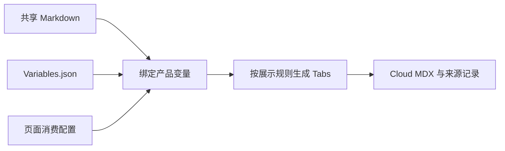

# Delete Entities：整篇共享，用变量处理连接差异

Delete Entities 介绍按条件删除、按主键删除和从分区删除。本例对照固定版本的 [Milvus 原文](https://github.com/milvus-io/milvus-docs/blob/7d87b0bf26d7cbc713f40af6453ea2f925367901/site/en/userGuide/insert-and-delete/delete-entities.md)与 [Cloud 原文](https://github.com/zilliztech/zdoc/blob/05e31600f14326073a2c25c1a1eeda8e8d8fcc81/content/en/guides/tutorials/development/insert-and-delete/delete-entities.md)，展示整篇复用。

**演示从整理后的拟议共享原文开始。** [本地原文](milvus-docs/site/en/userGuide/insert-and-delete/delete-entities.md)已吸收共同代码修订并补齐部分语言，尚未合入上游，仍需内容与 SDK 适用性审核。

整理后，Cloud 复用整篇正文、三个章节和七种语言示例，只通过变量绑定 endpoint、token；站点标题、导航和链接由 Cloud 配置。本文没有需要替换的正文产品名；产品名与 CLI 补充的用法见 [Filtered Search](../filtered-search/walkthrough.md)。以下配置采用[消费配置草案](../../docs/consumption-schema.md)的 schema v1 样例格式，生产接入仍待实现。

## 1. 首次接入：哪些文件需要修改

共享原文准备好后，zdoc 的本页接入工作是**新增一份页面 YAML，在共用注册文件中增加一条记录**。

以下路径用于展示文件关系，生产目录在接入时确定。

| 位置与文件 | 本次操作 |
|---|---|
| Milvus：[delete-entities.md](milvus-docs/site/en/userGuide/insert-and-delete/delete-entities.md) | 将连接值写成两个变量，保留共同正文与代码 |
| zdoc：[shared-pages/delete-entities/page.yaml](zdoc/shared-pages/delete-entities/page.yaml) | 新增本页整篇消费配置 |
| zdoc：[shared/modules.yaml](zdoc/shared/modules.yaml) | 增加本页源文件条目 |
| 两端的 `Variables.json` 及注册规则中的变量导出声明 | 已有变量直接复用；首次引入时补默认值、导出声明与 Cloud 绑定 |
| zdoc：[presentation/cloud-sdk-tabs.yaml](zdoc/presentation/cloud-sdk-tabs.yaml) | 引用站点共用展示规则，由工程维护者统一维护 |

本页无需命名块或 Cloud 内容文件。样例中的共用配置副本用于独立演示，正式接入按站点维护一份。



## 2. 准备共享原文与连接变量

共享原文保留各 SDK 的参数语法，所有语言共用两个连接变量。以 Python 为例：

```python
client = MilvusClient(
    uri="{{var.example_endpoint}}",
    token="{{var.example_token}}"
)
```

两端的共用变量文件分别提供以下示例值或占位符：

| 变量 | [Milvus Variables.json](milvus-docs/site/en/Variables.json) | [Cloud Variables.json](zdoc/Variables.json) |
|---|---|---|
| `example_endpoint` | `http://localhost:19530` | `YOUR_CLUSTER_ENDPOINT` |
| `example_token` | `root:Milvus` | `YOUR_CLUSTER_TOKEN` |

首次引入这两个变量时，还需在 zdoc 的 [shared/modules.yaml](zdoc/shared/modules.yaml) 中声明允许消费：

```yaml
variables:
  source_file: site/en/Variables.json
  exports:
    example_endpoint:
      type: text
    example_token:
      type: text
```

如果默认值、导出声明和 Cloud 绑定已经具备，就直接复用。新增时只补所需键，保留共用文件中的其他变量。

## 3. 登记原文并整篇引用

先在共用 [shared/modules.yaml](zdoc/shared/modules.yaml) 的 `modules` 下增加源文件条目：

```yaml
modules:
  delete-entities:
    file: site/en/userGuide/insert-and-delete/delete-entities.md
    export_page: true
    export_blocks: marked
```

`delete-entities` 是模块 ID，`export_page` 允许整篇引用。`export_blocks: marked` 表示按需扫描已有标记，本页没有命名块也可以正常使用。

再新增 [shared-pages/delete-entities/page.yaml](zdoc/shared-pages/delete-entities/page.yaml)：

```yaml
schema_version: 1
page: cloud.delete-entities
source:
  take: page
  module: delete-entities
variables:
  file: Variables.json
presentation:
  code_groups: presentation/cloud-sdk-tabs.yaml
metadata:
  title: Delete Entities | Cloud
  slug: /delete-entities
  sidebar_label: Delete
links:
  boolean.md: ./filtering-overview
```

`source.module` 对应刚登记的模块，`take: page` 读取整篇，再用 Cloud 变量绑定连接值、用共用规则生成 Tabs。正文没有局部增删替换，因此不写 `transforms`。

**整篇复用指正文共享。** Cloud 仍在 `metadata` 中维护站点标题、导航与路由，在 `links` 中指定站内链接映射。变量文件和 Tabs 规则的路径相对于 zdoc 消费配置根目录解析。

## 4. 检查生成的 Cloud 页面

工具生成的 [Cloud Markdown/MDX](generated/delete-entities.mdx)保留三个正文章节：

```text
Delete Entities by Filtering Conditions
Delete Entities by Primary Keys
Delete Entities from Partitions
```

每个章节各有一组 Tabs，均按以下顺序展示：

```text
Python → Java → Go → Rust → C++ → NodeJS → cURL
```

连接值已绑定为 Cloud 占位符，例如第一组 Python 代码：

```python
client = MilvusClient(
    uri="YOUR_CLUSTER_ENDPOINT",
    token="YOUR_CLUSTER_TOKEN"
)
```

检查时确认正文与章节完整、三组代码均保留七种语言、连接值正确，以及 Cloud 导航和链接可用。工具生成 Tabs 包装，writer 维护实际代码内容。共用规则中的 CLI 为可选项，本页未提供便不显示。

本地 [Milvus 变量展开结果](generated/milvus-delete-entities.md)用于对照，使用 Milvus 示例连接值；正式 Milvus 发布仍走既有工具链。

## 5. 从候选页面到审核发布，再到日常维护

以下是工具链落地后的目标操作，本地样例目前展示到页面生成：

1. **提交修改。** 共享原文与默认变量走 milvus-docs PR；注册规则、Cloud 绑定与页面配置走 zdoc PR。正式采用前，共享原文修订需审核合入。
2. **审核候选。** 工具读取固定版本的原文并生成预览与差异，文档工程师核对完整页面，发现问题回到源文件修改。
3. **采用并发布。** 审核与校验通过后，配置、正文和来源记录同批提交到 dev，激活 Git 来源，再部署站点；部署失败按既有机制重试或回滚，编辑来源仍为 Git。首次迁移在上述提交前仍以飞书为正式输入，提交配置或生成预览不代表切换完成。

日常共同正文和 SDK 修订改 milvus-docs；Cloud 连接值、站点元数据或链接改 zdoc。普通正文修改无需重新注册或重写页面配置。上游更新后，Cloud 审核新候选，暂缓采用时继续使用已批准版本；共用变量修改需检查所有受影响页面。

**生成文件不作为编辑源，手动修改不能进入正式发布。** 发布保护仍待工程接入，具体要求见[首期实施与验收](../../docs/phase-1.md)。

## 6. 内容基线与适用边界

[共享原文修订对照](evidence/shared-source-changes.diff)记录了共同修订、Rust/C++ 补齐及 Go v3 引用。拟议 Go 示例新增了显式 APIKey，尚需验证认证行为及两产品的 SDK 适用性。

生成结果供设计对照，尚不能替代生产页面。原始快照保存在 `evidence/`；本地检查方法、固定源记录和未实现的工程能力见[工程验证附件](../../docs/phase-1.md#7-当前证据本地样例)。
