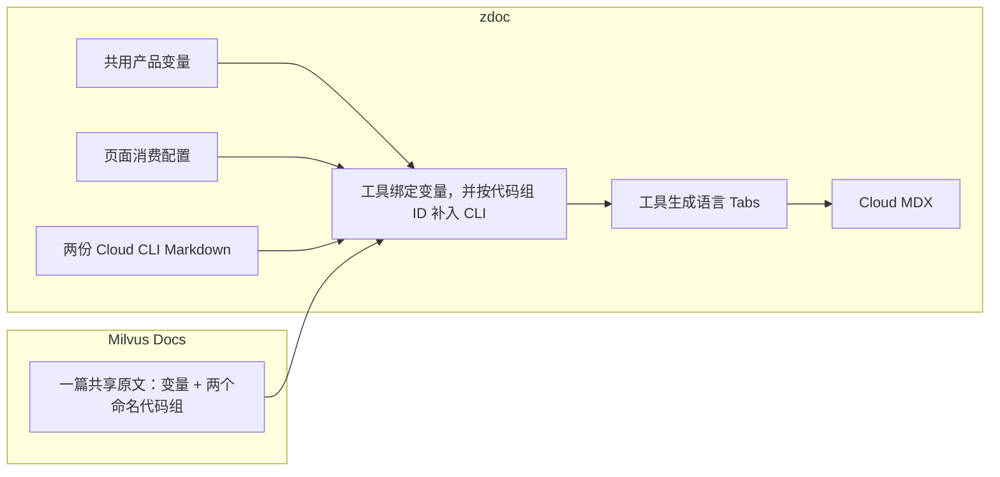

# Filtered Search：从共享原文到 Cloud 页面

Filtered Search 介绍标准过滤与迭代过滤，并用多种 SDK/API 展示搜索方法。本例对照了固定版本的 [Milvus 原文](https://github.com/milvus-io/milvus-docs/blob/7d87b0bf26d7cbc713f40af6453ea2f925367901/site/en/userGuide/search-query-get/filtered-search.md)和 [Cloud 原文](https://github.com/zilliztech/zdoc/blob/05e31600f14326073a2c25c1a1eeda8e8d8fcc81/content/en/guides/tutorials/development/search-and-query/filtered-search.md)。

**演示从已经整理过的共享原文开始。** 本地[拟议共享原文](milvus-docs/site/en/userGuide/search-query-get/filtered-search.md)保留 Milvus 的章节结构，吸收 Cloud 已有的共同代码修订，并补入 Rust/C++ 示例。这些修订尚未合入上游，仍需内容与 SDK 适用性审核；首次接入其他文章时，也要先核对共同内容和真实产品差异。

整理后，本页的共享与差异关系如下：

| 内容 | 本例怎样处理 |
|---|---|
| 过滤原理、章节、示例数据及七种共同语言代码 | 整篇引用共享原文 |
| 产品名称、endpoint、token | 原文使用变量，两产品分别绑定值 |
| Cloud 独有的标准过滤、迭代过滤 CLI | 在 zdoc 各维护一份片段，加入对应代码组 |
| Cloud 站点标题、导航、链接和图片地址 | 在 Cloud 页面配置中维护 |

下面按首次接入的顺序，以“标准过滤”走通一条完整引用关系，再说明迭代过滤如何复用同样做法。配置采用 [schema v1](../../docs/consumption-schema.md)，生产工具链接入仍待实现。

## 1. 首次接入：哪些文件需要修改

以下路径用于展示文件关系，生产目录在接入时确定。

| 位置与文件 | 本次要做的事 | 后续页面能否复用 |
|---|---|---|
| Milvus：[filtered-search.md](milvus-docs/site/en/userGuide/search-query-get/filtered-search.md) | 将产品名与连接值写成变量，给两个代码组加命名标记 | 每篇原文按实际差异处理 |
| zdoc：[filtered-search.page.yaml](zdoc/filtered-search.page.yaml) | 新增本页消费配置，引用整篇并补充两处 CLI | 每个共享页面维护自己的配置 |
| zdoc：`fragments/filtered-search/` 下的两份 CLI Markdown | 新增标准过滤与迭代过滤示例 | 属于本页的 Cloud 内容 |
| zdoc：[shared/modules.yaml](zdoc/shared/modules.yaml) | 在共用注册规则里增加本页源文件条目 | 共用文件，每篇新增条目 |
| 两端的 `Variables.json`，以及注册规则中的变量导出声明 | 已有变量直接复用；新增变量时补默认值、导出声明与 Cloud 绑定 | 跨页面共用 |
| zdoc：[presentation/cloud-sdk-tabs.yaml](zdoc/presentation/cloud-sdk-tabs.yaml) | 直接引用已有展示规则；需要变更时由工程维护者统一调整 | 站点共用 |

本页在 zdoc 新增的专属文件是**一份页面 YAML 和两份 CLI Markdown**；另外在共用注册文件中增加一个条目。三个变量若已具备默认值、导出声明和 Cloud 绑定，就无需再添加。样例目录为独立演示保留了共用配置副本，正式接入按站点维护一份。



## 2. 准备共享原文与产品变量

在 Milvus 原文中，将产品名写成变量：

```markdown
In {{var.product_name}}, filtered searches are categorized into two types —
**standard filtering** and **iterative filtering** — depending on the stage
at which the filtering is applied.
```

连接值也使用变量。以 Python 为例：

```python
client = MilvusClient(
    uri="{{var.example_endpoint}}",
    token="{{var.example_token}}"
)
```

Java、Go、Rust、C++、NodeJS 和 cURL 使用同一组 endpoint/token，保留各自的参数语法。只对明确标为变量的位置绑定产品值；`MilvusClient`、`pymilvus` 等 SDK 名称保持原样。

两端共用变量文件提供这些值：

| 变量 | [Milvus Variables.json](milvus-docs/site/en/Variables.json) | [Cloud Variables.json](zdoc/Variables.json) |
|---|---|---|
| `product_name` | `Milvus` | `Zilliz Cloud` |
| `example_endpoint` | `http://localhost:19530` | `YOUR_CLUSTER_ENDPOINT` |
| `example_token` | `root:Milvus` | `YOUR_CLUSTER_TOKEN` |

如果这三个变量是首次引入，还要在 zdoc 的 [shared/modules.yaml](zdoc/shared/modules.yaml) 中加入导出声明，允许消费方使用它们：

```yaml
variables:
  source_file: site/en/Variables.json
  exports:
    product_name:
      type: text
    example_endpoint:
      type: text
    example_token:
      type: text
```

新增变量时，将所需键合并进现有文件，保留其他页面使用的变量。这些连接值是文档中的示例或占位符。

## 3. 用标准过滤走通一条引用关系

### 3.1 在 Milvus 原文中标记标准过滤代码组

打开共享原文的 `Search with standard filtering` 章节，在现有 `<div class="multipleCode">` 前添加开始标记，在该组最后一个代码围栏后添加结束标记。示意如下，中间的说明代表原有完整内容：

```text
<!-- doc:block:start id="standard-filtering-code" -->
[原有 multipleCode 导航，以及七种语言的完整代码围栏]
<!-- doc:block:end id="standard-filtering-code" -->
```

`standard-filtering-code` 是 writer 为这组代码定义的稳定 ID。Cloud 将用它定位 CLI 要加入的位置；章节标题和周围说明继续随整篇原文引用。移动整组或修改标题时保留这个 ID，引用关系即可继续使用。

### 3.2 在 zdoc 登记这篇源文件

在共用 [shared/modules.yaml](zdoc/shared/modules.yaml) 的 `modules` 下增加一个条目：

```yaml
modules:
  filtered-search:
    file: site/en/userGuide/search-query-get/filtered-search.md
    export_page: true
    export_blocks: marked
```

`filtered-search` 是这篇共享文件的模块 ID；它与原文里的 `standard-filtering-code` 块 ID 各有用途。`export_page` 允许整篇引用，`export_blocks: marked` 让工具扫描原文标记，自动登记可供定位的块，writer 只维护这条文件注册规则。

### 3.3 在 zdoc 写标准过滤 CLI 片段

新增 [fragments/filtered-search/standard-filtering-cli.md](zdoc/fragments/filtered-search/standard-filtering-cli.md)。这是一个包含 `shell` 代码围栏的 Markdown 文件。下面保留完整命令，仅压缩请求体排版：

````markdown
```shell
# Zilliz CLI
# Prerequisite: run zilliz login and select your cluster with zilliz context set.
zilliz vector search \
  --collection my_collection \
  --body '{
    "data": [[0.3580376395471989, -0.6023495712049978, 0.18414012509913835, -0.26286205330961354, 0.9029438446296592]],
    "annsField": "vector",
    "filter": "color like \"red%\" and likes > 50",
    "limit": 5,
    "outputFields": ["color", "likes"]
  }' \
  --output json
```
````

CLI 通过登录和集群 context 确定连接；endpoint/token 变量用于前面的共同 SDK/API 示例。writer 维护 CLI 的命令和前置条件，工具负责生成 Tab 包装。

### 3.4 在页面 YAML 中把原文、代码组和片段连起来

新增 [filtered-search.page.yaml](zdoc/filtered-search.page.yaml)。以下节选展示整篇引用和标准过滤这一条补充关系：

```yaml
schema_version: 1
page: cloud.filtered-search
source:
  take: page
  module: filtered-search
variables:
  file: Variables.json
presentation:
  code_groups: presentation/cloud-sdk-tabs.yaml
transforms:
  - operation: add
    target:
      module: filtered-search
      block: standard-filtering-code
      language: shell
    content:
      file: fragments/filtered-search/standard-filtering-cli.md
```

沿配置读下来：先用 `source.module` 找到刚登记的整篇原文，绑定 Cloud 变量，再找到 `standard-filtering-code`，把 CLI 文件作为 `shell` 语言项加入该组。共用展示规则将 `shell` 显示为 `Zilliz CLI`。

文件路径相对于 zdoc 消费配置根目录解析。实际页面 YAML 还维护 `metadata` 中的站点标题、导航和路由，以及 `links`、`assets` 中的链接与图片地址映射；首次接入时需核对这些页面信息。完整字段说明见[消费配置规范](../../docs/consumption-schema.md)。

### 3.5 为迭代过滤增加第二条关系

迭代过滤沿用同样做法，只增加第二处标记、一份片段和一条 `add`，整篇来源和共用配置保持一致：

| 引用位置 | 原文中的块 ID | zdoc 内容文件 |
|---|---|---|
| 标准过滤代码组 | `standard-filtering-code` | [standard-filtering-cli.md](zdoc/fragments/filtered-search/standard-filtering-cli.md) |
| 迭代过滤代码组 | `iterative-filtering-code` | [iterative-filtering-cli.md](zdoc/fragments/filtered-search/iterative-filtering-cli.md) |

迭代过滤 CLI 的请求体包含 `searchParams.hints: iterative_filter`。完整页面 YAML 已包含两条 `add`，两份片段分别进入对应代码组。

## 4. 检查生成的 Cloud 页面

以上输入准备好后，工具生成 [Cloud Markdown/MDX](generated/filtered-search.mdx)。正文中的产品名已经变成：

> In Zilliz Cloud, filtered searches are categorized into two types — **standard filtering** and **iterative filtering** — depending on the stage at which the filtering is applied.

标准过滤 Python Tab 的连接部分已经变成：

```python
client = MilvusClient(
    uri="YOUR_CLUSTER_ENDPOINT",
    token="YOUR_CLUSTER_TOKEN"
)
```

标准过滤与迭代过滤各生成一组 Tabs，顺序均为：

```text
Python → Java → Go → Rust → C++ → NodeJS → cURL → Zilliz CLI
```

前七个 Tab 使用共享代码；最后一个 Tab 使用各自的 CLI Markdown，保留登录前提和请求内容。工具生成 `Tabs`、`TabItem` 组件包装，writer 无需手写组件。

| 页面部分 | 生成结果及检查重点 |
|---|---|
| 正文标题、过滤原理和章节 | 继承共享原文，确认整篇内容完整 |
| 产品名和连接值 | 绑定 Cloud 值，确认 SDK 名称与参数语法仍正确 |
| 两组多语言代码 | 每组七种共同语言加一份 CLI，确认 CLI 位于对应章节 |
| 站点元数据、链接和图片 | 使用页面配置，确认导航、跳转和图片符合 Cloud 页面 |

本地样例另外提供 [Milvus 变量展开结果](generated/milvus-filtered-search.md)用于对照，其中保留 Milvus 产品值和七种共同语言。正式 Milvus 发布仍走既有工具链。registry 和输入摘要由工具生成，工程记录的含义见[工程验证附件](../../docs/phase-1.md#本地样例检查)。

## 5. 从候选页面到审核发布，再到日常维护

以下是工具链落地后的目标操作，本地样例目前展示到页面生成：

1. **提交源内容和配置修改。** Milvus 原文及默认变量走 milvus-docs PR；注册规则、Cloud 绑定、页面 YAML 和 CLI 片段走 zdoc PR。正式采用前，共享原文修订需审核合入。
2. **检查工具生成的候选。** 工具读取固定版本的共享源，结合 Cloud 输入生成预览与差异。文档工程师按第 4 节核对完整页面；发现问题回到对应源文件修改。
3. **审核采用并安排发布。** 审核与校验通过后，配置、正文和来源记录同批提交到 dev，激活 Git 来源，再按现有流程部署站点。部署失败时按既有机制重试或回滚，编辑来源仍为 Git。首次迁移在上述提交前仍以飞书为正式输入，生成预览或提交配置本身不代表切换完成。

接入后，普通正文修订无需重复登记文件。日常修改按内容归属进行：

| 想修改什么 | 修改哪里 |
|---|---|
| 共同过滤说明、数据、SDK 调用 | Milvus 原文，提交 PR |
| 产品展示名或示例连接值 | 对应产品的共用变量文件，审核受影响页面 |
| Cloud CLI 参数、前提或输出格式 | 对应 CLI Markdown 文件 |
| CLI 所在代码组、页面链接或站点元数据 | 页面 YAML |
| 站点语言标签或 Tab 顺序 | 工程维护者调整共用展示规则 |

例如，上游 PR 改变了标准过滤条件，目标工具链应提示本页受影响，文档工程师需核对 CLI 的条件是否也要更新，再审核新候选；暂缓采用时继续使用已批准版本。块 ID 改名或删除导致引用失效时，应修正原文标记或消费配置后再升级。

**生成文件不作为编辑源，手动修改不能进入正式发布。** 这一发布保护仍待工程接入，具体要求见[首期实施与验收](../../docs/phase-1.md)。

## 6. 内容基线与适用边界

本例的[共享原文修订对照](evidence/shared-source-changes.diff)记录了共同代码整理和语言补齐。SDK 版本与两产品适用性仍需审核。

两产品的原有图片地址分别保留，图片内容是否一致尚待核对。JSON 输出中的全角逗号和尾逗号已修正，数据值未变；原文 top-K 3 与请求 limit 5、结果距离及各语言输出注释仍需内容和运行核验。

生成结果供设计对照，尚不能替代生产页面。本地脚本检查、固定源记录、增删替换覆盖范围和代码区域替换的待实现要求集中在[工程验证附件](../../docs/phase-1.md#本地样例检查)。
